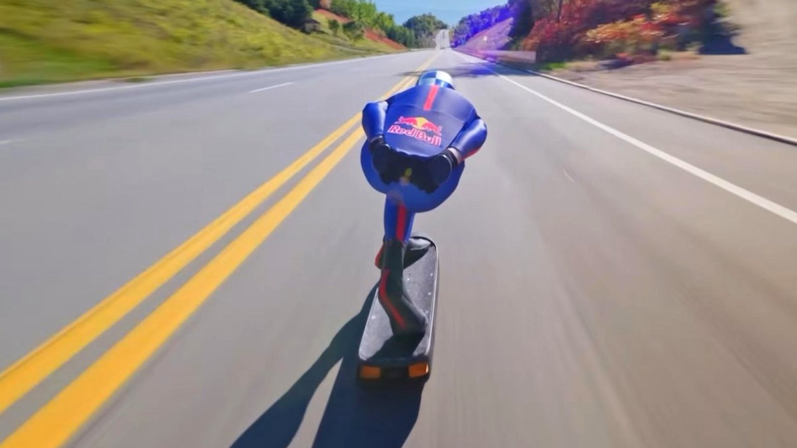

# شاب إسباني يسجل رقمًا عالميًا في سرعة لوح التزلج

لو وقفت على لوح خشب صغير مثبت على أربع عجلات، كم تتوقع أن تبلغ سرعتك القصوى قبل أن تشعر بالرعب وتفقد السيطرة؟

الشاب الإسباني دييغو بونسيليه، البالغ من العمر 27 عامًا، قرر خوض هذه التجربة إلى أقصى حد ممكن على منحدر جبلي في كندا. وبدل أن يكتفي بالتزلج التقليدي، حوّل لوحه إلى وسيلة انطلاق فائقة السرعة، فقط ليكسر رقمًا قياسيًا في موسوعة غينيس للأرقام القياسية.

## رهان الانحدار في شارلوفوا
التحدي لم يكن في مسار عادي، بل اختار دييغو جزءًا مغلقًا من طريق دي إيبولمان في منطقة شارلوفوا بمقاطعة كيبيك الكندية. والمثير للاهتمام أن هذا المسار بالذات هو نفس المكان الذي سُجل فيه الرقم القياسي السابق.

عندما قرأت تفاصيل المحاولة، استوقفني التهور المحسوب لهذا الشاب؛ فالتزلج على منحدر بتلك الزاوية وأنت واقف تمامًا يتطلب توازنًا لا يحتمل أي هفوة. هل يمكنك تخيل هبوب نسمة هواء مفاجئة وأنت بهذه الوضعية؟ بصراحة، السقوط في هذه الحالة قد يكون كارثيًا بكل المقاييس.

## طمع مشروع في سرعة أعلى
في أول تجربة اختبارية له على هذا الطريق، نجح دييغو في الوصول إلى سرعة بلغت 91.27 ميلاً في الساعة. هذا الرقم وحده، يا جماعة، كان كافيًا تمامًا ليمنحه اللقب العالمي ويكسر الرقم المسجل سابقًا.

لكنه لم يكتفِ بذلك أبدًا. تخيّلوا أنه انتظر خمسة أيام كاملة حتى تتحسن الظروف الجوية، من أجل تحقيق طموح كان يخفيه في داخله. هذا الإصرار لتسجيل الأرقام يذكرني بما قرأته سابقًا عن هوس الأرقام القياسية والتحديات غير المألوفة:

**اقرأ أيضًا:** [رجل يلتقط 20 طائرة ورقية في فمه خلال دقيقة ويسجل رقمًا قياسيًا](https://atar12345a.blogspot.com/2026/10/20.html)

## كسر الحاجز الصعب
في يوم 22 سبتمبر، عاد دييغو إلى المنحدر وحقق المفاجأة الكبرى. تمكن الشاب من تسجيل سرعة هائلة بلغت 94.34 ميلاً في الساعة وهو يقف بثبات على لوحه الصغير.

وحسب ما نُشر، اعترف دييغو بأنه كان يخشى الاعتراف لنفسه بأن هدفه الحقيقي هو بلوغ 93 ميلاً في الساعة، خشية ألا يتمكن من فعلها. وأكد أنه لم يشعر بالرضا التام عند سرعة 91.27 ميلاً في الساعة، ولم تكتمل سعادته إلا عندما تجاوز 93 وصولاً إلى 94.34 ميلاً في الساعة محققًا إنجازه الكبير.

رأيي الشخصي أن ما فعله دييغو يعكس رغبة بشرية مذهلة في تحدي الخوف، لكنها تظل مجازفة مخيفة قد تضيع فيها الحياة من أجل ثوانٍ معدودة. شو رايكم، هل ترون في هذا إنجازًا شجاعًا يستحق التقدير، أم مخاطرة متهورة لا داعي لها؟
