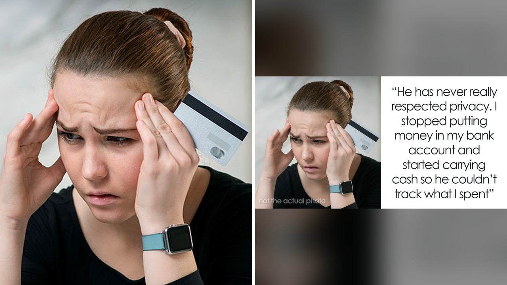

# عندما يتحول خوف الآباء المالي إلى قيد يمنع الأبناء من الاستقلال

عندما يبدأ الإنسان بكسب رزقه بنفسه، تشعر نفسه بلذة الاستقلال. لكن ماذا يحدث لو اكتشفت أن كل مبلغ تصرفه، مهما كان صغيراً، يخضع لرقابة أبوية دقيقة؟

هذا ما عاشته فتاة تبلغ من العمر تسعة عشر عاماً، بعدما لاحظت أن والدها يراقب كل حركة وسحب في حسابها البنكي المشترك، رغم أنها هي من تكسب هذا المال بجهدها الخاص.

## عندما يتحول الخوف القديم إلى سيطرة

قرأت القصة واستوقفتني مشاعر الطرفين. فالأب عانى طوال حياته تقريباً من مشاكل مالية، ويشير الخبراء إلى أن عدم الاستقرار المالي في مرحلة مبكرة يترك أثاراً طويلة الأمد على الدماغ، وينقل الشخص إلى حالة من التيقظ الفائق وحب التحكم لحماية نفسه.

الصراحة، يصبح التبضع البسيط في عين الأب المصاب بتلك الصدمات المالية القديمة بمثابة تهديد لوجوده، وليس مجرد مصاريف عادية. وهنا ينشأ ما يُعرف بالتداخل المالي، حيث تتشابك مخاوف الأب ورغبته في الأمان مع السلوك المالي لابنته، وهو ما يجسد أسلوب الوالدية الإفراطية في الحماية التي قد تستمر حتى المرحلة الجامعية.

## خطوة ناضجة ورد فعل غير متوقع

عندما شعرت الفتاة بسلب حريتها، قررت اتخاذ خطوة عملية واستخراج حساب بنكي ثاني منفصل كلياً. لكن رد فعل والدها كان غير متوقع؛ إذ استشاط غضباً وحاول تقطيع بطاقتها البنكية الجديدة لمنعها من الحرية المالية.

تخيلوا كيف يمكن لخطوة طبيعية في بداية الرشد أن تصنع مواجهة عائلية حادة؟ تؤكد نظرية تقرير المصير أن النمو النفسي السليم للشاب بين ثمانية عشر وخمسة وعشرين عاماً يعتمد على الاستقلالية والشعور بالكفاءة.

وهذا النزاع حول التحكم المالي يذكرنا بكيفية تأثير المسائل المالية على تماسك العلاقات وتوترها حين تغيب الحدود السليمة.

**اقرأ أيضًا:** [ألغت رحلته وطلبت منه الدفع: كيف يهدد المال العلاقات؟](https://atar12345a.blogspot.com/2026/10/blog-post_13.html)

## بين الدعم الأبوي والحدود الضرورية

المثير في التقرير أن ستين بالمئة من الشباب في مرحلة بداية الرشد يتقبلون مساعدة مالية من أهاليهم. الدعم الأبوي أمر محمود، لكن المشكلة تظهر عندما يخلط الأب بين مفهوم الرعاية ومفهوم التحكم المطلق.

ويرى علماء النفس أن منع الأبناء من تجربة الخطأ والصواب في إدارة أموالهم يضعف قدرتهم على بناء كفاءة مالية مستقبلاً. وعندما يتكرر اختراق الحدود الشخصية، يوصي الخبراء بضرورة استبدال أساليب الدفاع بوضع حدود صريحة وواضحة. شو رايكم، هل ترون فتح حساب مستقل حلاً كافياً في مثل هذه الحالات؟

## رأيي الشخصي

رأيي الشخصي أن قلق الآباء النابع من أزماتهم السابقة أمر متفهم إنسانياً، لكن تحويل ذلك القلق إلى حصار مالي للأبناء يضر بنموهم النفسي ويمنعهم من التعلم.

إذا واجهت موقفاً مشابهاً، هل تختار الإصرار على استقلالك المالي بفتح حساب خاص، أم تتنازل عن حدودك لتجنب الخلافات العائلية؟
