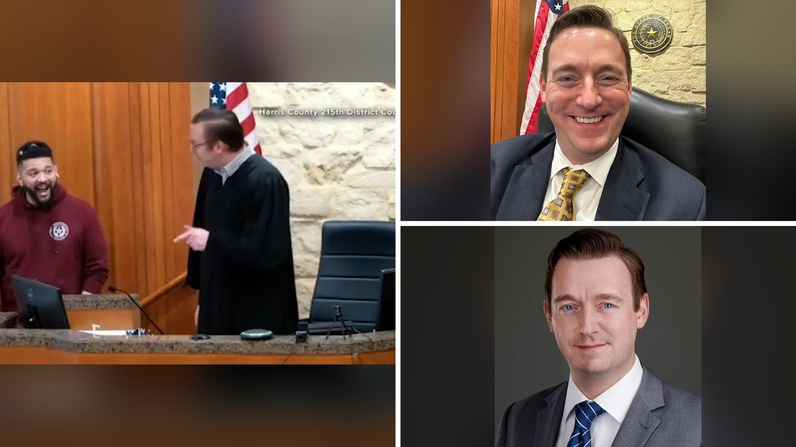

# قاضٍ أمريكي شهير يواجه عواقب سلوكه بعد مقطع فيديو انتشر له

تخيّل أنك موظف، تذهب لتقديم المساعدة في عملك، وفجأة تجد نفسك في مواجهة غضب لا مبرر له من مسؤول كبير. هذا بالضبط ما حدث مع فني دعم فني في إحدى المحاكم الأمريكية، والذي تحول موقفه إلى مادة انتشرت كالنار في الهشيم، لتكشف عن قصة أكبر بكثير.

الخبر اللي قرأته اليوم استوقفني الصراحة، وهو عن قاضٍ في ولاية تكساس اسمه ناثان ميليرون، اللي واجه أخيرًا إجراءات تأديبية بسبب سلوكه هذا. المقطع اللي انتشر له وهو يصرخ في وجه موظف الدعم الفني لم يكن حادثة معزولة، بل كان قمة جبل الجليد، وكشف عن نمط سلوكي أثار الكثير من الشكاوى.

## بداية المشكلة: "اخرج من قاعتي!"

القصة بدأت في 20 مارس 2026، لما استُدعي فني تقنية معلومات إلى قاعة القاضي ميليرون لإصلاح مشكلة في الصوت. الفني أصلح المشكلة بسرعة، وبشكل عفوي، قال مازحًا إنها كانت "إنذارًا كاذبًا". القاضي ما أعجبه الكلام، ولما الفني حاول يلطف الجو وقال "خطأ سلبي كاذب؟"، القاضي انفجر غضبًا. "لا تمزح. أنا جاد في هذا الأمر، كان يحدث بالفعل"، هكذا قال له، ثم أشار له بالابتعاد وأمره بالخروج من القاعة. "نحن بخير، شكرًا لك. اخرج من قاعتي!"، قالها بحدة. بعد خروج الفني، التفت القاضي لشخص خارج الكاميرا وتذمر قائلًا: "لماذا لا تخضع للإشراف؟ يا إلهي. لقد سئمت من هذا الهراء اليوم".

ما فاجأني أنا هو أن القاضي ادّعى لاحقًا إن الفني وصفه بـ "الأحمق" في المحكمة، لكن لجنة تكساس الحكومية للسلوك القضائي أكدت إن الفيديو المنتشر ما بيدعم كلامه هذا أبدًا. وش رايكم في هذا الموقف؟ هل تتخيلون إن الموقف كان يستاهل كل هذا الغضب؟

## كواليس التحقيق: رسائل تهديد ومواجهات

لجنة التحقيق ما اكتفت بمقطع الفيديو المنتشر. الحقيقة إنها كشفت عن سلسلة من الحوادث الأخرى اللي تورط فيها القاضي ميليرون. تخيلوا يا جماعة، كان يرسل رسائل "عدائية" لموظفي المحكمة بين فبراير وأغسطس 2025. كانت المشكلة في نقص الموظفين والتأخيرات اللي كانت بتأثر على قاعته القضائية. في إحدى رسائله الإلكترونية، كتب: "أحضروا لي كاتبًا!"، وأضاف لمديرة المحاكم المدنية: "أنا قاضي المقاطعة، وأنتِ مجرد مرؤوسة تمامًا". بل وورد إنه كتب: "أنا أذكى منك بكثير"، وطالب بتعيين كاتب لقاعته فورًا. وفي رسالة أخرى، كتب بلهجة تهديدية: "هذا لم يعد طلبًا. أحضروا لي كاتبًا يستجيب لي ويقوم بعمله!". وحتى إن اللجنة أشارت لرسالة نصية كتب فيها القاضي للمديرة: "يمكنك تقبيل مؤخرتي".

الموضوع ما توقفش هنا. محامٍ اسمه جيمس ستافورد، ما كان عنده أي قضايا أمام القاضي ميليرون، أرسل له بريدًا إلكترونيًا ينتقد فيه معاملته لفني الدعم الفني ويحثه على الاعتذار. القاضي، بدل ما يستوعب، أمر المحامي بالحضور للمحكمة لمناقشة ما وصفه بـ "تواصل غير لائق" مع قاضٍ. ستافورد ما حضر، لكن عدة محامين آخرين حضروا تضامنًا معه، وهذا زاد من تسليط الضوء على هالسالفة كلها. هذا ذكّرني بما حكيته لكم سابقًا عن النقاشات حول تقدير الموظفين والمشكلات التي تنشأ عندما لا يشعر الموظفون بالاحترام الكافي في بيئة العمل.

**اقرأ أيضًا:** [قصة جيل مع أربعة عقود من العمل وهدية أثارت الجدل](https://atar12345a.blogspot.com/2026/10/blog-post_277.html)

## تحذير علني وعواقب مؤجلة

في حادثة أخرى، خلال جلسة استماع في 3 مارس 2026، رفض القاضي ميليرون طلبًا، وبعد انتهاء الجلسة، قدم محامو الطرف الآخر أمرًا مقترحًا يتضمن عقوبات. المحامية ستايسي أوغستين سألت إذا كان بإمكانها الرد على الأمر المقترح، لكن القاضي رفض بشدة: "لا، لا يمكنك. هذه الجلسة انتهت". ولما أشارت المحامية إلى أن الأمر يتضمن عقوبات، قاطعها القاضي وطلب من الشرطي إخراجها من القاعة. ثم سأل زميلها المحامي إذا كان بإمكانه التحدث. فكان رد القاضي: "لا، لا يمكنك. يا إلهي، هؤلاء الناس اليوم". ثم أشار إلى المحامي وحذره: "ابتعد، أنت على وشك أن تُكبّل".

اللجنة وجدت إن القاضي ميليرون فشل في منح المحامين وعملائهم فرصة للتعبير عن رأيهم بخصوص الأمر المقترح، وهذا طبعًا مخالف للقواعد القضائية. القاضي قال للجنة إنه يعتقد إنه "تصرف باحترافية" وإن أي قاضٍ آخر سيتصرف بنفس الطريقة إذا رفض المحامي مغادرة المنصة بعد انتهاء الجلسة. لكن اللجنة أصدرت تحذيرًا عامًا له في 5 نوفمبر 2026، وخلصت إلى أن سلوكه لم يلبِ المتطلبات التي تلزم القضاة بأن يكونوا "صبورين وكرماء ومهذبين" تجاه جميع الأطراف. كما وجدت أن أفعاله "تلقي بظلالها على القضاء أو على إدارة العدالة". القاضي اعترف إنه "كان بإمكانه التصرف بشكل أفضل" في حادثة فني الدعم الفني، لكنه لم يتوقع أن يوصف بـ "الأحمق" في المحكمة. هو الآن يحترم التحذير ويتطلع لخدمة سكان مقاطعة هاريس، لكن هذا الإجراء التأديبي ما بيعزله من منصبه، وبيقدر يستأنف القرار. فترة ولايته بتنتهي في ديسمبر 2028. 

## رأيي الشخصي في هذه القصة

رأيي الشخصي إن هذه القصة تضعنا أمام مفارقة حقيقية. القاضي، وهو رمز للعدالة والاحترام، يتصرف بطريقة لا تليق بمكانته، ثم يبرر أفعاله بطرق مختلفة. أعتقد أن اعترافه بأنه "كان بإمكانه التصرف بشكل أفضل" في حادثة فني الدعم الفني، رغم أنه جاء متأخرًا، هو نقطة إيجابية، لكن تبريراته الأخرى لسلوكه في مواقف أخرى، مثل تهديد المحامي بالتقييد، تثير القلق. التبرير بأن "أي قاضٍ آخر سيتصرف هكذا" لا يعفيه من مسؤولية التصرف بكياسة واحترام، خاصة وأن دوره يقتضي الحفاظ على هيبة القضاء وثقة الناس فيه. كنت أتمنى لو كان اعتذاره أكثر صراحة وشمولية، بدلاً من التمسك بالاحترافية في بعض الحالات فقط، فالمعاملة المهذبة يجب أن تكون شاملة لكل من يتعامل معهم في المحكمة. هذه الحادثة تذكرنا بأن السلطة، مهما كانت رفيعة، يجب أن تقترن بالمسؤولية والأخلاق.

برأيكم، هل التحذير العلني كافٍ لتصرفات بهذا القدر من الحدة، أم أن الأمر يتطلب إجراءات أشد؟

**من أين جاء الخبر؟** من boredpanda.com. الخبر كما نُشر تقرؤه [هنا](https://2.boredpanda.com/texas-judge-disciplined-berating-it-worker/)، وصياغة هذا المقال وما فيه من آراء من عندي.
