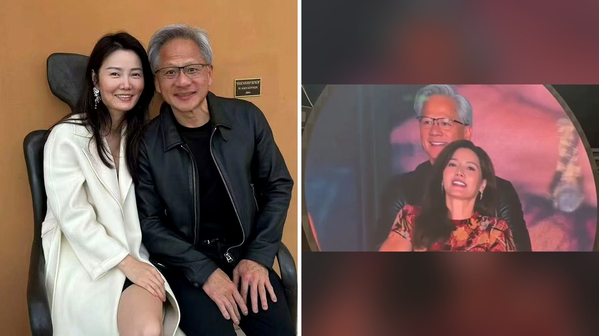

# فضيحة رئيس نفييديا والتجسس تحول أزمة التكنولوجيا إلى تريند

رجل يقود ثورة الذكاء الاصطناعي بشركة تقترب قيمتها من أربعة تريليونات وثلاثمائة مليار دولار، يجد نفسه فجأة حديث شبكات التواصل الاجتماعي. السبب ليس إطلاق رقاقة جديدة، بل بيان اعتذار علني وجهه لزوجته بعد عقود من الزواج.

ما فاجأني بصراحة هو السرعة التي تحول بها الأمر إلى سيل من التعليقات المضحكة والميمز. جينسن هوانغ، الرئيس التنفيذي لشركة نفييديا البالغ من العمر ثلاثة وستين عاماً، اعترف بالخيانة الزوجية، لتبدأ معها قصة تشابكت فيها الخيانة الفردية مع تحقيقات الأمن القومي.

## اعتذار علني وتحقيقات أمنية

في الثامن من نوفمبر، أصدر هوانغ بياناً رسمياً قدم فيه اعتذاراً صريحاً لزوجته لوري ولأطفاله. أكد في البيان أنه يتحمل المسؤولية كاملة عن الضرر الذي تسبب فيه، مشيراً إلى أنه لا يملك أي أعذار لما فعله تجاه عائلته التي دعمته طوال حياته.

لكن هالسالفة لم تتوقف عند حدود الاعتذار العائلي. العلاقة كانت مع سيدة أعمال تُدعى أليس هوانغ، وهي مسؤولة سابقة في شركة مقراتها في سنغافورة اشترت رقائق من نفييديا بقيمة تجاوزت 4.8 مليار دولار خلال عامين. التقارير أشارت إلى أن مسؤولي الاستخبارات الأمريكية يعتقدون أن أليس عنصر تجسس لبلادها لتجميع معلومات داخل الولايات المتحدة.

في المقابل، رفضت وزارة الخارجية في بكين هذه الاتهامات، ووصفتها بأنها لا أساس لها ومجرد تكهنات تهدف إلى التشويه. أليس حالياً غير معروف مكانها، فهل تعتقدون أن العلاقات التجارية يمكن أن تتشابك مع التجسس دون علم أصحابها؟

## بين البيت الأبيض والمحاكم

دخلت القصة أروقة السياسة بقوة في التاسع من نوفمبر. أعلن الرئيس الأمريكي دونالد ترامب أن مكتب التحقيقات الفيدرالي يجري تحريات رسمية تخص الأمن القومي بخصوص علاقة هوانغ بأليس. ترامب أوضح أنه سأل هوانغ عما إذا كان يعلم أنها جاسوسة، فنفى الأخير ذلك، وأكد ترامب أنه يصدقه ويستمر في لدعمه.

ترامب الذي يعتبر هوانغ مستشاراً بارزاً في التكنولوجيا ورافقه في رحلات سابقة، أشار إلى إمكانية اصطحابه في زيارته المرتقبة إلى الصين. هذا الموقف أثار ردود فعل غاضبة بين مستخدمي منصات التواصل الاجتماعي، حيث اعتبر البعض أن التعامل مع أشخاص مرتبطة بجهات خارجية يمثل مخاطرة كبيرة.

تخيلوا حجم الضغط، فهوانغ الذي شوهد سابقاً مع أليس في فعاليات تقنية بتايبيه وتايوان عامي 2024 و2025، يواجه الآن دعوى قضائية رفعها مساهمون في الشركة. الدعوى تتهمه وتتهم الشركة بتضليل المستثمرين وعدم الإفصاح عن المخاطر التي تهدد سمعة الشركة وأعمالها، بعد أن كانت الشركة قد وصفت اللقاءات سابقاً بأنها جزء طبيعي من عمل المدير التنفيذي.

## ثروة في مهب الريح وعائلة في نفييديا

يا جماعة، القصة لها بعد إنساني ومالي معقد جداً. هوانغ التقى بزوجته لوري أثناء دراستهما للهندسة الكهربائية في جامعة ولاية أوريغون في أوائل الثمانينيات وتزوجا بعد خمس سنوات. لديهما ابنان، ماديسون التي تعمل مديرة أولى لتسويق المنتجات والتقنيات لمنصات الذكاء الاصطناعي، وسبنسر الذي يعمل في إدارة المنتجات لبرامج الروبوتات داخل نفييديا، بينما شغلت لوري نفسها منصباً تنفيذياً بالشركة بعد عملها السابق في شركة أخرى.

تطبق ولاية كاليفورنيا التي يعيش فيها الزوجان قانون الملكية المشتركة، ما يعني أن أي طلاق قد يؤدي إلى تقسيم الثروة والممتلكات التي كسباها خلال الزواج بالنصف.

هذا الوضع يذكرني بما ناقشناه سابقاً حول كيفية تداخل العلاقات الشخصية مع القرارات المالية والتأثير المباشر للثقة في الشراكات.

**اقرأ أيضًا:** [ألغت رحلته وطلبت منه الدفع: كيف يهدد المال العلاقات؟](https://atar12345a.blogspot.com/2026/10/blog-post_13.html)

ويرى المحلل المالي دان آيفز أن استبعاد هوانغ من منصبه قد يفقد الشركة ما بين 25% إلى 30% من قيمتها السوقية، ويغير اتجاه منافسة الذكاء الاصطناعي عالمياً. فهل تراها مجرد أزمة شخصية ستمر أم بداية انهيار لهيكل الشركة؟

رأيي الشخصي أن خلط العلاقات الشخصية بالتوازنات الجيوسياسية والتجارية خطأ جسيم لا يمكن لمدير شركة بهجم نفييديا ارتكابه. المهم، شو رأيك في الموقف: هل ترى أن خطأ هوانغ الشخصي يجب أن ينهي مسيرته في إدارة إمبراطورية الذكاء الاصطناعي، أم أن الفصل بين الحياة الخاصة والنجاح المهني هو الحل الأنسب؟
