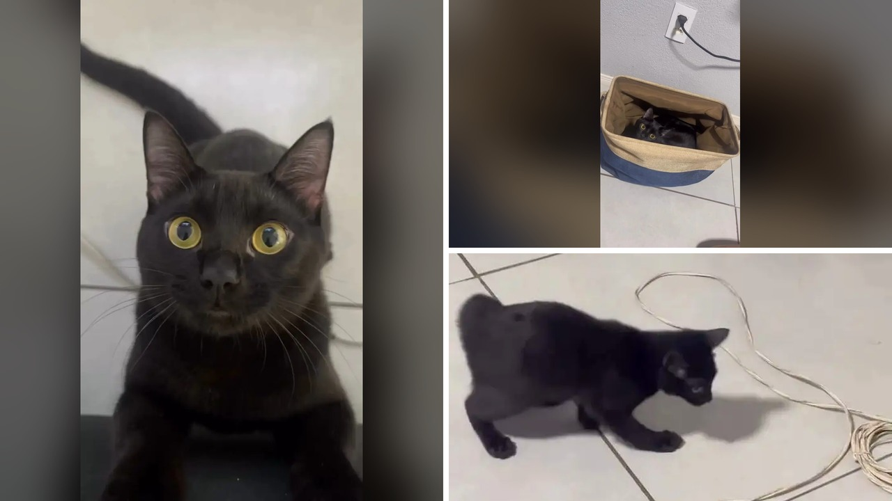

# تحول غريب في لون قط يسحر الملايين بعد عام من تبنيه

في الثاني عشر من يونيو من عام 2024، عاشت المصورة البرازيلية كواني ستيفاني، المقيمة في مدينة بيلو هوريزونتي، لحظة مميزة عندما تلقت هدية عيد ميلاد طالما حلمت بها. تمثلت الهدية في هرير أسود صغير أطلقت عليه اسم فوماتشا، وهي كلمة تعني الدخان باللغة البرتغالية. كانت كواني ترغب بشدة في اقتناء قط أسود خالص ليتناسق مظهره مع كلب العائلة الأسود، وسرعان ما نشأت بينهما رابطة قوية وأصبحا لا يفترقان.

مر العام الأول بهدوء تام، وكان فوماتشا يبدو كأي قط أسود آخر في تصرفاته ومظهره. لكن في إحدى اللحظات، لاحظت كواني تفصيلاً صغيرًا غير متوقع على الإطلاق. يا جماعة، ظهرت بقعة وردية دقيقة للغاية على أنف القط الذي كان مظلمًا بالكامل. لم يترتب على ظهور تلك البقعة أي ألم أو تغير في سلوك القط في البداية، إلا أنها كانت البداية الحقيقية لسلسلة من التغيرات المتسارعة.

## بقعة صغيرة تقلب الموازين

مع مرور الأيام والأشهر، لم تتوقف تلك البقعة الوردية عند حدود الأنف. بدأت رقع صغيرة ومتفرقة من الفراء الأسود تفقد لونها الداكن تدريجيًا، لتظهر مكانها خصلات بيضاء ناصعة. كيف يمكنك أن تتخيل مشاعر مربٍ يرى كائنه المفضل يعيد تشكيل مظهره أمام عينيه يومًا بعد يوم؟

تحول الفراء الأسود الصلب إلى مزيج استثنائي يجمع بين الأبيض والرمادي والبقع الداكنة. أصبح التباين بين صور فوماتشا عندما كان هريرًا صغيرًا ومظهره الجديد مذهلًا إلى درجة تصعب معها تصديق أن الصور تعود للقط نفسه. هذا التحول السريع تسبب في موجة قلق شديدة لكواني خوفًا على صحة رفيقها الصغير. أليس من الطبيعي أن ينتاب المرء الخوف حين يتغير شكل أليفه بهذا الشكل المفاجئ؟

## مخاوف طبية وتشخيص غير متوقع

من أجل الاطمئنان على سلامة فوماتشا، قررت كواني استشارة طبيبين بيطريين لمعرفة السبب الحقيقي وراء هذه الظاهرة النادرة. وهناك تلقت الإجابة العلمية المنتظرة: قطها مصاب بمرض البهاق، وهو حالة نادرة تصيب القطط وتؤدي إلى فقدان الجلد والفراء لصبغتهما الطبيعية تدريجيًا. يحدث هذا المرض عندما تتلف أو تُدمر الخلايا الصبغية التي تنتج اللون، ويُعتقد أن العملية مرتبطة باضطرابات الجهاز المناعي الذاتي.

مثّل هذا التشخيص راحة هائلة لكواني بعدما تأكدت أن الحالة لا تهدد حياة قطها مطلقًا. فمرض البهاق بوجه عام غير ضار، وغير معدٍ، ولا يسبب أي ألم أو حكة أو مشاكل صحية داخلية. ومع ذلك، تبقى المناطق الجلدية التي فقدت صبغتها أكثر عرضة لأشعة الشمس، مما يتطلب عناية مناسبة ومتابعة بيطرية مستمرة. الصراحة، كان اللفت للنظر أن فوماتشا واصل حياته بكامل نشاطه وحيويته، بل تشير صاحبته إلى أنه يمتلك طاقة تزيد عن معظم القطط الأخرى.

## ملايين المشاهدات وتفاعل واسع

قررت كواني توثيق هذا التحول المدهش لقطها ومشاركته مع الجمهور، فنشرت مقطع فيديو على منصة إنستغرام يوضح كيف تغير مظهره بشكل دراماتيكي. لم تكن تتوقع حجم التفاعل الهائل الذي سيتلقاه المقطع. بحلول شهر أكتوبر من عام 2026، حقق الفيديو أكثر من 18.5 مليون مشاهدة، وحصد أكثر من 2.2 مليون إعجاب من متابعين في مختلف أنحاء العالم.

امتلأت التعليقات بمقارنات طريفة، حيث شبهه البعض بالفنان مايكل جاكسون، وتمازح آخرون بأنه يبدو وكأنه سقط في وعاء من الطحين. هالسالفة لم تقف عند حد الدعابة، بل أثارت فضولًا علميًا حول طبيعة المرض. كيف تتصرف لو اكتشفت أن تجربة أليفك الخاصة أسهمت في توعية آلاف المربين بحالة صحية لم يكونوا يعرفونها؟ فقد تواصل العديد من أصحاب الحيوانات الأليفة مع كواني مؤكدين ملاحظتهم تغيرات مماثلة في قططهم. واليوم، يستمتع فوماتشا بحياته اليومية الشقية والمرحة غير مدرك أنه أصبح شعلة من النشاط وشخصية شهيرة على الإنترنت.

## رأيي الشخصي

رأيي الشخصي أن قصة القط فوماتشا تذكرنا بأن الجمال الحقيقي للحيوانات الأليفة لا يقتصر على لونها أو شكلها الخارجي، بل يمتد إلى الروح والوفاء والتفرد الذي تمنحه لأصحابها. قد تكون كواني تمنّت قطًا أسود بالكامل في البداية، لكنها حظيت في النهاية برفيق استثنائي لا يشبه أي قط آخر.

لو كنت مكان كواني وشاهدت فراء أليفك يتغير لونه كليًا، هل كنت ستشعر بالذعر وتبحث عن علاج لعودة لونه السابق أم ستتقبل مظهره الجديد بكل حب وفرادة؟
