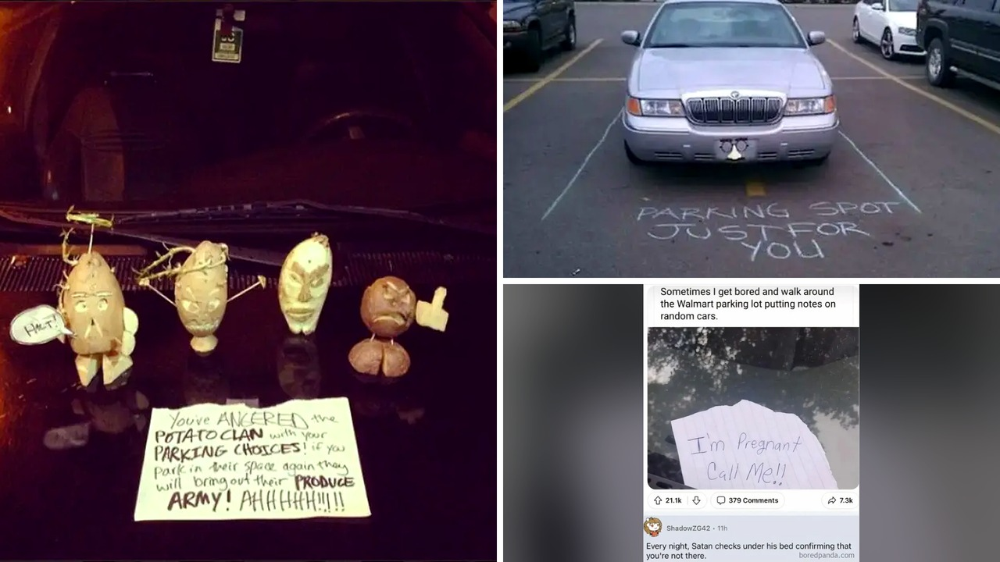

# رسائل الزجاج الأمامي: عندما تتحول أخطاء الركن إلى مواجهات

غرباء يتركون أوراقًا صغيرة على زجاج السيارات الموقوفة خطأ. بعضها يحمل طابعًا طريفًا كشخص كتب ورقة وهمية لينقذ سائقًا آخر من مخالفة مرورية، وبعضها الآخر يحمل غضبًا أو تهديدًا يثير الخوف.

استوقفني هذا التقرير لأنه يغوص في سلوك يومي نراه جميعًا في حياتنا. الصراحة، من منا لم يشعر بالضيق عندما يجد سيارة تأخذ مساحتين أو تغلق عليه الطريق؟ تعالوا نتوقف عند هذا السلوك ونفهم أبعاده الإنسانية.

## خطوط بيضاء وقواعد غير مكتوبة
السيارة بالنسبة لكثيرين ليست مجرد وسيلة نقل، بل امتداد لمساحتهم الشخصية. عندما يقتحم أحد هذه المساحة بالركن القريب جدًا أو التعطيل، يحدث التوتر الفوري.

تختلف خطوط الركن عن باقي القواعد الاجتماعية الشفهية؛ فهي حدود بصرية واضحة لا تحتمل التشكيك. تخيلوا كيف ينشأ الغضب حين يفضل سائق راحته الشخصية على حساب الآخرين، خاصة عندما يكون المرء مستعجلًا أو يبحث عن موقف.

تشبه هذه القواعد تصرفات يومية أخرى، كترك الحقائب على المقاعد الفارغة أو عدم الانتظار في طابور. إنها تعتمد على إدراك أن المساحات العامة تتطلب مسؤولية مشتركة.

هل سبق أن شعرت بحرج أو غضب مكتوم بسبب طريقة ركن أحدهم لسيارته؟

## قصص خلف الورقيات المتروكة
يتناول التقرير مواقف واقعية متنوعة كشفتها تلك الرسائل. في إحدى الحالات، وجد أبناء وزوجة يجمعون مقتنيات جدهم المتوفى بطاقات طريفة كان يحتفظ بها في سيارته لتنبيه المخالفين بطريقة فكاهية.

وفي موقف آخر، ترك أحدهم رسالة غاضبة في مرأب العمل، ليجد في اليوم التالي أن السيارة المخالفة انتقلت إلى زجاجة ركن منفردة في الزاوية. كما أظهرت رسالة أخرى معاناة رجل كبير في السن يحمل تصريح إعاقة ويمشي بصعوبة بعد جراحة في الورك، لكنه وجد موقفه المخصص مأخوذًا.

غير أن بعض الرسائل أحدثت خرقًا للراحة النفسية؛ فقد شعرت إحدى الساكنات الجدد في شقة بعدم الأمان بعد العثور على رسالة شديدة اللهجة، بينما تفاجأت زائرة برقعة ورقية غاضبة على زجاج سيارتها رغم ركنها في مكان شاغر عادة.

هذا التواصل المباشر بين الغرباء في الأماكن العامة يُظهر كيف يمكن لتصرف بسيط أن يتحول إلى قضية رأي ومواجهة حادة. هذا ذكّرني بما حكيته لكم سابقًا عن المواجهات التي تشتعل بسبب إهانات البقشيش والسلوكيات العامة.

**اقرأ أيضًا:** [إهانة البقشيش في كاليفورنيا: عندما يفضح بار العملاء](https://atar12345a.blogspot.com/2026/10/blog-post_906.html)

أليس من الغريب كيف تستخرج ورقة صغيرة على الزجاج كل هذه المشاعر المتباينة؟

## بين التنبيه والإحراج العام
بحسب الجمعية النفسية البريطانية المذكورة في التقرير، فإن ترك ملاحظة على السيارة يعود في كثير من الأحيان إلى الرغبة في تصحيح سلوك يتجاوز الحدود المعترف بها، خاصة عندما يكون السائق غير موجود.

لكن الدوافع لا تقف دائمًا عند حدود التنبيه. أحيانًا تحرّك الشخص رغبةٌ في إظهار مبادئه أمام الآخرين أو نيل تأييدهم، فيتحول النقد من محاولة لإصلاح الخطأ إلى وسيلة لإحراج الشخص علنًا.

الإحراج العلني يهدد سمعة الطرف الآخر ويدفعه للدفاع عن نفسه بدلاً من الاعتراف بخطئه. هناك فارق كبير بين تنبيه سائق أخطأ التصرف وبين تعمد توجيه إهانة له.

## مساحة للتأمل والرأي
رأيي الشخصي أن التعبير عن الانزعاج حق طبيعي لكل شخص تعطلت مصالحه بسبب ركن خاطئ، لكن الطريقة التي نختارها تعكس قيمنا بقدر ما تعكس خطأ الطرف الآخر. استوقفني في التقرير تصرف ذلك الغريب الذي وضع ملاحظة وهمية لينقذ سائقًا من مخالفة مرورية؛ إنها لفتة إنسانية لطيفة تظهر كيف يمكن استبدال الغضب بالتفهم. وفي المقابل، أجد أن استخدام رسائل تهديدية تجعل ساكنًا جديدًا يشعر بعدم الأمان في بيته أمراً مقلقاً وينحرف بالقضية عن هدفها. كان يتوجب على المجتمع أن يفرق بين الحزم في حفظ الحقوق—مثل حق صاحب تصريح الإعاقة الذي يعاني بعد جراحة الورك—وبين ممارسة التنمر والتخويف. كنت أتمنى لو نركز جميعًا على التنبيه الهادئ المباشر بدلاً من إشاعة التوتر في مساحاتنا المشتركة. يا جماعة، السلوكيات التي نمارسها في الطرقات والأماكن العامة ليست مجرد قواعد قيادة، بل هي مرآة لمدى احترامنا لبعضنا بعضًا في حياتنا اليومية.

هل تفضل ترك ملاحظة هادئة على سيارة أغلقت عليك الطريق أم الابلاغ للجهات المختصة فوراً؟

**للتوثيق:** استندت في هذا المقال إلى ما نشره موقع boredpanda.com، وهذا هو الخبر الأصلي لمن يريد التوسع: [هنا](https://2.boredpanda.com/notes-left-on-cars/). أما التعليق والرأي فهما رأيي أنا.
