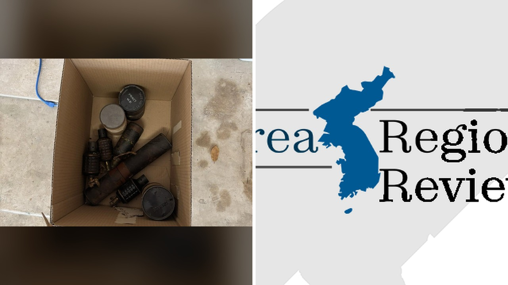

# صندوق قديم من مزاد منزلي يخبئ قنابل يدوية حية من الحرب العالمية

تشتري بعض الصناديق القديمة من مزاد منزلي لجمع التحف، وتعود إلى بيتك متحمسًا لتفريغها. تفتح الصندوق الأول، فتجد داخله شيئًا لا يخطر على بال أحد: ذخائر حربية حقيقية جاهزة للانفجار.

هذا بالضبط ما واجهه متسوق في ولاية تكساس الأمريكية، عندما تحولت جولة تسوق عادية إلى بلاغ أمني طارئ.

## مشتريات عادية ومفاجأة غير متوقعة

قرأت تفاصيل هذا الخبر الذي وقع في مدينة أوستن، وما فاجأني حقًا هو بساطة الموقف في بدايته. متسوق ذهب إلى تصفية منزلية واشترى بعض الصناديق. الصراحة، كلنا نبحث أحيانًا في هذه المزادات عن كتب نادرة أو لوحة فنية منسية.

لكن بينما كان المشتري يفرز أغراضه الجديدة في المنزل، عثر على صندوق مليء بما يبدو أنه قنابل يدوية تعود إلى حقبة الحرب العالمية الثانية. تخيلوا شعوره في تلك اللحظة؛ هل يعقل أن تكون مجرد مجسمات تاريخية للزينة أم خطر حقيقي؟

## تدخل فرقة المتفجرات

المشتري تصرف بحكمة ولم يتردد، بل اتصل فورًا بالشرطة للإبلاغ عما وجده. استجابت شرطة أوستن لهذا النداء غير المألوف، وسرعان ما استدعت فرقة تفكيك المتفجرات لمعاينة الموقع.

عندما فحص الخبراء الصندوق، تأكدت الشكوك سريعًا؛ القنابل لم تكن تذكارات خاملة، بل كانت نشطة وحية تمامًا. التعامل مع متفجرات يبلغ عمرها نحو 80 عامًا يمثل مهمة دقيقة وبالغة الخطورة، لأن استقرار المواد المتفجرة بداخلها بعد كل هذه السنوات يظل مجهولًا تمامًا.

هذا الموقف الغريب ذكّرني بما حكيته لكم سابقًا عن العثور على مقتنيات قديمة مفقودة منذ عقود طويلة داخل منازل يتم تجديدها، ولو أن العثور على محفظة قديمة أقل رعبًا بكثير من متفجرات حربية.

**اقرأ أيضًا:** [محفظة ضاعت 51 عاماً تُعثر عليها في تجديد منزل بنوفا سكوشيا](https://atar12345a.blogspot.com/2026/10/51.html)

## نهاية آمنة لصفقة مرعبة

تمكن المختصون في النهاية من تأمين القنابل ونقلها بعيدًا عن المكان بسلام دون وقوع أي إصابات. وأوضحت الشرطة أن ما حدث بعيد تمامًا عما يتوقع أي شخص إيجاده في مزاد منزلي. شو رأيك لو فتحت صندوقًا اشتريته لتجد تاريخًا حربيًا ينبض بالخطر أمامك؟

رأيي الشخصي أن البحث في الصناديق القديمة يحمل متعة لا تُنكر، لكن إدخال طرود مجهولة إلى البيت دون حذر قد يضعك في مواقف لا تستحق المجازفة إطلاقًا.

لو وُضعت مكان هذا المشتري، هل ستبتعد وتطلب المساعدة فورًا أم يدفعك الفضول لتفحص القنابل بنفسك؟
