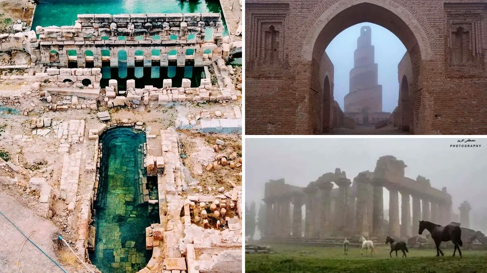

# شواهد أثرية تثبت أن العالم القديم كان متطورًا للغاية

تخيّل أن تجلس في حمام دافئ تتدفق مياهه بحرارة خمس وأربعين درجة مئوية دون انقطاع منذ ألفين ومئتي عام. هذا ليس مشهدًا خياليًا، بل واقع حمام روماني في وسط تركيا، ما زال يعمل حتى هذه اللحظة. كلما اعتقدنا أن تقنياتنا المعاصرة هي قمة الذكاء البشري، تظهر لنا تفاصيل تجعلنا نعيد التفكير في قدرات الأقدمين.

قرأت تقريرًا استعرض شواهد ملموسة من حضارات شتى، وأصابني الذهول من دقة ما أنجزه أسلافنا بموارد بدائية. هل كنا حقًا أذكى منهم، أم أنهم امتلكوا أسرارًا معمارية نسيناها مع الزمن؟

## أنظمة مياه تتحدى الزمن

الجميع يعرف خطوط نازكا الشهيرة في البيرو، لكن قلة فقط يعرفون ما يقع بجوارها مباشرة. هناك قنوات مائية جوفية تعتمد على حركة الرياح، وتعمل بكفاءة حتى الآن. بصراحة، فكرة ضخ المياه وتسييرها تحت الأرض بطاقة الرياح في ذلك الزمن البعيد أمر عبقري. 

الأمر ذاته يتكرر تحت شوارع إيطاليا، حيث تقع شبكة مائية قديمة أسفل مدينة نابولي، تمتد في سراديب تكشف دقة التخطيط الهيدروليكي القديم. شلون استطاعوا حفر كل تلك القنوات وصيانتها لعقود طويلة؟ يبدو أن مفهوم البنية التحتية لم يكن غريبًا عليهم أبدًا، بل تعاملوا معه باحتراف يثير الإعجاب.

## إتقان الصخور وفنون المعمار

إذا ابتعدنا عن أنظمة المياه وانتقلنا إلى التعامل مع الحجر، فالمشهد يصبح أكثر إثارة. في ولاية بيهار الهندية، تضم كهوف بارابار، التي يعود عمرها إلى ألفين ومئتي عام، جدرانًا من الغرانيت مصقولة بدقة فائقة كأنها مرآة عاكسة. جرب أن تلمس صخر الغرانيت الصلب لتعرف صعوبة تشكيله، فما بالك بتحويله إلى سطح عاكس وناعم بهذا الشكل!

وعند النظر إلى منحدرات كاونوس في تركيا، تبرز مقابر ليسية منحوتة في قلب الجبال الشاهقة بتفاصيل هندسية تحبس الأنفاس. يا جماعة، كيف تسلقوا تلك الارتفاعات الوعرة ليحفروا واجهات ضخمة بتلك الدقة دون رافعات حديثة؟ الأمر لا يتوقف هنا، فقلعة أربيل في كردستان العراق ما زالت تنبض بالحياة، وتعد من أقدم مدن العالم المأهولة بشكل مستمر لأكثر من ستة آلاف عام.

رأيي الشخصي أننا غالبًا ما نستهين بقدرات الحضارات السابقة ونتعامل مع الماضي كأنه حقبة بدائية مجردة من العلم. الشواهد تؤكد أن العقل البشري بلغ ذروة الإبداع بطرقه الخاصة، فهل تعتقد أننا تقدمنا فعلًا في التفكير، أم أننا طورنا الآلات فقط؟
