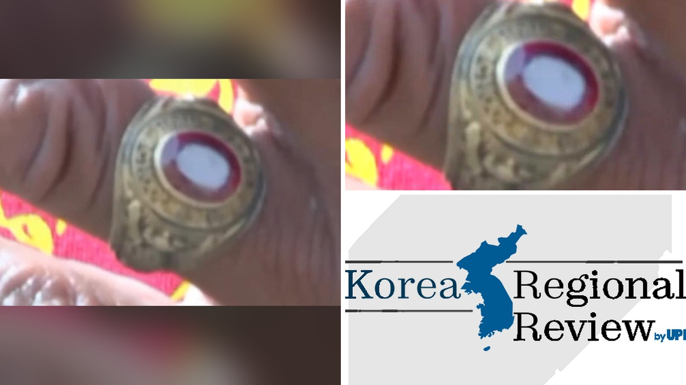

# خاتم الصف 1965 يُسترجع من مجرى الصرف بعد عقود في ألاباما

تخيّلوا: كنت أعمل في أحد محطات الصرف عندما لاحظ زميلنا خاتماً يلمع بين حطام الأنابيب. الصدمة كانت إنّه ليس مجرد حلية عادية، بل خاتم تخرج من مدرسة سودة للطلاب في عام 1965. الصراحة، ما فاجأني هو أن القصة ورى هذا الخاتم تحمل حكاية حبٍّ دفنته السنوات.

أنا قرأت الخبر وشعرت بمد يد الزمن، فكيف يمكن لشيء صغير يختفي في صرف أن يعود ليقابل صاحبه بعد أكثر من نصف قرن؟ وش رايكم إذا وقع معكم موقف مشابه؟

## من الصرف إلى الفيسبوك

العمل كان في محطة "Sheffield Wastewater Plant" بفلورنس، ألاباما. أثناء تنظيف مجرى صرف مسدود، عثر العامل "Junior Riner" على الخاتم المطبوع بالحروف "OJM". بعد ما اكتشف أن المدرسة التي صُنع فيها الخاتم أُغلقت عام 1969، بدأ يبحث عن خريجين عبر مجموعة فيسبوك. بصراحة، هذه الخطوة أظهرت قوة التكنولوجيا في جمع القلوب المبعثرة.

## البحث عن صاحب الخاتم

مرت شهور دون أي رد، لكن صهر رينر لم يترك الأمر. لقى صورة لخريجين من "Burrell‑Slater" على الإنترنت، وتعرف على أوسكار جيمس ميردث. تواصلوا مع ابنته "أبريل ميردث مو" التي استفسرت من والدها إنّ والدها فقد الخاتم. اكتشفوا أن الخاتم كان قد سقط في حوض المطبخ قرب منزل طفولة أمه "آنا"، التي توفت قبل سنوات. مشهد عودة الخاتم إلى أصحابه كان مشوقاً، خصوصاً وهو لا يزال يناسب إصبعه.

## لحظات الفرح والذكريات

قابل رينر أوسكار في المنزل وسلمه الخاتم. قال ميردث إن الخاتم يذكّره بأيام المدرسة وعلاقته بآنا، وأنه سيُضع الآن في علبة عرض داخل البيت. يا جماعة، ما أحلى إنّ الذكريات تعود من خلال شيء بسيط. هل تعتقدون أن مثل هذه اللحظات تغير نظرتنا للأشياء المفقودة؟

## النهاية التي تركت بصمة

رأيت في القصة مثالاً على أن الصدفة قد تحمل رسائل حنونة، وأن الجهد البسيط للعمال يمكن أن يخلق لحظات لا تُنسى. الصراحة، ما فاجأني أكثر هو أن الخاتم ظل محفوظاً في أنبوب الصرف، وكأنه ينتظر لحظة عودته إلى أصحابه.

رأيي الشخصي أن هذه القصة تذكّرنا بأهمية عدم الاستهانة بالأشياء الصغيرة؛ فربما تحمل بين طياتها قصصاً تستحق أن تُروى. إذا وجدتوا شيئًا قديمًا في مكان غير متوقع، هل ستسعون لتتبع أصله؟
