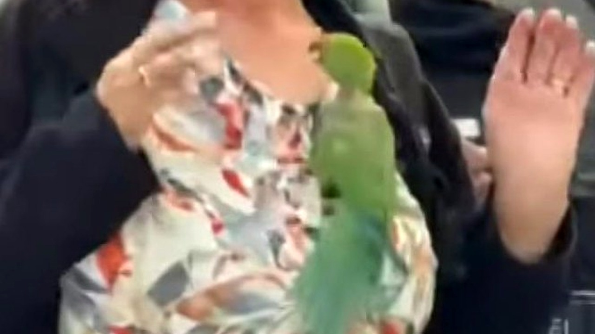

# طائر أخضر غريب يقتحم مطار شيكاغو ويهاجم الركاب

تخيل أنك تقف في طابور المطار، تراجع تذكرتك وتنتظر وزن حقائبك بهدوء، وفجأة يهبط ضيف ريشي على رأسك ويبدأ معركة لا مبرر لها. هذا بالضبط ما عاشه مسافرون في مطار شيكاغو أوهير الدولي.

القصة بدأت في 13 أكتوبر في الصالة رقم 5 بالمطار، وتحديداً قرب طابور إنهاء إجراءات السفر لشركة طيران إير فرانس. فجأة، اقتحم طائر أخضر غريب، يُرجح أنه ببغاء، المكان بعدما تسلل عبر باب مفتوح. ما فاجأني حقاً ليس دخوله الصالة، بل المزاج الهجومي الصريح الذي دخل به.

## معركة فوق الحقائب والرؤوس

الطيور عادة تهرب من الزحام، لكن صاحبنا هذا قرر أن يتحدى الجميع. مقاطع الفيديو أظهرت الطائر وهو يحط بكل ثقة فوق رؤوس المسافرين وحقائبهم. مش معقول كيف انقلب الموقف؛ فكلما حاول شخص أن يقترب منه بلطف أو يمسك به بهدوء، تحول الطائر إلى مقاتل شرس وبدأ ينقر بحدة كل يد تمتد نحوه.

الموظف باريس إلبرت، الذي وثق الحادثة، لخص المشهد بعبارة دقيقة جداً: الطائر اختار القتال بدل الهرب. بصراحة، سلوك هذا الطائر يعكس شخصية عنيدة لا ترى في البشر أي تهديد يخيفها، بل خصوماً في ساحتها الخاصة.

هذا الموقف الغريب مع عالم الطيور وتصرفاتها غير المتوقعة ذكرني بقصة سابقة تابعناها عن العناية بالطيور النادرة وإنقاذها بحلول مبتكرة.

**اقرأ أيضًا:** [أول منقار مطبوع بتقنية ثلاثية الأبعاد ينقذ طائرا نادرا](https://atar12345a.blogspot.com/2026/10/blog-post_17.html)

## قميص ينهي المواجهة

استمرت الفوضى لبعض الوقت، والركاب بين متفاجئ ومحاول لتجنب ضربات المنقار السريعة. يا جماعة، كيف يمكن السيطرة على كائن طائر وسريع في مكان مفتوح ومزدحم؟ الحل لم يأتِ من أجهزة أمن المطار المعقدة، بل من عامل نظافة تصرف بحيلة بسيطة وذكية للغاية.

العامل استخدم قميصاً وألقاه بحذر فوق الطائر لتقييد حركته دون أن يؤذيه، ونجح أخيراً في الإمساك به وإنهاء تلك الجولة الصاخبة. بعد السيطرة عليه، تم نقله مباشرة إلى طبيب بيطري لفحصه والتأكد من سلامته، والبحث عما إذا كان يحمل شريحة إلكترونية تكشف عن صاحبه الحقيقي، لمعرفة شلون انتهى به المطاف داخل صالة سفر دولية.

رأيي الشخصي أن مثل هذه اللحظات غير المتوقعة تكسر جمود السفر الروتيني وتترك حكايات لا تُنسى، حتى لو تسببت في بعض الذعر المؤقت للمسافرين.

لو كنت في مكان هؤلاء المسافرين، هل كنت ستحاول الإمساك به ومساعدته أم ستفضل الابتعاد تماماً عن منقاره؟
