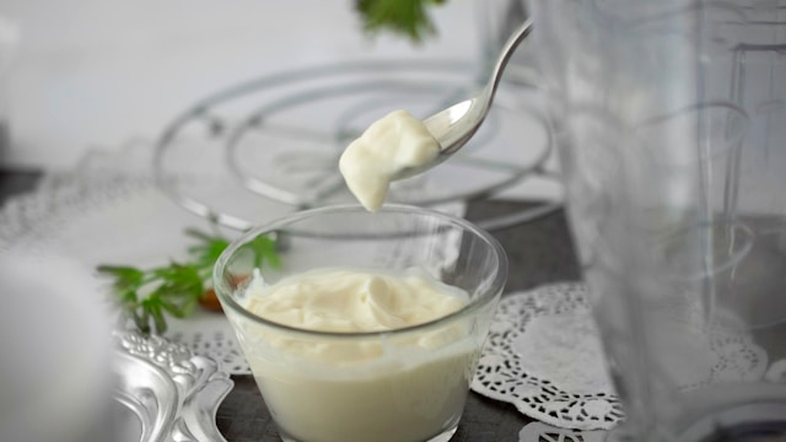

# أغرب مشروبات العالم: من دم الثعابين إلى خميرة السرة!

تخيّل إنك قاعد في مكان، ويتقدّم لك مشروب غريب، شكله أو مكوناته تخلي فكك يطيح! أنا قرأت عن بعض المشروبات اللي بتخليك تسأل: "كيف؟ وليه؟". الصراحة، الخبر اللي وصلني اليوم عن مشروبات من حول العالم، فيه أشياء تدهش العقل وتثير الفضول بشكل مو طبيعي. تعالوا نشوف وش هالسوالف الغريبة اللي الناس تشربها.

## نبيذ الثعابين: سم بلا ضرر؟

أول شي لفت انتباهي كان "نبيذ الثعابين". أنا لما قرأت الاسم، فكرت يمكن مجرد تسمية، لكن لا يا جماعة، السالفة جد! هذا النبيذ بيتعمل بأنهم ينقعوا ثعبان، وغالبًا بيكون سام، في نبيذ الأرز. بس بيقولوا إن الكحول اللي فيه بيبطّل مفعول السم ويخليه غير ضار. طب ليش؟ حسب الطب الصيني، شرب جرعة بسيطة من نبيذ الثعابين له تأثير منشّط. والمفاجأة الأكبر، إنه فيه نسخة ثانية من هذا النبيذ، بيقتلوا فيها الثعبان الحي على الفور، ويخلطوا دمه وعصارته الصفراوية مع الكحول كجرعة سريعة. أنا بصراحة استغربت وايد من الفكرة دي، مش معقول! وش رايكم أنتم؟

## بيرة الأطفال: للمتعة فقط

من الثعابين نروح لليابان، وهناك نلاقي "بيرة الأطفال" أو "كيدزبير". تذكرون سجائر الحلوى اللي كنا نتظاهر إننا ندخنها واحنا صغار؟ هذي زيها بالضبط، بس بيرة! هي بيرة يابانية بدون كحول، طعمها زي الكولا، لكن شكلها بالضبط زي البيرة. تجي في قناني بنية وعليها ملصقات شبيهة بملصقات البيرة، والأغرب إنها حتى بتعمل رغوة كثيفة عشان تبدو وكأنها بيرة حقيقية. تخيلوا طفل يشربها ويحس إنه كبير! هل تشوفون إنها تستحق تكون في قائمة المشروبات الغريبة؟ أنا أشوفها فكرة حلوة بس غريبة بنفس الوقت.

## بيرة زر البطن: عندما تصبح الخميرة شخصية

وهذي السالفة اللي يمكن تستغربوها زيادة: "بيرة زر البطن". الفكرة العامة إن الخميرة هي خميرة، لكن بعض صانعي البيرة في مصنع "7 سنتس" في فيكتوريا، استخرجوا خميرة من داخل سرّاتهم واستخدموها في صنع البيرة! يا الله، أنا لما قرأت هالشي، قعدت أضحك من الغرابة. يقولون إن الفكرة هذي ما كانت جديدة تمامًا، بل استلهموها من مصنع بيرة ثاني استخدم خميرة مأخوذة من لحية صانع بيرة. البيرة اللي عملوها من خميرة السرة، وصفوها بأنها بيرة ويت بلجيكية بنكهة جديدة، مع قشر البرتقال الطازج وبذور الكزبرة المحمصة، والخميرة أظهرت خصائص البيرة البلجيكية بنكهات التوابل والقرنفل ولمحات الموز الخفيفة. حاجة غريبة جدًا، صح؟

## سعلة المدخن وجين النمل: لمحات من البهارات والحشرات

نروح لمشروب اسمه "سعلة المدخن". أنا من الاسم بس حسيت إنها قصة. هذي كوكتيل بسيط، عبارة عن جرعة من مشروب "ياجرمايستر" وعليها ملعقة كبيرة من المايونيز! بصراحة، أنا ما قدرت أتخيل الطعم أبداً، المايونيز مع أي مشروب؟ مش ممكن! وهذا يعتبروه من أقذر المشروبات وأغربها. 

وبعدين عندنا "جين النمل" الأسترالي. هذا المشروب أصوله من تقاليد السكان الأصليين في أستراليا، اللي بيستخدموا النمل الأخضر كدواء وبيجمعوه من الإقليم الشمالي بواسطة أفراد من شعب لارّاكيا. شركة "سامثينج وايلد للمشروبات" في أديلايد هيلز بتدخل النمل في عملية التقطير. يقولون إن نكهات الليمون والكزبرة بتطلع من النمل وتدخل في طعم الجين. والأغرب إن النمل اللي بيكون في قاع الزجاجة بيكون صالح للأكل! هل ممكن تجربوا تاكلوا النمل من هالنوع من المشروبات؟ أنا أقول لا، بس شو رأيكم أنتم؟

## رأيي الشخصي في هذه الجرأة الغريبة

رأيي الشخصي بعد ما قرأت كل هذه المعلومات، هو أن العالم مليء بالغرائب والابتكارات اللي تتجاوز حدود المنطق أحيانًا. أنا استوقفني وايد فكرة استخدام خميرة السرة أو حتى النمل في صناعة المشروبات، ليس فقط لغرابتها بل لجرأة الفكرة نفسها. الفضول البشري يدفع الناس لتجربة أشياء عجيبة جدًا، وبعضها يجد له سوقًا ويصبح تقليدًا. أعتقد أن الغاية وراء هذه المشروبات ليست فقط الطعم، بل التجربة بحد ذاتها، أو ربما البحث عن تأثيرات معينة كما في نبيذ الثعابين. لكن أن يصل الأمر إلى المايونيز مع مشروب كحولي، فهذا شيء أجد صعوبة في فهمه أو تقبله. أتمنى لو كانت كل هذه التجارب مركزة على النكهات الفريدة من الطبيعة فقط، وليس من مصادر قد تبدو مقززة للبعض. هذه الأنواع من المشروبات تجعلني أتساءل دائمًا عن حدود الإبداع البشري، وهل هناك أي شيء لا يمكن تحويله إلى مشروب؟

ما هو أغرب مشروب سمعت عنه أو رأيته في حياتك، وهل تجرؤ على تجربة أحد هذه المشروبات الغريبة؟

**للتوثيق:** استندت في هذا المقال إلى ما نشره موقع Oddee، وهذا هو الخبر الأصلي لمن يريد التوسع: [هنا](https://www.oddee.com/more-strange-drinks-from-around-the-world/?utm_source=rss&utm_medium=rss&utm_campaign=more-strange-drinks-from-around-the-world). أما التعليق والرأي فهما رأيي أنا.
