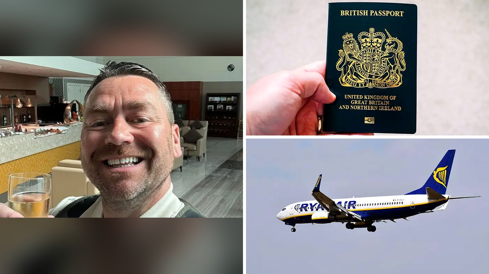

# رجل يسافر دوليا بجواز سفر زوجته دون أن يلاحظ أحد

وقف الرجل في طابور الجوازات داخل مطار أليكانتي بإسبانيا، وفتح حقيبة يده ليسحب وثيقة سفره بثقة، لكنه تجمد مكانه فجأة حين وقعت عيناه على الصورة. لم تكن صورته هو، بل كانت صورة زوجته. في تلك اللحظة بالذات، شعر أن دمه تجمد بالكامل، فكيف يعقل أنه ركب طائرة دولية وعبر كل نقاط التفتيش في بلاده دون أن يستوقفه مخلوق؟

تخيّل أن تجد نفسك في دولة أخرى، وأنت في الحقيقة لا تملك إثبات هوية رسمي يخصك شخصيًا. هذه بالضبط الورطة التي عاشها بن مور، الرجل البالغ من العمر 48 عامًا، والقادم من بلدة تالك في ستافوردشاير، حين قرر السفر يوم الجمعة 20 نوفمبر لحضور حفلة توديع عزوبية مع أصدقائه. الصراحة، ما حدث معه يبدو أقرب لمشهد في فيلم كوميدي.

## صدمة في صالة الوصول

عندما كان بن يتقدم في طابور فحص الجوازات الإسباني، اعتقد في البداية أنه التقط جواز سفر زوجته إلى جانب جوازه بالخطأ أثناء جمع أمتعته من المنزل. لكن الحقيقة المرة سرعان ما ظهرت، إذ لم يكن هناك أي جواز آخر معه. يا جماعة، الرجل فتح حقائبه وفتشها حوالي ثماني مرات متتالية وهو في حالة إنكار تام، متسائلًا بينه وبين نفسه: شلون وصلت إلى هنا من الأساس؟

أصدقاؤه الذين رافقوه لاحظوا شحوب وجهه المفاجئ. حينها، لم يجد مفرًا من التوجه بنفسه إلى رجال الشرطة الإسبانية ليشرح لهم هالسالفة الغريبة. الضباط هناك وقفوا مذهولين وغير قادرين على تصديق ما يسمعونه، خاصة مع وجود حاجز اللغة الذي جعل التواصل أكثر صعوبة وإرباكًا للجميع.

## من المسؤول عن الثغرة؟

السؤال البديهي الذي يتبادر إلى ذهنك الحين: كيف غادر بريطانيا أصلًا؟ تبين أن رحلته بدأت من مطار مانشستر عبر شركة رايان إير. مطار مانشستر سارع إلى التوضيح بأن فحص تطابق الجوازات يقع على عاتق شركات الطيران والجهات المسؤولة عن تسجيل الركاب، وليس على إدارة أمن المطار التي تكتفي بالتحقق من بطاقات الصعود وتفتيش الأمتعة.

المسؤولية الفعلية كانت تقع على شركة سويسبورت، وهي الطرف الثالث المكلف بمراجعة وثائق المسافرين لصالح شركة الطيران عند بوابات المغادرة. الشركة خرجت لاحقًا لتؤكد أنها تأخذ إجراءات التحقق من الوثائق بجدية بالغة، وأنها فتحت مراجعة داخلية شاملة لما جرى لتعزيز إجراءات الصعود الإلزامية. لكن الواقع يقول إن رجلاً استقل رحلة دولية كاملة بوثيقة تحمل صورة واسم امرأة، دون أن ينتبه أحد.

## نهاية مبكرة للحفلة

رغم أن بن نجح في الوصول إلى وجهته، إلا أن عطلته انتهت قبل أن تبدأ فعليًا. السلطات الإسبانية لم تسمح له بدخول البلاد للاحتفال، بل تقرر إعادته إلى المملكة المتحدة. وقد وصف الرجل تعامل رجال الأمن معه بأنه كان مشحونًا ومخيفًا، وهو أمر طبيعي في ظل حساسية الموقف الأمني.

المفارقة أن هذه الحادثة لم تكن الوحيدة من نوعها في ذلك التوقيت؛ ففي اليوم التالي مباشرة، وتحديدًا في 21 نوفمبر، وقع تساهل تنظيمي آخر ولكن في مطار إدنبرة. ركاب طائرة تابعة لشركة إيزي جيت، قادمة من مطار كيفلافيك الدولي في أيسلندا، تم توجيههم بالخطأ إلى صالة الوصول الداخلي بدل الصالة الدولية، ليتجاوزوا فحص الجوازات تمامًا بسبب خطأ موظف أرضي، قبل أن يتم تدارك الأمر وإجراء التدقيق لاحقًا.

## ثغرات لا ينبغي أن تحدث

رأيي الشخصي أن ما مر به هذا المسافر يكشف فجوة مقلقة في روتين السفر الحديث الذي نظنه صارمًا ولا يخترق. نحن نمر اليوم بطوابير طويلة ونخضع لإجراءات تفتيش مشددة، ونخلع أحذيتنا وأحزمتنا لضمان السلامة، ثم نكتشف أن أبسط خطوة بديهية، وهي النظر في صورة الجواز ومقارنتها بوجه الراكب، قد تسقط من حسابات الموظف بسبب العجلة أو الاعتماد الأعمى على مسح الباركود آليًا.

ما استوقفني فعلاً هو موقف الراكب نفسه؛ فالرجل تصرف بحسن نية وذهب بملء إرادته ليعترف بخطئه للشرطة، ومع ذلك وجد نفسه يواجه ساعات عصيبة ومعاملة حادة انتهت بترحيله وحرمانه من رحلته، بينما الخطأ الأساسي بدأ من شباك المطار في بلده. كنت أتمنى لو أظهرت الإجراءات قدرًا من المرونة الإنسانية في احتواء الموقف بدلاً من إشعار المسافر بأنه ارتكب جريمة كبرى، خصوصًا أن سجله ونواياه كانت واضحة، والخطأ كان مشتركًا وتقاسمه معه موظفو الصعود إلى الطائرة. هذه الواقعة تضعنا أمام حقيقة أن التكنولوجيا والإجراءات المعقدة تفقد قيمتها بالكامل إذا غاب التركيز البشري البسيط لثوانٍ معدودة.

لو كنت مكان هذا المسافر واكتشفت الخطأ بنفسك في بلد الوصول، هل كنت ستبادر بإبلاغ الشرطة فورًا أم ستخاطر وتلتزم الصمت؟

**المصدر:** أعدت صياغة الموضوع بأسلوبي اعتمادًا على خبر منشور في boredpanda.com. وللاطلاع على الخبر كما ورد اضغط [هنا](https://2.boredpanda.com/man-international-flight-using-wifes-passport/).
