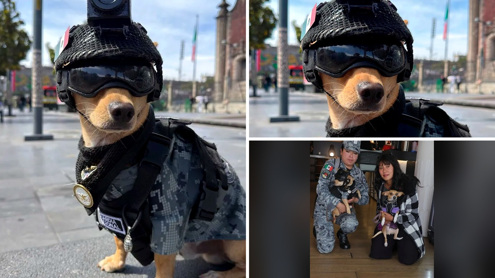

# كلب تشيواوا صغير ينضم للحرس الوطني المكسيكي ويخطف القلوب

تخيّلوا يا جماعة كلبًا من فصيلة التشيواوا، عمره ثلاثة عشر شهرًا فقط، ووزنه لا يتجاوز خمسة عشر رطلاً، يرتدي خوذة ونظارات واقية وسترة تكتيكية صغيرة!

هذا ليس مشهدًا من فيلم كرتوني، بل واقع حقيقي أقرأ عنه وأنا أبتسم بصراحة. الكلب "كوماندو" أصبح رسميًا عضوًا في الحرس الوطني المكسيكي، ليثبت أن الشجاعة لا تقاس بالحجم إطلاقًا.

## بداية غير متوقعة لمهمة كبيرة

تبدأ القصة عندما أصبحت عائلة كوماندو المسنة غير قادرة على رعايته. هنا تدخل عناصر من الشرطة المحلية وأخذوه لمنحه بيتًا جديدًا. سرعان ما اكتشف الضباط شخصيته المليئة بالحيوية والثقة، ورغبته الشديدة في الانضمام إليهم.

تحول كوماندو من مستقبل غير معروف إلى حياة مليئة بالهدف والمغامرة. شو رأيكم بهذا التحول؟ لقد أصبح يمتلك كل ما يحتاجه الضابط الصغير: سترة تكتيكية بمقاس مخصص، وخوذة، ونظارات واقية، بل وحتى كاميرا دقيقة مثبتة عليه!

## تدريبات شاقة وبناء جسور التواصل

ما فاجأني بحق هو أن كوماندو يتدرب حاليًا جنبًا إلى جنب مع كلاب الخدمة الكبيرة في القوة، حيث يتعلم أساسيات الكشف عن الروائح. أليست هالسالفة مثيرة للاهتمام؟

لكن رغم زيّه العسكري المنظم، تبدو مهمته الأهم أبسط من ذلك بكثير. كوماندو يعمل على رسم الابتسامة على وجوه الناس، ومساعدة الضباط في بناء روابط أقوى وأكثر دفئًا مع مجتمعهم.

هذا التفاعل الإنساني مع الحيوانات ذكّرني بما حكيته لكم سابقًا عن مشاهد دافئة بين الكائنات، كما حدث حين احتضنت قطة صغار سنجاب يتيمة بعد فقدان صغارها.

**اقرأ أيضًا:** [قطة تفقد صغارها وتحتضن سنجابين يتيمين في مشهد مؤثر](https://atar12345a.blogspot.com/2026/10/blog-post_16.html)

## رسالة أمل في مهرجان الحيوانات

مؤخرًا، شارك هذا المجند الصغير في مهرجان "وُفتلان فيست" المقيم في "وُفتوب كونديسا". ظهر هناك برفقة عدة منظمات لرعاية الحيوان بهدف تشجيع التبني المسؤول للحيوانات الأليفة، ومساعدة الكائنات التي تنتظر فرصة ثانية لبدء حياة جديدة.

احتفل الحرس الوطني بمشاركته، مؤكدين أن وجود كوماندو يمثل جزءًا من جهود ناطقة بأهمية الرفق بالحيوان. وجوده يذكرنا جميعًا بأن كل حيوان يستحق العطف والرعاية والعيش في عائلة تحبه.

## رأيي الشخصي

رأيي الشخصي أن قصة كوماندو تثبت أن إحداث التغيير لا يتطلب حجمًا ضخمًا ولا هيئة مخيفة، بل يكفي أن تتوفر الشجاعة والفرصة الثانية في بيئة محبة.

هل تعتقدون أن استعانة الأجهزة الأمنية بحيوانات صغيرة يساهم فعليًا في تقريبها من المجتمع، أم أن الدور يظل محصورًا في الترفيه؟
