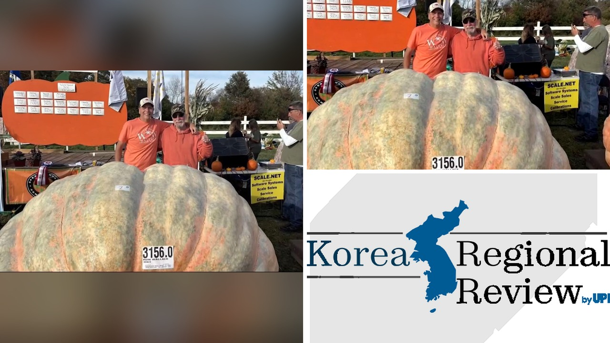

# قرعة عملاقة في رود آيلاند تسجل وزنًا غير مسبوق 3,156 رطلاً

هل تصدقوا أن قرعة واحدة قد تتجاوز وزن ثلاث أطنان؟
تخيلوا مشهد مزارع من كوفنتري، رود آيلاند، وهو يضع قرعًا بحجم سيّارة صغيرة على ميزانٍ في مسابقة جنوب نيو إنجلاند للقرع الضخم. الصراحة، الوزن الرسمي كان 3,156 رطلاً، رقم لم يُسجل من قبل.

## كيف وصل الوزن إلى 3,156 رطلاً؟
حسب ما نُشر، المزارع رون والاس وضع قرعته الضخمة على الميزان في وارن. الوزن ارتفع إلى 3,156 رطلاً، ما يجعلها أول قرعة تتجاوز 3,000 رطل. يا جماعة، هذا مش معقول! الفكرة أن القرعة نمت ببطء عبر موسم كامل، مع رعاية خاصة من السماد وتقليم دقيق.

## هل سيكسر الرقم القياسي العالمي؟
الآن السؤال الأكبر: هل سيعتمدها جينيس كرقم قياسي عالمي؟ إذا وافقوا، ستستولي على اللقب من قرعة إنجليزية وزنها 2,856.8 رطلاً سُجلت في 3 أكتوبر في بيركشاير. وش رايكم إذا تم اعتمادها؟ هل سيُعيد الإنجليز محاولة استعادة اللقب؟

## ما الذي يجعل هذه القرعة فريدة؟
الصراحة، رون ليس غريبًا على الأرقام القياسية؛ ففي 2012 كان أول من يحصد قرعة تفوق طنًا واحدًا. هذا يدل على خبرة طويلة في زراعة القرع الضخم. تخيّلوا الجهد المبذول في اختيار البذور، والتربة، والري، وحتى الموسيقى التي يُشغّلها للمزارع أثناء النمو. كل هذه التفاصيل تجعل القرعة أكثر من مجرد خضار، بل تحفة زراعية.

## هل ستستمر المنافسة؟
المسابقات القادمة ستشهد مزارعين من جميع الولايات يتحدون الوزن. هذا يذكرنا بإنجازات الأرقام القياسية في رياضات غير تقليدية. 

رأيي الشخصي أن هذه القصة تبرهن على شغف الإنسان بتحدي نفسه، وحتى الطبيعة يمكن أن تصبح ساحة لتحدٍ جديد. فهل تعتقدون أن الوزن سيصمد أمام مراجعة جينيس أم سيُعيده إلى إنجلندا؟
