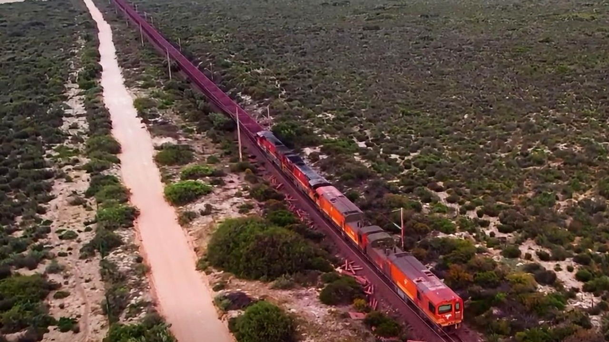

# قطار بضائع عملاق في جنوب إفريقيا يكسر رقمًا قياسيًا عالميًا

تخيل أنك تقف عند تقاطع سكة حديد، وتنتظر مرور قطار بضائع لا يبدو أن له نهاية في الأفق. هذا ليس مشهدًا خياليًا، بل ما حدث بالفعل قبل أيام في جنوب إفريقيا.

استوقفني هذا الحدث المثير حين أعلنت شركة شحن السكك الحديدية الحكومية هناك عن تسيير قطار بضائع ضخم للغاية. القطار انطلق في رحلته يوم الأحد على خط تصدير خام الحديد بين سالدانها وكيب الشمالية، في تجربة استثنائية بكل المقاييس.

## وحش حديدي يمتد لأميال

ما فاجأني حقًا هو الأرقام المرتبطة بهذا القطار. لقد سحب 696 عربة كاملة، ليمتد طوله الإجمالي إلى 4.7 أميال. هل يمكنكم استيعاب قطار بهذا الامتداد دفعة واحدة؟

الهدف الأساسي من هذه الخطوة كان كسر الرقم القياسي العالمي المسجل في موسوعة غينيس لأطول قطار بضائع. ذلك الرقم السابق حققه قطار في أستراليا عام 2001، وكان يتألف من 682 عربة بطول بلغ 4.6 أميال. الفارق قد يبدو بسيطًا في الأرقام، لكن على أرض الواقع، تحريك هذا الثقل الهائل يُعد إنجازًا هندسيًا معقدًا للغاية.

هذا السعي لكسر الأرقام الصعبة يذكرني بما حكيته لكم سابقًا عن محاولة رجل تسجيل رقم قياسي فريد بطائرات ورقية في وقت قصير.

**اقرأ أيضًا:** [رجل يلتقط 20 طائرة ورقية في فمه خلال دقيقة ويسجل رقمًا قياسيًا](https://atar12345a.blogspot.com/2026/10/20.html)

## ما وراء الأرقام القياسية

المهم في هذه التجربة، بحسب تصريحات راسل باتجيس، الرئيس التنفيذي للشركة المشغلة، أن الأمر يتجاوز فكرة المباهاة بالأرقام القياسية. الهدف الأكبر كان تطوير المعرفة التقنية في تصميم القطارات، وتحسين طرق التعامل معها ورفع كفاءة الأداء التشغيلي.

الصراحة، هذا التفكير يبدو منطقيًا جدًا؛ فالخبرات المستفادة من هذه الرحلة ستساعد في تطوير عمليات السكك الحديدية ودعم الابتكار وتعزيز قدرات نقل البضائع مستقبلًا. والآن، تنتظر الشركة مراجعة الأدلة والوثائق من قِبل موسوعة غينيس لاعتماد الرقم رسميًا.

رأيي الشخصي أن مثل هذه التجارب تثبت أن الطموح الهندسي لا يتوقف عند حد معين، والجميل هو توظيف محاولات الأرقام القياسية لخدمة التطور العملي لا للاستعراض فقط.

لو صادفت قطارًا بهذا الطول في طريقك، هل ستستمتع بمشاهدة هذا المشهد النادر أم سينفد صبرك من الانتظار الطويل؟
