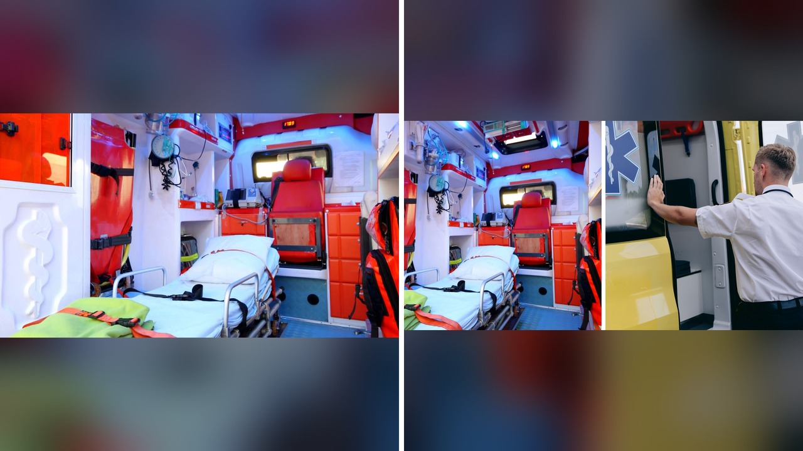

# سائق إسعاف يترك مريضة ويطلب سيارة أوبر في أوهايو

تخيّل أن تسوء حالتك الصحية فجأة، وتطلب سيارة الإسعاف لتنقلك إلى المستشفى، ثم تكتشف في منتصف الطريق أن السائق قرر إنهاء نوبة عمله والمغادرة! هذا بالضبط ما حدث في حادثة غريبة شهدتها ولاية أوهايو الأمريكية.

امرأة كانت تعاني من آلام حادة في الصدر، وكان من المفترض أن تصصل سريعاً إلى المستشفى داخل سيارة إسعاف تابعة لشركة خاصة. لكن الرحلة لم تكتمل كما ينبغي، بسبب تصرف غير متوقع من السائق.

## نهاية الدوام في منتصف الطريق

وقعت هذه القصة مساء يوم الأربعاء، 28 أكتوبر، عندما كانت سيارة الإسعاف تنقل السيدة مجهولة الهوية متجهة بها نحو مستشفى كليفلاند كلينك. السيارة كانت تابعة لشركة إسعاف خاصة تُدعى لينكس إي إم إس.

وفق ما ورد في التقرير، فإن السائق ضل الطريق أثناء القيادة. وبدلاً من تدارك الموقف أو البحث عن المسار الصحيح، أبلغ المرأة ببساطة أن نوبة عمله لهذا اليوم قد انتهت، ولا يرغب في مواصلة القيادة!

يا جماعة، الأمر لم يتوقف عند هذا الحد، بل قام السائق بحجز سيارة عبر تطبيق أوبر لنفسه، وترك سيارة الإسعاف بالمريضة وغادر المكان! الصراحة، هذا الموقف يجعلك تتساءل كيف يمكن لشخص يتولى مهمة إسعافية أن يتصرف بهذا الشكل.

## رحلة تائهة وسائق يطلب أوبر

انتشرت تفاصيل الواقعة سريعاً على منصات التواصل الاجتماعي، وأثارت حالة واسعة من الذهول والاستغراب. تساؤل عديد من المتابعين حول كيفية وقوع مثل هذا الحدث، خاصة مع وجود مريضة تشكو من آلام بالصدر وتحتاج إلى رعاية سريعة.

أحد المتابعين علّق متسائلاً: إذا كان السائق قد ضل الطريق بالفعل، فكيف استطاع تحديد موقعه بدقة ليطلب سيارة أوبر لتأخذه من هناك؟ كما تساءل آخرون عما إذا كان هناك فني طوارئ طبية يتواجد في الجزء الخلفي من السيارة مع المريضة أم لا، وما الذي فعله عند مغادرة السائق.

يعني إيه سائق يترك سيارة إسعاف في الشارع ويذهب إلى بيته؟ هذا السؤال كان المحور الأساسي للنقاشات التي اشتعلت بين المتابعين على المنصات.

## تدخّل إسعافي ينقذ الموقف

لتدارك هذا الموقف الحرج، تلقت خدمة الإسعاف العامة في كليفلاند بلاغاً عن الحادثة، وهرع طاقم من كليفلاند إي إم إس إلى الموقع على الفور. قدم الفريق الطبي الرعاية اللازمة للمريضة في المكان، ثم تولى نقلها بأمان إلى مستشفى كليفلاند كلينك، بينما لا تزال حالتها الصحية غير معروفة.

ومع تداول الأخبار بشكل متسارع، اختلط الأمر على البعض ونُسب التصرف إلى طواقم الإسعاف الحكومية. هذا ما دفع جمعية موظفي الإنقاذ في كليفلاند، النقابة المحلية 1975، إلى إصدار بيان توضيحي.

أكدت النقابة في بيانها أن الشخص الذي ترك المريضة لا ينتمي إلى طواقم إسعاف كليفلاند، بل يعمل لدى شركة إسعاف خاصة. وأوضحت أن طواقمها هي التي تدخلت فوراً ورعت المريضة ونقلتها، مؤكدة التزامها بتقديم أعلى مستويات الرعاية. كما دعت الجميع إلى التحقق من الحقائق قبل نشر الصور والمعلومات غير الدقيقة.

من جانبها، خرجت شركة الإسعاف الخاصة لينكس إي إم إس عن صمتها، وأكد متحدث باسمها أن سلامة المرضى والرعاية العالية هي الأولوية القصوى بالنسبة لهم. وأوضح المتحدث أن الشركة اتخذت خطوات فورية لضمان تلبية الاحتياجات الطبية للمرأة بمجرد علمها بالواقعة، وتواصل مراجعة الظروف المتعلقة بالحادث لاتخاذ الإجراءات المناسبة، مشيراً إلى عدم القدرة على تقديم المزيد من التفاصيل لحماية خصوصية الموظف والمريضة.

## تساؤلات وسخرية على المنصات

الحديث عن هالسالفة فتح الباب لموجة عارمة من السخرية والتعليقات الطريفة بين مستخدمي الإنترنت. شو رأيكم في شخص يقرر أن التعب ألمّ به فجأة في وسط مهمة إنقاذ؟

بعض المتابعين كتبوا مازحين إن السائق شعر بالإرهاق وقرر ببساطة اعتبار نوبته قد انتهت. بينما قال آخر إن وجود هاتف ذكي بحوزة السائق ينفي حجة ضلال الطريق. وتهكّم آخرون بالقول إن الدرس المستفاد هو طلب سيارة أوبر بدلاً من طلب الإسعاف عند الطوارئ! بينما ربط البعض بين هذا التصرف وأسلوب عمل أجيال الشباب الجديدة.

ما فاجأني حقاً في هذه القصة ليس فقط غشامة التصرف، بل حجم العشوائية في التعامل مع حالة صحية طارئة تحتاج كل ثانية.

رأيي الشخصي أن هذا التصرف يمثل استهتاراً بالغا بالأرواح ولا يمكن تبريره بالإرهاق أو انتهاء نوبة العمل، والمسؤولية تقع على السائق وعلى الشركة التي تلجأ لآليات عمل غير صلبة.

لو كنت مكان هذه المريضة وتفاجأت بمغادرة السائق، هل كنت ستنتظر وصول طاقم الإسعاف الجديد أم تحاول البحث عن وسيلة نقل أخرى بنفسك؟
