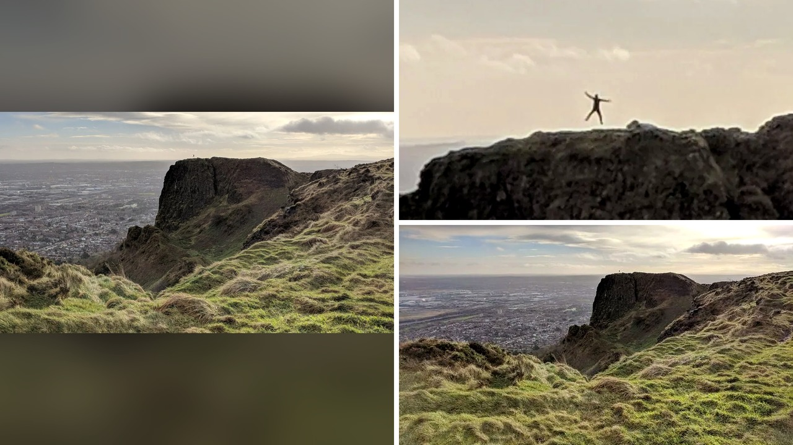

# صورة في جبال إيرلندا تثير الذهول بسبب مفاجأة في خلفيتها

تخيّل أن تلتقط صورة عفوية لمنظر طبيعي خلال رحلة جبلية، ثم تكتشف بعد أيام أنك سجلت بالصدفة المحضة لقطة لا تتكرر إلا مرة واحدة! هذا ما حدث تمامًا مع غافين بيست، البالغ من العمر 43 عامًا، عندما قرر الخروج مع أصدقائه في نزهة ممتعة. كان غافين يقضي عشية رأس السنة فوق تلة كافهيل الصخرية في بيلفاست بشمال إيرلندا، وهي مرتفع طبيعي يبلغ ارتفاعه نحو 368 مترًا، أي ما يعادل 1207 أقدام. أخرج كاميرته والتقط مشهدًا عاديًا للقمة والمنحدرات الجبلية البعيدة، ثم واصل رحلته دون أن يتوقع أي مفاجأة.

## قفزة في الهواء بين الصخور
الممتع في القصة أن غافين لم يلاحظ أي شيء غير عادي وقت التقاط الصورة، ولا حتى في الأيام الأولى التالية للرحلة. لكن عندما جلس لاحقًا لتفقد الصور وقرر تقريب إحدى اللقطات وتكبيرها، صُدم بما ظهر أمامه! يا جماعة، على بروز صخري بعيد جدًا، ظهر خيال واضح لشخص يبدو وكأنه يطير في الهواء في تلك اللحظة بالذات. كان الشخص يتخذ وضعية قفزة النجمة بكامل جسمه، سابحًا في الفضاء دون أن تمس قدمه الأرض.

نشر غافين الصورة على منصة تويتر عام 2018 معلقًا على التوقيت العجيب الذي جمع بين قفزة الغريب وزاوية الكاميرا. وسرعان ما حظيت الصورة بتفاعل هائل من المتابعين الذين وصفوها بأنها لقطة من مليون. ولكن، شو كان رد فعل الناس حين ركزوا في تفاصيل المشهد؟ سرعان ما تحول الذهول إلى موجة قلق وتساؤلات على وسائل التواصل الاجتماعي.

## قلق على سلامة الغريب
تخوّف بعض المتابعين من أن هذا الشخص الغريب البعيد ربما كان يخوض تجربة خطيرة أو يواجه قفزة مميتة من أعلى الجبل، وليس مجرد الاستعراض لالتقاط صورة تذكارية. الحين، سارع غافين إلى طمأنة الجميع، موضحًا أنه شاهد مجموعة من الأشخاص يقفون على ذلك البروز الصخري نفسه بعد بضع دقائق من التقاط الصورة، ولم يظهر على المكان أي شيء يثير الشك أو يدل على وقوع حادث.

هذه المصادفة الغريبة فتحت بابًا واسعًا للحديث عن ظاهرة اقتحام الصور، أو ما يُعرف بالقصف الضوئي. الظاهرة لا تعبر دائمًا عن مزاح مقصود، بل تقع في كثير من الأحيان بعفوية تامة. وبسبب انتشار هالسالفة وايد في الثقافة الرقمية، أدرج معجم كولينز الإنجليزي هذه الكلمة لتكون كلمة العام في سنة 2014. هل سبق وأن اكتشفت شخصًا غريبًا يقتحم خلفية إحدى صورك المفضلة؟

## تاريخ قديم ومواقف طريفة
الصراحة، إن ظاهرة اقتحام الصور ليست مجرد تقليعة حديثة وليدة عصر الهواتف الذكية. تعود واحدة من أقدم اللقطات المسجلة لهذا التصرف إلى عام 1853، من خلال صورة التقطتها المصورة الويلزية ماري ديلوين بعنوان "سالي ومصنوعات السيدة ريد". في تلك الصورة التاريخية، ظهر وجه رجل يبتسم في الخلفية بوضوح. ونظرًا لأن بطء الكاميرات قديمًا كان يستلزم وقت تعرض أطول، فإن تطفل ذلك الرجل كان يتطلب منه الوقوف بثبات لفترة كاملة ليظهر في الصورة!

ويرى المصورون أن تطفل الآخرين على الكادر قد يضيف عنصرًا فكاهيًا ممتعًا، تمامًا مثل القصة الشهيرة لسمكة الراي التي قفزت فجأة على ظهور ثلاث سيدات أثناء التقاط صورة في الماء وتركتهن في حالة رعب طريفة. ولكن مش معقول أن يُمارس هذا المزاح في مناسبات رسمية كحفلات الزفاف أو بحركات غير لائقة قد تفسد الذكرى.

رأيي الشخصي أن الصدف الطبيعية تمنح الصور روحًا أجمل بكثير من الصور المرتبة، وصورة غافين ظلت تحفة عفوية خلدت قفزة مرح لغريب لا يعلم ربما حتى اليوم أنه صار حديث العالم. لو كنت مكان ذلك الشخص واكتشفت أنك صاحب هذه القفزة الشهيرة، هل ستعلن هويتك للجميع أم ستفضل بقاء القصة غامضة؟
