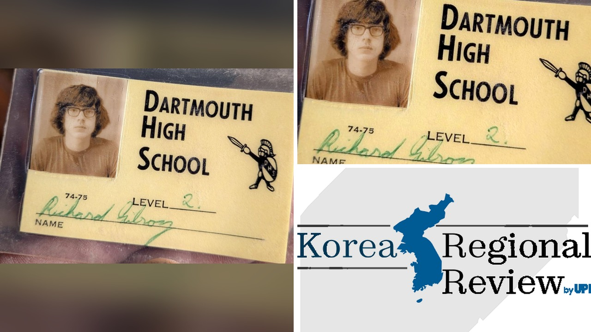

# محفظة ضاعت 51 عاماً تُعثر عليها في تجديد منزل بنوفا سكوشيا

تخيلوا أنكم تحفرون تحت أرضية منزل قديم وتصدّون شيئًا يعود لأكثر من نصف قرن. هذا ما حدث لمتّى جولدسميث، نجّار من دارتفورد، عندما كان يشتغل على تجديد منزل على شارع فيكتوريا في دارتفورد، نوفا سكوشيا. لقيتُ نفسي أرفع لوحًا خشبيًا وفجأةً وجدت محفظة مغطاة بالغبار، وكأنها توقفت عن الزمن.

## اكتشاف غير متوقع
المحفظة كانت بسيطة، لكنها حملت هوية صاحبها من خمسين عامًا مضى. داخلها رخصة قيادة، بطاقة طالب من مدرسة دارتفورد الثانوية، وشهادة ميلاد مكتوبة بخط اليد، بالإضافة إلى دولار واحد وتذكرة مسرحية لهامليت عام 1975. الصراحة، ما فاجأني أكثر كان وجود تذكرة مسرحية قديمة؛ هل سمعتم من قبل عن شخص يحتفظ بتذكرة عرض قديم لسنوات؟

## رحلة البحث عبر السوشيال ميديا
بعد ما شاركت الصورة على حسابي، انتشرت القصة بسرعة. أحد المتابعين، دونا غيلروي، تعرفت على محتويات المحفظة وربطتها بزوجها، ريتشارد غيلروي، اللي فقدها قبل 51 سنة. وش رايكم، هل وسائل التواصل هي أقوى وسيلة لإعادة الأشياء الضائعة أم أن الطرق التقليدية ما زالت تنفع؟ هذه القصة ذكّرتني بموضوع ، حيث كان للذكريات دور كبير في حياة الناس.

## اللحظة التي عادت فيها الذكريات
بعد ثلاثة أيام فقط، تم تسليم المحفظة إلى ريتشارد، اللي الآن عمره 68 سنة. قال إن فقدان المحفظة كان من أحد الأيام التي كان فيها يعمل في ذلك المنزل، لكن ما فاجأه هو تذكّر سعر تذكرة الهاملي: 1.50 دولار. مش معقول إن سعر التذكرة كان هكذا! لحظة اللقاء كانت مليانة مشاعر مختلطة؛ فرح، حنين، وربما حسرة على ما فات.

رأيي الشخصي أن هذه القصة تُظهر كيف أن الأشياء الصغيرة، حتى محفظة مهملة، يمكن أن تُعيد لنا شريحة من الماضي وتربطنا بأشخاص ننسى وجودهم. هل تعتقدون أن نشر القصة على السوشيال ميديا هو أفضل طريقة لإعادة الأشياء الضائعة أم أن الطرق التقليدية ما زالت فعّالة؟
