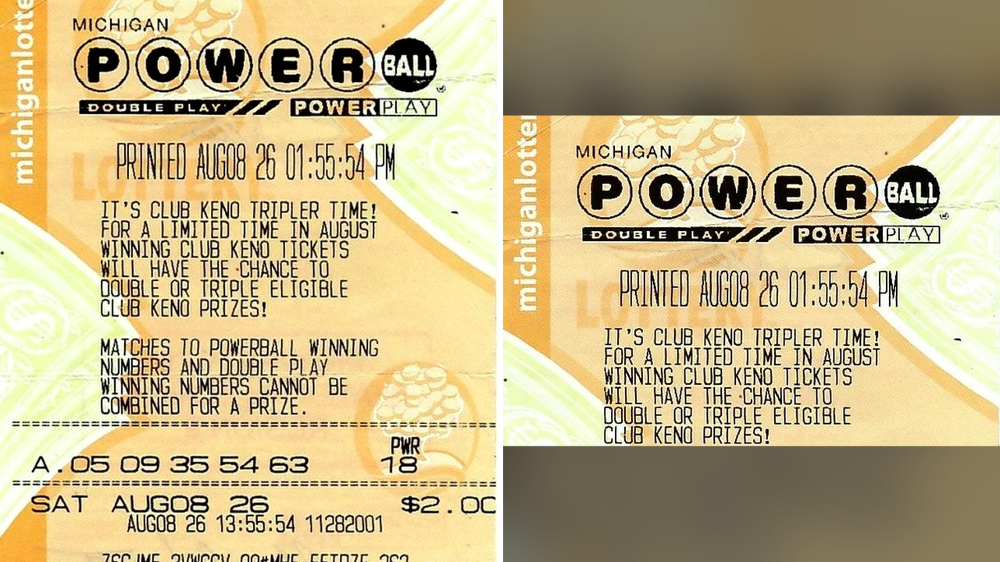

# تذكرة يانصيب بمليون دولار بقيت نسياً في محفظة صاحبها

تخيّل أن تجلس في سيارتك ومعك مليون دولار كاملة دون أن تدري! هذا بالضبط ما حدث مع رجل احتفظ بتذكرة رابحة داخل محفظته شهرين كاملين، محتفظًا بثروة تغير حياته وهو يظنها مجرد ورقة عادية.

الموضوع بدأ عندما اشترى مايكل فاندر لوغت، البالغ من العمر 54 عامًا من مدينة وايكومينغ بولاية ميشيغان، تذكرة يانصيب لسحب الثامن من أغسطس من متجر بيغ توب ماركت. وضع التذكرة في محفظته مع بقية التذاكر، ثم نسيها تمامًا.

## زجاجة صودا تكشف السر

تمر الأيام والأسابيع، والتذكرة مستقرة في محفظته. الصراحة، من منا لا يحتفظ بأوراق قديمة وينساها؟ لكن ما حدث بعد ذلك كان محض صدفة مذهلة.

توقف مايكل عند أحد المتاجر لشراء مشروب غازي. وعند الدفع، اكتشف أن النقدية التي بحوزته لا تكفي. بدلًا من استخدام بطاقته المصرفية، قرر إعطاء البائعة بضع تذاكر قديمة كان يعلم أنها حققت أرباحًا بسيطة للغاية لتغطية الثمن.

هنا ظهرت المفاجأة. قامت البائعة بمسح التذاكر ضوئيًا، لتظهر رسالة غير متوقعة على الشاشة تطالبه بزيارة مكتب اليانصيب لتقديم طلب استلام الجائزة.

## لحظة الجنون داخل السيارة

يا جماعة، هل تتخيلون الشعور في تلك اللحظة؟ خرج مايكل سريعًا إلى سيارته ليفحص الأرقام الفائزة بنفسه.

عندما تطابقت الأرقام الخمسة البيضاء وهي 05 و09 و35 و54 و63، أدرك أنه فاز بمبلغ مليون دولار كاملة! أصابته حالة من الذهول والذهول الشديد وهو يجلس في مقعده، محاولًا استيعاب أن ورقة نسأها في جيبه كانت تزن ذهبًا.

كيف ستتصرف لو اكتشفت فجأة أنك تحمل ثروة ضخمة في جيبك طوال شهرين دون أن تدري؟ هالسالفة تجعل أي شخص يعيد فحص كل الأوراق المهملة في محفظته الآن!

شو كان ليحدث لو لم يقرر شراء ذلك المشروب في ذلك اليوم بالتحديد؟ أحياناً المصادفات البسيطة تغير مسار الحياة بالكامل.

## خطط لمستقبل آمن

صرح مايكل للمسؤولين أنه يخطط لاستغلال هذا المبلغ بشكل عملي وحكيم. ينوي سداد الرهن العقاري الخاص بمنزله أولًا، ثم استثمار ما يتبقى من أموال لضمان مستقبله.

الحين، بعد هذه التجربة الشائقة، من الصعب ألا نفكر في أشيائنا المهملة.

رأيي الشخصي أن الحياة تخبئ لنا مفاجآت مذهلة في أبسط الأماكن، والتصرف بحكمة عند نيل الثروة هو النجاح الحقيقي. هل تفضل إنفاق مبلغ مفاجئ كهذا في السفر والرفاهية فورًا، أم تسديد الديون والاستثمار أولًا؟
