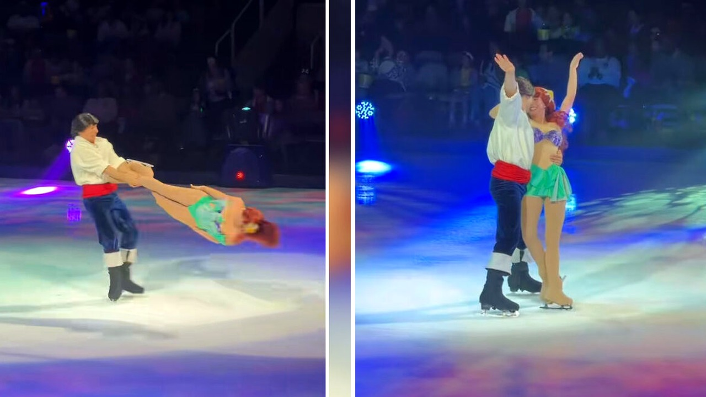

# سقطة مرعبة لشخصيتي ديزني على الجليد بسبب حركة محظورة

الموسيقى تعزف والأضواء تسلط على الرقعة البيضاء الناصعة. الجمهور يتابع بشغف شخصيتي أرييل والأمير إريك وهما يتحركان بسلاسة فوق الجليد. فجأة، تتغير النبرة تمامًا.

في ثوانٍ معدودة، انقلب العرض الساحر إلى لحظة رعب حقيقية أمام أعين الحاضرين. ارتفع صراخ الجمهور وزادت ضربات القلوب في القاعة بعد تعثر مفاجئ.

## مشهد تحول إلى لحظة ذعر

وقع هذا الحادث الدرامي في مركز إس أي بي بمدينة سان خوسيه في ولاية كاليفورنيا، يوم الأحد الموافق الخامس والعشرين من أكتوبر. كان كل شيء يسير وفق الخطة المرسومة في عرض ديزني على الجليد، حتى قرر الثنائي المتزلج تنفيذ حركة استعراضية عالية الخطورة.

في تلك اللحظة، أمسك المتزلج بقدم شريكته التي تؤدي دور أرييل، وبدأ بتدويرها في الهواء بدوائر متتالية وسريعة. كان رأس المتزلجة يقترب بشكل مخيف من سطح الجليد الصلب مع كل دورة. وفجأة، اهتزت قدم الشاب وفقد ثباته.

فقد المتزلج توازنه وانفلتت قبضة يده عن قدم شريكته. ارتطم الاثنان بقوة على الأرضية الجليدية. يا جماعة، كان الارتطام قويًا لدرجة جعلت المتابعين يمسكون أنفاسهم، بينما شوهدت المتزلجة تمسك رأسها بيديها فور محاولتها النهوض من شدة الصدمة.

## مجازفة كادت تنهي كل شيء

هل تتخيلون مدى الخطورة التي تنطوي عليها هذه الحركة تحديدًا في عالم التزلج؟ هذه الخدعة الاستعراضية تُعرف باسم ضربة الرأس، وتسمى أحيانًا الدوران الارتدادي، وهي الحركة نفسها التي اشتهرت باسم لوتس الحديد في الفيلم الكوميدي شفرات المجد الذي صدر عام ألفين وسبعة.

تعتمد هذه الحركة كليًا على قوة قبضة المتزلج وتوازنه الدقيق للغاية. أي انزلاق بسيط أو فقدان طفيف للتركيز قد يؤدي إلى نتيجة كارثية، لأن رأس المؤدية المدارة يدور على بعد سنتيمترات قليلة فقط من سطح الجليد القاسي.

لحسن الحظ، لم يستمر بقاء الثنائي على الأرض الجليدية طويلًا. استجمع المتزلجان قواهما ونهضا سريعًا على أقدامهما، ثم غادرا الحلبة متوجهين نحو الكواليس، مع توجيه تحية سريعة للجمهور عبر التلويح بأيديهم لطمأنة الحاضرين في القاعة.

## بين المنع في البطولات والاستمرار في العروض

وانتشر مقطع الفيديو الذي وثق لحظة السقوط بسرعة هائلة على منصة تيك توك، محققًا ما يقارب تسعة ملايين مشاهدة خلال فترة قصيرة. وانهالت تعليقات القلق من المتابعين؛ حيث كتب أحدهم أن المشهد كان يبدو سيئًا للغاية، وأشار آخر إلى أنها كانت قد تفقد حياتها في تلك اللحظة، بينما علق متابع ثالث بأن رأسها كاد يرتطم بالجليد مباشرة.

وهنا يطرح السؤال نفسه بين الجمهور: لماذا تُدرج هذه الحركة الخطيرة في فقرات العرض من الأساس؟ بصراحة، هذه الحركة محظورة تمامًا في مسابقات التزلج الفني الرسمية بسبب خطورتها الشديدة على سلامة الرياضيين. لكن القوانين لا تمنع أدائها في العروض الاستعراضية والتلفزيونية مثل ديزني على الجليد أو برنامج الرقص على الجليد.

وقد أوضحت متزلجة سابقة شاركت في برنامج الرقص على الجليد، ميتشيل هيتون، في تصريحات صحفية تعود لعام ألفين وثلاثة وعشرين، أن تنفيذ هذه الحركة يخضع لمعايير صارمة تتعلق بالطول والسلامة. وأكدت أن طول القامة يلعب دورًا حاسمًا، فلو كانت أطول ببضعة سنتيمترات لما فُكر في إسناد الحركة إليها إطلاقًا لحمايتها.

## موقف الشركة وتساؤلات المتابعين

أحد المتابعين على وسائل التواصل الاجتماعي أشار إلى أن هذه الحركة يؤديها العديد من متزلجي العروض أسبوعًا بعد أسبوع، وأن الأخطاء قد تحدث أحيانًا للأسف في هذا المجال، متوقعًا أن تكون المتزلجة قد عانت من ارتجاج شديد بعد ضربة بهذا الثقل، وطالب الجميع بضرورة إبداء الاحترام والتقدير للمؤدين.

لكن الشركة المنتجة للعرض، فيلد إنترتينمنت، حسمت الجدل وحجم المخاوف في تصريح رسمي وجهته للصحافة. وأعربت الشركة عن تقديرها الكبير لاهتمام الجمهور وقلقه على المتزلجَين اللذين سقطا أثناء تقديم عرض سان خوسيه.

وأكدت الشركة المنتجة أن كلا المتزلجَين نجوا تمامًا دون التعرض لأي إصابات، وأنهما واصلا المشاركة في تقديم جدول العروض المقررة لهما بشكل طبيعي بعد الواقعة مباشرة.

رأيي الشخصي أن الإصرار على إقحام حركات استعراضية خطيرة ومحظورة رياضيًا في عروض ترفيهية موجهة للأطفال والعائلات يضع سلامة المؤدين في مخاطرة غير مبررة مهما بلغت درجة احترافهم.

فهل ترون أن استمرار تقديم هذه الخدع الخطيرة في العروض العائلية أمر مبرر للترفيه، أم تتفقون مع ضرورة حظرها نهائيًا لحماية أمان المتزلجين؟
