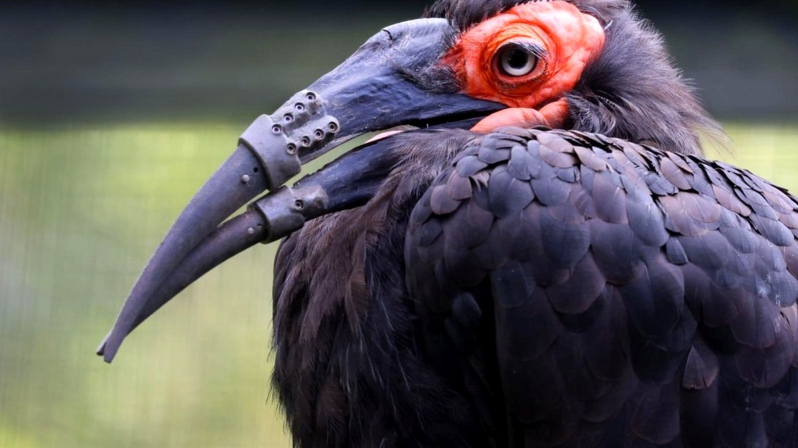

# أول منقار مطبوع بتقنية ثلاثية الأبعاد ينقذ طائرا نادرا

كسر مزدوج في الفك والأنف يعني الموت البطيء إذا كنت طائرًا يعتمد كليًا على التقاط قوته من التراب. هذا بالضبط ما حل بطائر أبو قرن الأرضي الجنوبي داخل حديقة حيوان آرتيس في العاصمة الهولندية أمستردام.

تخيلوا كائنًا لا يملك يدين، وفجأة تحطم الجزء العلوي والسفلي من منقاره معًا. الموقف لم يكن تشوهًا عابرًا، بل عجزًا كاملًا عن التقاط الغذاء الصعب أو تنظيف الريش.

## لحظة الخطر الحقيقي

حسب ما ورد في التقرير، فقدان المنقار يعني فقدان شريان الحياة للطائر. الكائن لم يعد قادرًا على إطعام نفسه، والوقت بدأ ينفد أمامه، فكيف يمكن إنقاذ كائن ضعيف تحطم أهم عضو في جسده؟ 

قرر الفريق الطبي ألا يستسلم لخيار إنهاء حياته. تشكل تحالف علمي عاجل يضم حديقة الحيوان مع كلية الطب البيطري في جامعة أوتريخت، والمركز الطبي الجامعي، وشركة أمنوفيس المتخصصة. الهدف واحد: تصميم طرف اصطناعي غير مسبوق للمنقارين العلوي والسفلي.

## ابتكار يكسر المألوف

هذا الموقف الصعب ذكّرني بما حكيته لكم سابقًا عن تجارب غير متوقعة لإنقاذ الحيوانات من مصير حتمي.

**اقرأ أيضًا:** [ثعلب مصاب ينجو من القتل الرحيم بفضل دروس السباحة](https://atar12345a.blogspot.com/2026/10/blog-post_159.html)

السجلات العلمية السابقة لم تسجل سوى تركيب طرف علوي أو سفلي فقط لبعض الطيور. هنا كانت الصعوبة مضاعفة؛ تصنيع فك كامل بتقنية الطباعة ثلاثية الأبعاد. الصراحة، هل كنت تتوقع أن التكنولوجيا قادرة على محاكاة عظام الطيور بهذه الدقة؟

## عودة أسرع من المتوقع

أُجريت العملية الجراحية المعقدة بنجاح، ليصبح هذا الطائر الأول عالميًا الذي يحصل على طقم منقار كامل بديل. المفاجأة الكبرى التي نقلها مسؤولو الحديقة حدثت بعد الإفاقة مباشرة؛ إذ لم يحتج الطائر أيامًا للتدريب، بل شوهد في يوم الجراحة نفسه وهو يستخدم منقاره الجديد بالطريقة الطبيعية لفصيلته.

رأيي الشخصي أن تسخير التقنيات الحديثة لحماية كائن أعزل يعكس أرقى صور الإنسانية والمسؤولية العلمية. لو كنت مكان الأطباء، هل كنت ستخاطر بهذه الجراحة المعقدة أم ستختار الطرق التقليدية؟
