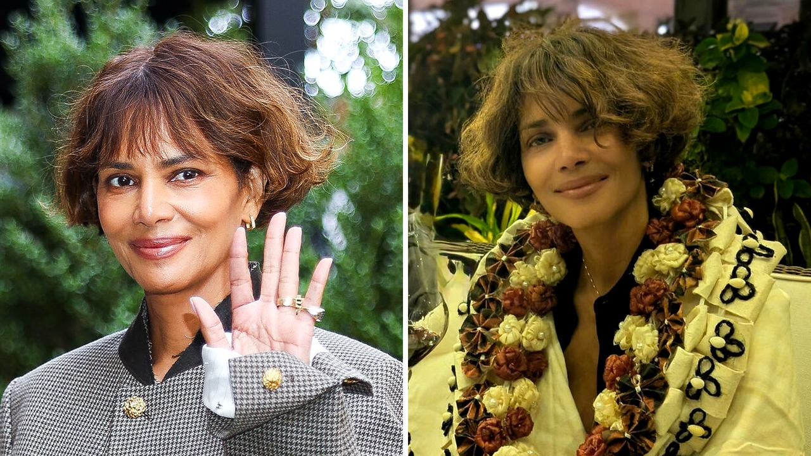

# معركة حراسة هالي بيري لابنها: تفاصيل الخلاف مع أوليفير مارتينيز

## ما وراء طلب الحماية الجديد؟

صراحة، عندما قرأت أن أوليفير مارتينيز قدم أمرًا جديدًا للمنع ضد هالي بيري، توقفت لحظةً لأتساءل: ما الذي يدفع أحدهما إلى اتخاذ مثل هذه الخطوة المتطرفة؟ حسب ما نُشر، المدعى عليه يزعم أن هالي هاجمت ابنها ماستيو في 26 سبتمبر، حتى أنها حاولت خنقه. القصة تتصاعد بسرعة، خاصةً بعد أن ظهر هالي مع ماستيو في أحد المنتزهات العامة خلال عطلة نهاية الأسبوع، وكأنها تقول للمتابعين: "أنا هنا، ولن يمنعني شيء". وش رايكم، هل هذا الظهور العلني مجرد محاولة لاستعادة الصورة العامة أم خطوة قانونية؟

## المدفوعات والمسؤوليات المالية

هنا يأتي جانب آخر من القصة لا يقل أهمية. الاتفاق السابق بين هالي وأوليفير من عام 2023 كان يفرض على هالي دفع 8,000 دولار شهريًا كنفقة أطفال، بالإضافة إلى 4.3٪ من أي دخل يتجاوز مليوني دولار. الصراحة، هذه الأرقام تجعلنا نتساءل عن مدى تعقيد الاتفاقيات المالية في القضايا العائلية. هالي، التي تتحمل تكاليف مدرسة ماستيو الخاصة والزي المدرسي والأنشطة اللامنهجية، تطالب بإعادة تطبيق اتفاق الحضانة 50/50 وإعادة صلاحيتها في اتخاذ القرارات الحاسمة. في الوقت نفسه، تدعي أن أوليفير يحاول إقحام ماستيو في صراعه الشخصي، ما يفاقم سلوك الابن "الغاضب والمتمرد" بعد عودته من زيارة والده.

## ما يقوله ميسو عن سلوك ابنه

هنا أجد نفسي أستوقف نفسي: "تخيّلوا أن طفلًا في الثانية عشرة من عمره يصبح وسيلة في معركة بين والديه". هالي تصف أن ماستيو يحتاج إلى وقت 2-3 أيام ليعود إلى جو المنزل، وأن دورة الصراع تبدأ من جديد عندما يعود إلى أوليفير. هي تقول إن ابنها يكرر المناقشات التي تجري بينهما في الخفاء، ويتخذ موقف والده دون أن تستمع إلى رأيها. هل هذا يعكس تأثير بيئة الانقسام على نفسية الطفل؟ أو ربما تكون هذه مجرد محاولات قانونية لتقوية الموقف أمام القاضي؟

## رأيي الشخصي في الخلاف

من وجهة نظري، القصة تبدو أكثر تعقيدًا من مجرد ادعاءات عن عنف أو خنق. أرى أن هالي تسعى لإعادة توازن الحضانة لتضمن استقرار ماستيو، بينما أوليفير يبدو أنه يستخدم الأدلة المتناولة لتقويض مكانتها. المهم الآن هو ما سيقرره القاضي: هل سيعيد الصلاحيات إلى هالي ويعيد تطبيق الحضانة المشتركة، أم سيمنح أوليفير الحضانة الوحيدة بناءً على الاتهامات؟

ما رأيكم في هذا النزاع العائلي؟ هل تعتقدون أن النظام القضائي سيعطي الأولوية لمصلحة الطفل أم سيقع في فخ الصراعات الشخصية؟ أخبروني بأفكاركم، لأن القصة ما زالت تتكشف، وربما تكون هناك تفاصيل جديدة في الأيام القادمة. 

## الخاتمة

رأيي الشخصي أن النزاع لا يزال في مراحله الأولى، وأن أي قرار قضائي سيحمل أثراً كبيراً على مستقبل ماستيو. الصراحة، أمل أن يتمكن الطرفان من وضع خلافاتهما جانبًا من أجل مصلحة الطفل، لأن الأطفال لا يستحقون أن يكونوا سلاحًا في معارك الكبار. ما هو موقفكم؟ هل تفضلون حلًا وسطيًا أم أنكم تميلون إلى اتخاذ موقف حازم من أحد الطرفين؟
