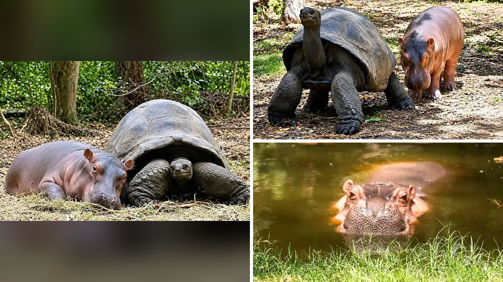

# قصة نجاة فرس النهر أوين وصداقته مع السلحفاة مزي

أمواج المحيط الهندي كانت تضرب الساحل الكيني بعنف غير مسبوق في أواخر عام 2004. وسط المياه الهائجة، جرفت السيول عائلة كاملة من أفراس النهر من نهر ساباكي نحو البحر المفتوح.

اختفت العائلة وسط التيارات العاتية، ولم يبقَ سوى صغير وحيد يصارع الموت على حيد مرجاني قبالة الشاطئ. كان عاجزاً عن العودة إلى اليابسة، بينما المياه المالحة تهدد حياته بجفاف قاتل مع كل ساعة تمضي.

## حصار على الحيد المرجاني

الوضع بالقرب من بلدة ماليندي كان يزداد خطورة دقيقة بعد دقيقة. مياه الأمطار الغزيرة ألقت بالصغير في البحر، ثم جاء تسونامي السادس والعشرين من ديسمبر ليحاصره فوق الشعاب المرجانية. تخيل مئات السكان يقفون على الشاطئ يراقبون هذا المشهد القاسي، محاولين المساعدة بكل الوسائل المتاحة من قوارب وشباك وسيارات.

الصغير، ورغم إرهاقه الشديد، كان سريع الحركة وجلده زلق يصعب الإمساك به. الموقف حُسم بتدخل شجاع من متطوع يُدعى أوين سوبيين، الذي اندفع وثبّته بحركة تشبه تدخلات الرجبي القوية. وسط هتافات الحشود التي دوّت لمسافة تزيد على كيلومتر كامل، تقرر إطلاق اسم «أوين» على الصغير تكريماً لمن خاطر لإنقاذه.

## لقاء غير متوقع في المحمية

تحركت الدكتورة باولا كاهومبو، المسؤولة البيئية في محمية هالر بارك بمدينة مومباسا، لنقل الصغير فور وصول البلاغ. هذه المحمية التي أُعيد إحياؤها بعد أن كانت مجرد مقلع مهجور، كانت شاهدة على تصرف غير مسبوق من فرس النهر الصغير لحظة إطلاق سراحه.

بمجرد أن لامست قدماه الأرض، لم يتجه نحو بركة الماء أو الشجيرات، بل ركض مباشرة نحو سلحفاة عملاقة تبلغ من العمر مئة وثلاثين عاماً تُدعى «مزي»، وهي كلمة تعني بالسواحيلية «الرجل العجوز». انكمش أوين خلفها تماماً كما يفعل أي صغير يبحث عن حماية أمه. المشهد كان محيراً للجميع؛ فالحيوان العجوز عاش عقوداً في المحمية متجاهلاً كل الكائنات التي تدور في فلكه.

## عندما تنكسر العزلة

في اللحظات الأولى، واجه مزي هذا الضيف بفحيح حاد لتحذيره وإبعاده عن مجاله. تراجع أوين قليلاً، لكنه لم يبتعد. خلال أيام معدودة، يا جماعة، حدث ما لم يتوقعه الحراس أبداً؛ إذ استسلم السلحفاة العجوز لهذا الإصرار، وتحول الكائن المنعزل إلى رفيق مخلص يتبادل معه التحركات طوال اليوم.

أوين صار يلعق وجه رفيقه ويحميه بحدة إذا اقترب منه أحد، حتى طور الطرفان أصواتاً ونغمات خاصة للتواصل بينهما لفتت انتباه المراقبين. هذا المشهد في البحث عن الأمان ذكّرني بما حكيته لكم سابقاً عن قوة المشاعر الفطرية التي تكسر حواجز الفصائل لرعاية الصغار الضعفاء.

**اقرأ أيضًا:** [قطة تفقد صغارها وتحتضن سنجابين يتيمين في مشهد مؤثر](https://atar12345a.blogspot.com/2026/10/blog-post_16.html)

هل كان الشكل الدائري لقوقعة السلحفاة ولونها البني هو ما خدع أوين ليعتقد أنها أمه؟ المراقبون يرجحون هذا الاحتمال، لكن الارتباط بينهما تجاوز مجرد التباس بصري عابر.

## الفراق الإجباري وبداية جديدة

الزمن لم يقف في صالح هذه العلاقة الفريدة. أوين الصغير واصل النمو سريعاً حتى أصبح حجمه ضعف حجم صديقه العجوز، وبدأ مسؤولو المحمية يخشون أن يؤدي ثقله الهائل إلى إيذاء السلحفاة دون قصد.

في مارس من عام 2007، اتُّخذ القرار الحاسم بفصل الصديقين. أُعيد مزي إلى مساحته الأصلية ليستعيد هدوءه القديم، بينما تعرّف أوين على «كليو»، وهي أنثى فرس نهر تبلغ ثلاثة عشر عاماً عاشت وحيدة لأكثر من عقد. بصراحة، كانت خطوة مدروسة، إذ اندمج معها سريعاً وبدأ يعيش طبيعته الحقيقية بين بني جنسه، بعد أن أدّى السلحفاة العجوز دوره كاملاً في حمايته خلال أصعب مراحل حياته.

## درس من قلب الطبيعة

رأيي الشخصي أن هذه القصة لا تدور فقط حول صدفة بيئية، بل تكشف عن عمق الاحتياج الفطري للأمان عند الكائنات في لحظات الصدمة، وهو احتياج يوازي الرغبة في الطعام والماء. ما استوقفني حقاً لم يكن مجرد تصرف الصغير التائه، بل رد فعل السلحفاة المعمر الذي تجاوز قرناً من الزمان في عزلة تامة وغير مبالٍ بقرود المحمية وظبائها، لكنه أمام خوف هذا الصغير قرر أن يغيّر نمط حياته ويتقبل وجوده.

أعجبني هذا الاستعداد الفطري لتقديم المأوى من كائن بطيء وغير اجتماعي، بينما شعرت ببعض الحزن حيال قرار الفصل الإجباري لاحقاً، وإن كنت أتفهم تماماً مبررات الحراس وخوفهم المنطقي من فارق الوزن والقوة بين الصديقين. الزاوية التي تستحق التأمل هنا هي أن الإنقاذ النفسي قد يأتي أحياناً من أبعد نقطة نتوقعها، ومن كائن لا يشبهنا إطلاقاً.

لو كنت مسؤولاً في المحمية حين كبر فرس النهر، هل كنت ستفصل الصديقين حفاظاً على سلامة السلحفاة أم تتركهما معاً طالما استمر التناغم بينهما؟

**مصدر الخبر:** boredpanda.com. وإن أحببت العودة إلى الخبر الأصلي بنصه الكامل فتجده [هنا](https://2.boredpanda.com/hippo-tortoise-owen-mzee-friendship-tsunami-kenya/).
