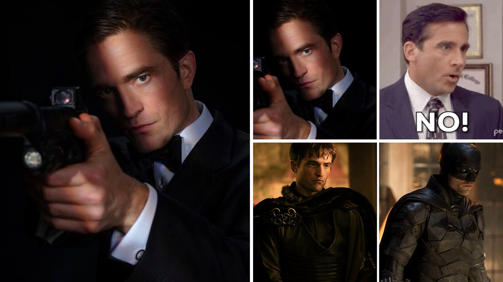

# روبرت باتينسون يصبح رسمياً جيمس بوند الجديد ويثير الجدل

من كان يصدق أن الفتى الذي عرفناه جميعًا في أفلام الشباب والتقاء مصاصي الدماء سيمسك يومًا برخصة القتل؟ اختيار روبرت باتينسون ليكون جيمس بوند الجديد أحدث زلزالًا حقيقيًا على الإنترنت، واشتعلت منصات التواصل بالكوميكس والتعليقات المتباينة فور إعلان الخبر رسميًا.

## رحلة طويلة نحو الاختيار الحاسم

بعد أشهر من البحث والتكتم، أعلنت استوديوهات أمازون إم جي إم اختيار الممثل البالغ من العمر أربعين عامًا لارتداء عباءة 007، ليصبح أول إعادة تجسيد للشخصية منذ واحد وعشرين عامًا. يا جماعة، التغيير جاء بعد رحيل دانييل كريج الذي قدم خمسة أفلام واختتم مسيرته عام ألفين وواحد وعشرين. وخلال العقدين الماضيين، ترددت أسماء بارزة لخلافته، مثل توم هاردي، وهينري كافيل، وإدريس إيلبا، وأرون تايلور جونسون.

ولكن بعد استحواذ أمازون على حقوق السلسلة من عائلة بروكولي عام ألفين وخمسة وعشرين، وتعيين المخرج دينيس فيلنوف، تغيرت قواعد اللعبة بالكامل. هل كنت تتخيل أن فتى تويلايت سيصبح عميل سرّي يرتدي التاكسيدو الشهير؟ هالسالفة بدأت تأخذ منحنى جادًا عندما بدأت الاختبارات في منتصف عام ألفين وستة وعشرين للممثلين في الثلاثينيات والأربعينيات من عمرهم.

## كواليس التجارب وردود أفعال النجوم

تضمنت القائمة المصغرة للتجارب أسماء مثل كالوم تيرنر، وجاك لودين، وجوش أوكونور، ونيكولاس هولت، إلى جانب باتينسون. وأخضع القائمون على العمل المتأهلين للنهائيات لاختبارات صارمة في الأداء الحركي، والحضور أمام الكاميرا، وإلقاء الحوار في أواخر أكتوبر، حتى وقع الاختيار عليه. المنتجون إيمي باسكال ودافييد هيمان أكدوا في بيان مشترك أن جرأة باتينسون وسخريته الذاتية وقدرته على تجديد نفسه تجعله بوند المثالي لزماننا. أما باتينسون فعبّر عن امتنانه الكبير للمخرج والمنتجين، مشيرًا إلى أن الدور حلم يتحقق.

هذا الجدل المثار حول إعادة تقديم الشخصيات الكلاسيكية وااختيار الممثلين يذكرنا بطبيعة التفاعل الجماهيري والمفاجآت التي يفجرها نجوم هوليوود في المحافل، كالمواقف التي تناولناها سابقًا عن إثارة النجوم للجدل في مهرجانات السينما.

**اقرأ أيضًا:** [حذاء ألكسندر سكارسجارد الشفاف يثير الجدل في لندن](https://atar12345a.blogspot.com/2026/10/blog-post_288.html)

استوقفتني أيضًا تصريحات سابقة؛ ففي عام ألفين وعشرة، أثناء ترويجه لفيلم يجمعه ببيرس بروسنان، قال باتينسون إن تجسيد بوند حينها سيكون أمرًا سيئًا ومحرجًا، بينما أشاد به بروسنان وقتها مؤكدًا قدرته على التعامل مع الضغوط. في المقابل، عندما سُئل دانييل كريج في نوفمبر ألفين وأربعة وعشرين عمن يتمنى أن يخلفه، أجاب بلامبالاة شهيرة: لا يهمني.

## انقسام السوشيال ميديا ونسائم السخرية

بصراحة، لم يكن الجميع سعيدًا بهذا القرار فور إعلانه عبر الحساب الرسمي لجيمس بوند. بعض المتابعين انتقدوا الاختيار بشدة، واعتبر أحدهم أن السلسلة ستنتقل من أفضل بوند إلى الأسوأ، بينما رأى آخر أن باتينسون يعطي انطباعًا شخصيًا حزينًا لا يناسب العميل السري. ألم تلاحظوا كيف ينجح هذا الممثل دائمًا في إثارة الجدل مع كل دور جديد؟

على الجانب الآخر، رحب فريق عريض بالخبر، وأثنى كثيرون على استمراريته الناجحة ومشاركاته في أعمال كبرى مثل "ذا باتمان" وأفلام نولان وفيلنوف. حتى إن بعضهم مزح قائلاً إن باتينسون سيسحب الوظائف منا قبل الذكاء الاصطناعي! شو رأيكم بهذا التباين؟ حتى العائلة الملكية البريطانية رحبت بالقرار عبر بيان رسمي جاء فيه: أهلاً بك في الخدمة السرية لجلالة الملك يا مستر بوند. وايد تفاعل الجمهور مع الأمر واجتاحت الصور الساخرة المنصات.

## نظرة تحليلية على القرار المرتقب

رأيي الشخصي أن اختيار روبرت باتينسون يمثل مجازفة ذكية ومحسوبة للغاية من صناع العمل. ما استوقفني في هذا الخبر ليس فقط فوزه بالدور وسط منافسة شرسة مع أسماء ثقيلة مثل هينري كافيل وتوم هاردي، بل التطور الهائل في مسيرته الفنية منذ أن كان يجسد شخصية سيدريك ديجوري في هاري بوتر، ثم إدوارد كولين، وصولاً إلى تعاونه مع كبار المخرجين مثل كريستوفر نولان ودينيس فيلنوف.

ما أعجبني حقًا هو أن باتينسون أثبت قدرته على التلون والتخلص من عباءة الأدوار النمطية، وموقفه القديم عام ألفين وعشرة عندما وصف تجسيد بوند بالمحرج يظهر نضجه الحالي وإدراكه لحجم التحدي. الحين نحن أمام بوند مختلف قد يعيد تعريف السلسلة بعيدًا عن النمطية التقليدية. كنت أتمنى لو أن دانييل كريج قدم دعمًا معنويًا يخفف الضغط عن خلفه، لكن لا بأس. الزاوية التي يجب أن نرى من خلالها هذا الاختيار هي أن النجومية لا تتوقف عند محطة واحدة، بل تعتمد على الجرأة والتجدد المستمر.

هل تعتقد أن باتينسون سينجح في تقديم شخصية 007 بطريقة أفضل من دانييل كريج أم أنك تفضل الأسماء الكلاسيكية الأخرى؟

**مصدر الخبر:** Bored Panda. وإن أحببت العودة إلى الخبر الأصلي بنصه الكامل فتجده [هنا](https://www.boredpanda.com/robert-pattinson-james-bond-memes/).
