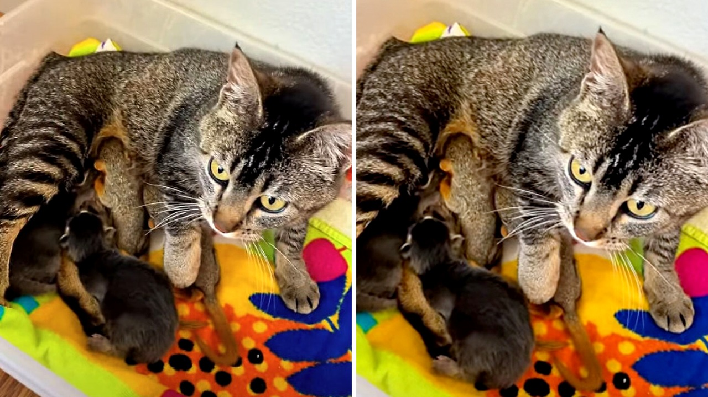

# قطة تفقد صغارها وتحتضن سنجابين يتيمين في مشهد مؤثر

مشهد غير معتاد استوقفني تماماً: أربعة أجساد دقيقة ترقد متلاصقة في دفء وأمان، يرضعون من أم واحدة، لكن التدقيق البسيط في ملامحهم يكشف أن اثنين منهم لا ينتميان إطلاقاً إلى فصيلة القطط.

القصة بدأت حين خسرت قطة اثنين من صغارها حديثي الولادة. وفي التوقيت ذاته تقريباً، وُجد في الجوار سنجابان صغيران فقدا أمهما، لتلتقي المأساتان في مساحة واحدة ملؤها الحنان.

كيف يمكن لمشاعر الفقد أن تتحول فجأة إلى ملاذ آمن لكائنات غريبة تماماً؟

## لقاء غير متوقع في العش

صاحب المقطع الذي نشر هذا المشهد وثّق تلك اللحظات بذهول واضح، وسأل متابعيه إن كانوا يلاحظون ما يراه؛ فالأم كانت ترعى طفليها البيولوجيين المتبقيين، وبجوارهما تماماً يرقد السنجابان الصغيران ويرضعان باطمئنان، وكأن وجودهما هناك هو الشيء الطبيعي الوحيد في هذا العالم.

القطة لم تتردد لحظة واحدة في قبول هذين الغريبين الصغيرين داخل عرينها. وبحسب ما ذكره موثق القصة، فإنها تؤدي دور الأم ببراعة غير متوقعة، متجاوزة غريزة الصيد أو النفور التي تحكم عادة علاقة القطط بهذه القوارض الصغيرة.

هل تخيلت يوماً أن يتقاسم سنجاب وقطة حليب الأم ذاته في هدوء تام دون أي توتر؟

## دهشة خبير وإشارات تعافٍ

موثق المقطع، وبحكم خبرته الطويلة في إعادة تأهيل الحيوانات ومساعدتها على تبني صغار من الفصيلة نفسها، أبدى انبهاره التام بما حدث. هالسالفة أظهرت له أن هرمونات الأمومة تمتلك قدرة خارقة تدفع الحيوان لاتخاذ خطوات عجيبة لا تخطر على بال أحد.

الأمر المبشر الذي ذكره التقرير، وبصراحة هو أكثر ما أثلج صدري، أن الصغار جميعاً يكتسبون وزناً وينمون بصحة ممتازة تحت رعاية تلك الأم البديلة. الحيوانات تثبت لنا دوماً أننا نستهين بقدرتها على التعاطف والشعور، وأن لدى البشر الكثير ليتعلموه من هذه السلوكيات النقية.

## صدى واسع وتجارب ملهمة

التعليقات على هذا الموقف كانت في غاية الدفء، إذ كتب أحد المعلقين أن أم السناجب في مكان أفضل ترعى صغيري القطة الراحلين، بينما رأى آخر أن غريزة الأمومة معجزة حقيقية لا تحدها حدود.

الموقف دفع أصحاب حيوانات أليفة آخرين لمشاركة حكايات قريبة من هذه الواقعة، حيث روى أحدهم كيف أنقذت قطته صغار حيوان الأبوسوم اليتيمة وأرضعتها حتى كبرت دون أي تردد. الطبيعة تكرر هذه المشاهد وكأنها تذكرنا بأن مشاعر الاحتواء أكبر من كل القيود المفترضة.

رأيي الشخصي أن هذا السلوك يكشف عن ذكاء عاطفي فطري؛ فالأم لم تنظر إلى شكل الصغير أو فصيلته، بل استجابت فقط لنداء الضعف والحاجة. أحياناً يكون العطاء وتخفيف آلام الآخرين هو الطريق الوحيد لالتئام جراحنا الداخلية.

لو خُيّرت بين إرضاع صغار الحيوانات صناعياً بأيدي البشر أو تركها لأم بديلة من فصيلة مختلفة، أي الخيارين ستفضل لضمان نجاتها؟
