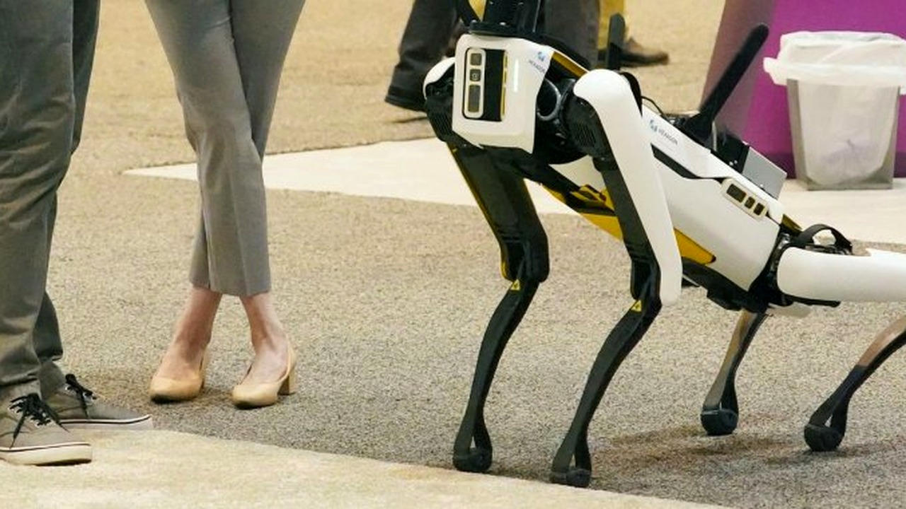

# وظيفة غير متوقعة في سان فرانسيسكو: تمشية كلاب آلية بأجر بالساعة

عشرون دولارًا في الساعة مقابل أن تأخذ كلبًا في نزهة، يبدو الأمر عرضًا عاديًا ومألوفًا في شوارع المدن، أليس كذلك؟ لكن تخيّلوا للحظة أن هذا الكائن الذي يسير بجوارك لا يمتلك فراءً ولا يهز ذيله، بل هو كتلة معدنية تزن 33 رطلًا وتتحرك بعقل إلكتروني كامل.

هذا تحديدًا ما طرحته شركة ناشئة في سان فرانسيسكو متخصصة في التكنولوجيا، تدعى «دايمنشنال»، بعدما نشرت إعلان عمل غير مألوف على فيسبوك للبحث عن أشخاص يتولون تمشية كلاب آلية في الأماكن العامة لمدة تتراوح بين أربع وست ساعات.

## شرط واحد لا يخلو من المتاعب

المهمة في ظاهرها تبدو ممتعة ومجرد نزهة يومية، لكن الإعلان وضع شرطًا محددًا أثار انتباهي؛ المتقدم يجب أن يكون قادرًا على حمل معدات ثقيلة بأمان. السبب؟ بصراحة، إذا تعطل هذا الكلب الميكانيكي فجأة في منتصف الطريق، فعلى مرافقه أن يحمله على ذراعيه ويعود به سيرًا على الأقدام إلى مقر الشركة، الذي يقع للمفارقة في حي يحمل اسم «دوغ باتش».

هل تقبل أن تقطع مسافة طويلة حاملاً جهازًا إلكترونيًا ثقيلًا على كتفك إذا توقف محركه فجأة؟ يا جماعة، الأمر هنا ليس كالتنزه مع حيوان أليف حقيقي يتعب فيجلس لتستريح معه، بل عبء تقني حقيقي.

## ذكاء اصطناعي يحتاج لخطوة بشرية

قد تتساءل الحين عن الهدف من هالسالفة كلها؛ لماذا تحتاج شركة إلى إنزال روبوتات لتمشي بين المارة؟ مؤسس الشركة، ستاش بوميشتر، أوضح أنهم يعملون على تطوير نظام تشغيل مفتوح المصدر يتيح للروبوتات القيام بمهام وأعمال بدنية شاقة.

التجارب الأولية أظهرت للمهندسين أن وكلاء الذكاء الاصطناعي ما زالوا يواجهون صعوبة شديدة وضعفًا في التحكم بالعتاد والأجهزة مقارنة بالإنسان. لذلك قرروا شراء كلاب آلية مقابل ألفي دولار للروبوت الواحد من شركة صينية اسمها «يونيتري»، وأنزلوها إلى الشوارع برفقة بشرية لجمع البيانات وتدريب النظام عمليًا وسط الزحام.

رأيي الشخصي أن هذا الإعلان يكشف بوضوح أن حلم استبدال البشر بالآلات لا يزال يواجه عقبات بدائية جدًا، فالروبوت الذي يُفترض أن يخدمنا يحتاج حتى الآن إلى من يحرسه ويحمله إذا تعثر. لو عُرضت عليك هذه المهمة، هل ستختار خوض المغامرة وتجربة التقنية أم ستتراجع خوفًا من حمل هذا المعدن الثقيل لمسافات؟
