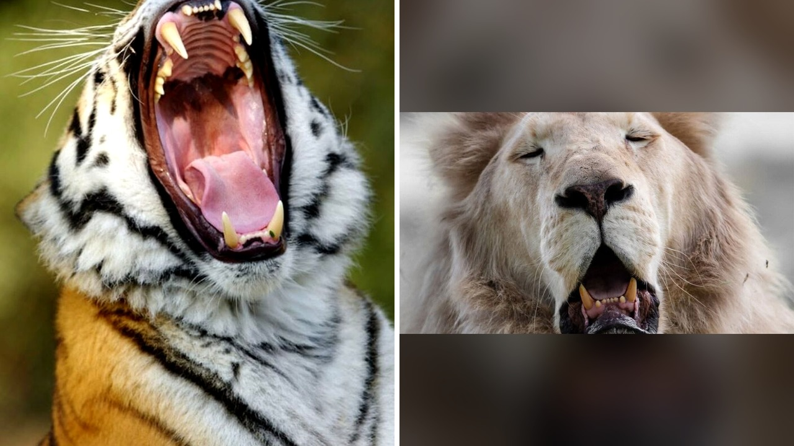

# مصور يتثاءب أمام المفترسات ويلتقط ردود أفعالها

جالس أمام مفترس مرعب يفصل بينك وبينه زجاج أو سياج، وبدل أن تثبت عدسة كاميرتك بهدوء، تبدأ بالتثاؤب أمامه بشكل متعمد! هذا ما فعله المصور جوران أناستاسوفسكي أثناء تصويره للحيوانات.

بصراحة، القصة بدأت عندما كان جوران يلتقط صورًا للحيوانات في حديقة حيوان سكوبيه على مدى سنوات. اكتشف بالصدفة حيلة غريبة جدًا: عندما يتثاءب أمام الحيوانات، يبدأ بعضها بالتثاؤب مثله تمامًا!

## خدعة التثاؤب المعدي
تثاؤب الإنسان قد يكون معديًا للبشر، لكن هل تخيلتم أنه يؤثر على المفترسات الكبيرة أيضًا؟ جوران جرب هذه الحيلة مع الأسود، والنمور، والفهود، وحتى الفهود السوداء.

المدهش أن الخدعة نجحت بشكل أذهل المصور نفسه. بمجرد أن يبدأ هو بالتثاؤب، تبدأ تلك المفترسات بفتح أفواهها على وسعها، وكأنها ترد عليه التحية بالطريقة نفسها! هل جربتم من قبل التثاؤب أمام أليفكم المنزلي لمعرفة رد فعله؟

## لقطات حقيقية لا فوتوشوب
ما فاجأني في هذه المجموعة من الصور هو تعابير وجوه المفترسات. تراها عادة بهيبة وقوة، لكن في لحظة التثاؤب تبدو ملولة أو نعسانة بطريقة مضحكة ولطيفة.

قد يظن البعض أن هذه الصور معدلة أو مقتطعة باستخدام الذكاء الاصطناعي، لكن الحقيقة أنها لقطات واقعية تمامًا وثقها المصور بعدسة كاميرته في سكوبيه. يا جماعة، المشهد يجعلك تبتسم رغماً عنك.

هذا التفاعل البسيط العجيب بين الإنسان والحيوان يذكرنا بمدى التشابه في بعض التصرفات، مثلما رأينا سابقًا في قصة القطة التي احتضنت سنجابين يتيمين وعبرت عن مشاعر دافئة وغير متوقعة.

**اقرأ أيضًا:** [قطة تفقد صغارها وتحتضن سنجابين يتيمين في مشهد مؤثر](https://atar12345a.blogspot.com/2026/10/blog-post_16.html)

## نبرة الفضول والتأثير
شو هو السر في انتقال التثاؤب بين الكائنات؟ التقرير لم يفسر السبب العلمي، لكنه يظهر كيف استغل المصور هذا السلوك ليلتقط صورًا استثنائية وبورتريهات تعبر عن نوبة نعاس مفاجئة أصابت ملك الغابة ورفاقه.

تخيلوا أن تجلسوا أمام نمر ثائر فتتثاءبون ليرد عليكم بتثاؤب أعمق! مش معقول كيف يمكن للفتة بسيطة أن تغير هيئة مفترس مخيف إلى كائن يدعو للضحك.

رأيي الشخصي أن جوران استطاع بذكائه وحسه الفني تحويل حركة عفوية نكررها يوميًا إلى أداة لكسر الجمود مع مفترسات حديقة الحيوان، ليقدم لنا لقطات أظهرت الجانب الطريف من حياتها.

لو كنت مكان هذا المصور في حديقة الحيوان، هل ستجرؤ على تجربة حيلة التثاؤب أمام النمر أم ستكتفي بالتقاط الصور التقليدية؟
