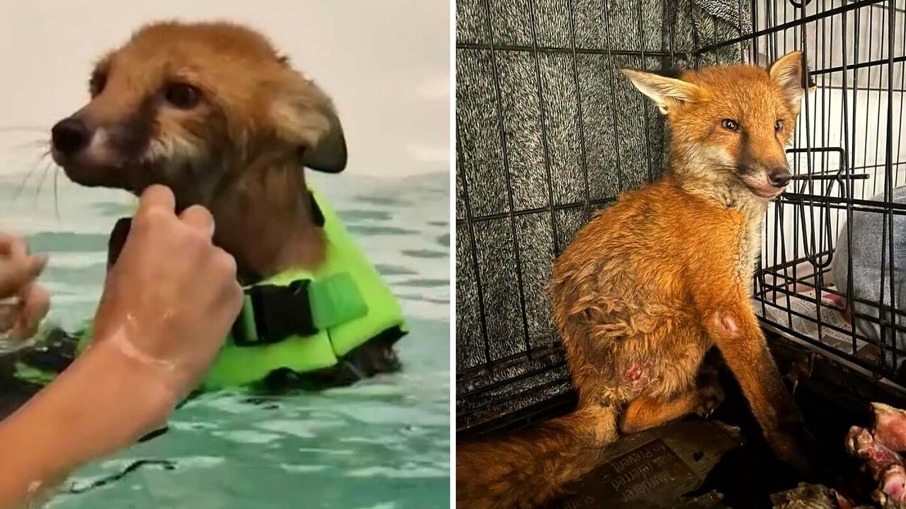

# ثعلب مصاب ينجو من القتل الرحيم بفضل دروس السباحة

في شهر يونيو، وعلى أحد طرقات بلدة هوثويت في مقاطعة نوتنغهامشير، كان جسد صغير ملقى على حافة الإسفلت دون حراك. ثعلب بري صغير صدمته سيارة مسرعة، وبقي هناك لأيام يصارع ألمه، عاجزًا بالكامل عن تحريك طرفيه الخلفيين.

حين عثر عليه أحد المارة، كان المشهد قاسيًا ومحبطًا للغاية. الأطباء البيطريون الذين فحصوه في البداية رأوا أن حالته شبه ميؤوس منها، وخافوا ألا يجدوا مفرًا من خيار القتل الرحيم لإنهاء معاناته.

هل يمكن لحيوان بري مشلول أن يقف مجددًا؟

## قرار يرفض الاستسلام

فريق إنقاذ الحياة البرية في مانسفيلد رفض فكرة الاستسلام للمصير السريع. أخذوا الصغير وأطلقوا عليه اسم "تشانس"، أملًا في منحه فرصة ثانية يستحقها للتشبث بالحياة. بصراحة، التحدي كان هائلًا، لأن إصابات العمود الفقري والأطراف لدى الكائنات البرية غالبًا ما تعني حكما نهائيًا بالموت.

بدأ الفريق بالبحث عن حلول علاجية غير تقليدية لإعادة الحركة إلى ساقيه الخلفيتين. العلاج الطبيعي المعتاد لم يكن كافيًا، وهنا ظهر مقترح غير مألوف لمثل هذا النوع من الحيوانات: العلاج المائي.

## مسبح الكلاب والسترة الخضراء

تطوع مركز مانسفيلد للكلاب بتقديم جلسات علاج مائي مجانية في حوض مخصص عادة لتأهيل الكلاب بعد العمليات الجراحية. وضعوا للثعلب الصغير سترة نجاة خضراء فاقعة مزودة بزعنفة صغيرة لضمان سلامته التامة فوق الماء.

تولت معالجته المخصصة، تشيلسي، مرافقته داخل الحوض خطوة بخطوة، مع الالتزام الصارم بتعليمات الأطباء البيطريين. طفو الماء منح جسد الثعلب الصغير خفة ألغت ثقل وزنه عن مفاصله المصابة، بينما قدمت مقاومة الماء الهادئة حافزًا مثاليًا لتحريك العضلات الضعيفة دون ألم حاد.

شلون يقاوم هذا الكائن الصغير كل ذلك الخوف؟ المشهد في الماء كان مؤثرًا، فقد تحول الصغير من كائن عاجز إلى سباح يحاول دفع نفسه نحو النجاة.

## ركلات صغيرة نحو البرية

الجهد المتواصل بدأ يؤتي ثماره تدريجيًا. أظهرت الملاحظات أن تشانس بدأ يستعيد الإحساس في ساقيه الخلفيتين، وأصبح قادرًا على استخدامهما لدعم جسده، بل وبات يركل بهما الماء أثناء جلسات السباحة.

ورغم الرعاية الدقيقة التي يحظى بها، يحرص الفريق على تقليل تواصله مع البشر قدر الإمكان. الهدف واضح وصارم: الحفاظ على فطرته البرية حتى لا يستأنس وجود الناس، لأن الألفة الزائدة قد تمنعه من النجاة إذا عاد إلى موطنه الطبيعي. الأمل معقود الآن على تعافيه الكامل ليتمكنوا من إطلاقه في الريف حيث ينتمي.

رأيي الشخصي أن قرار الفريق بمنح هذا الثعلب وقتًا كافيًا وتجربة العلاج المائي يعكس إنسانية عظيمة تتجاوز الحلول السهلة، فالأمل يستحق المحاولة دائمًا حتى في أصعب الظروف.

هل تؤيدون استنزاف الموارد في علاج حيوان بري مصاب، أم ترون أن تركه لمصير الطبيعة هو الخيار الأنسب؟
