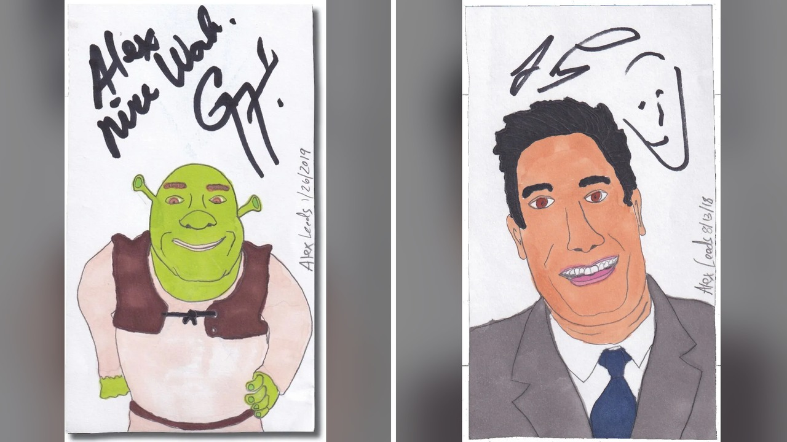

# رسومات بسيطة تجمع توقيعات المشاهير في تجربة ساخرة

أتساءل أحياناً: كيف يمكن لفكرة تبدو للوهلة الأولى سخيفة جداً أن تتحول إلى مشروع مكتمل يُدهش الجميع؟ هذا ما فعله الفنان أليكس ليدز حين قرر إرسال آلاف الرسومات البسيطة، أو كما وصفها بالرسومات الغبية، إلى مشاهير عالميين لمطالبتهم بالتوقيع عليها.

تخيلوا أن تشاهدوا الممثل شون بين يوقع على رسم لشخصية مستر بين، أو ترى المخرج الشهير فرانسيس فورد كوبولا يضع توقيعه على رسم للمصارع المحترف الملقب بالعراب. ما فاجأني حقاً لم يكن فقط استجابة المشاهير، بل تلك الطريقة الطريفة التي تداخلت بها الرسومات مع أسمائهم أو ألقابهم.

## تناقضات مضحكة وتوقيعات حقيقية

بحسب ما ورد في التقرير، تنوعت قائمة المشاهير الذين تفاعلوا مع رسومات ليدز بشكل غير متوقع. فقد وقّعت الممثلة جينيفر لورانس على رسم لوجبة عشاء مجمدة، بينما وضع متزلج لوح التزلج رودني مولين توقيعه على رسم لشخصية مولان من ديزني. ولم يتوقف الأمر عند هذا الحد، إذ وقّع الموسيقي ويرد آل يانكوفيك على صورة لشخصية بيغ غاي آل من مسلسل ساوث بارك، ووقّع الدكتور أنتوني فوتشي على رسم لشخصية القناع، كما وقّع ويلفورد بريملي على رسم لقطٍ مصاب بالسكر اسمه ستوي، ووقّع جاي فييري على رسم لشخصية شريك.

والأغرب من ذلك هو ما حدث مع جو إكزوتيك، نجم برنامج تايجر كينغ؛ إذ أعاد صورة ضوئية موقعة من رسم ليدز للاعب الجولف تايجر وودز، وأرفق معها رسالة يطلب فيها من الفنان المساعدة في الحصول على عفو رئاسي! الصراحة، هذا الموقف بالذات يجعلك تتساءل: هل كان المشاهير يدركون حجم الفكاهة في هذه الرسومات أم أنهم يوقعون فحسب؟

## ثأر عائلي ورسائل من الورق

قد يظن البعض أن هدف المشروع كان مجرد التسلية، لكن التقرير يوضح أن الدافع الأول لليدز كان دعم خدمة البريد في الولايات المتحدة والاحتفاء بمتعة استلام الرسائل الورقية. لكن القصة لا تتوقف هنا؛ يا جماعة، المشروع تحوّل أيضاً إلى ما يشبه الانتقام العائلي القديم من بنيامين فرانكلين!

تبيّن أن تيتان ليدز، وهو أحد أجداد أليكس، كان يخوض منافسة نشر شهيرة قبل قرون مع فرانكلين، حيث تنبأ الأخير بوفاة تيتان في تقويمه الشهير. وعندما لم يمت تيتان في الموعد المحدد، واصل فرانكلين المزحة ونشر نعي وفاة تيتان رغم أنه كان حياً! وبعد نحو ثلاثمئة عام، قرر أليكس إحياء هذا الخلاف العائلي بتنبؤ مضحك عن مستقبل البريد. هل تصدقون أن خلافاً تاريخياً يمكن أن يعود للحياة بهذه الطريقة الطريفة؟

## مقدمة مرفوضة وسخرية متقنة

تضمن كتاب رسومات غبية موقعة من المشاهير تعليقات ساخرة وقصصاً عن المراسلات، بل وحتى مقدمة الكتاب نفسها كانت جزءاً من الدعابة! فقد أدرج المؤلف بريداً إلكترونياً قصيراً من حاكم فلوريدا السابق جيب بوش يرفض فيه كتابة مقدمة الكتاب، ليجعله ليدز المقدمة الرسمية.

لكن يجب ألا نأخذ كل ما ورد في الكتاب كحقائق مسلّم بها. الناشر أوضح في التمهيد أن المجموعة تُعتبر عملاً ساخراً بالكامل؛ فبينما تُعتبر توقيعات المشاهير حقيقية، فإن العديد من الإحصاءات والقصص المرفقة جرى اختراعها عمداً لإضافة طابع كوميدي. بعض الادعاءات الأكثر غرابة كانت صحيحة، بينما كانت هناك ادعاءات تبدو تصديقها بسهولة لكنها خيالية تماماً، كما أن المشاهير لم يقرؤوا تلك التعليقات الساخرة أو يوافقوا عليها.

## القيمة الحقيقية للفكرة السخيفة

في النهاية، يوضح هذا المشروع كيف نمنح الأشياء قيمة لمجرد ارتباطها بأسماء لامعة. رسم بسيط قد لا يلفت انتباه أحد، لكن بمجرد وضع توقيع نجم من هوليوود عليه، يتحول إلى قطعة فنية يجمعها الهواة. الحين، يتضح لنا كيف يمكن للاستمرارية والميزانية المخصصة للبريد أن تحول فكرة غريبة إلى عمل مكتمل.

رأيي الشخصي أن ليدز نجح في سحب المشاهير إلى لعبه الساخرة بذكاء شديد، وأثبت أن البساطة حين تقترن بالإصرار تخلق علامة مميزة.
لو أتيحت لك الفرصة لإرسال رسم بسيط لشخصية شهيرة لتوقيعها، هل تختار ممثلاً سينمائياً أم شخصية سياسية؟
