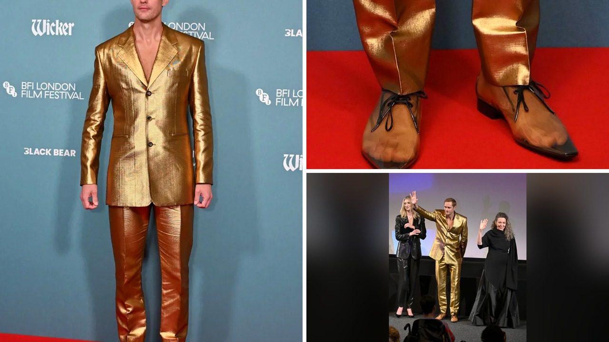

# حذاء ألكسندر سكارسجارد الشفاف في لندن يثير جدل الموضة

تخيّلوا أن تسيروا على السجادة الحمراء بإطلالة كاملة باللون الذهبي ودون قميص، لكن الجميع لا يتحدث إلا عن قدميك! هذا بالضبط ما حدث مع النجم ألكسندر سكارسجارد صاحب الـ 50 عامًا. قرأت الخبر واستوقفتني هذه الحالة الغريبة من التفاعل. الرجل ظهر في العرض الأول لفيلمه الجديد ببدلة ذهبية مكشوفة الصدر من دار سان لوران، لكن الحذاء البلاستيكي الشفاف كليًا من الدار نفسها هو من سرق الأضواء وقسم الجمهور.

## إطلالة غير مألوفة
الصراحة، تصميم الحذاء غير تقليدي إطلاقًا. بحسب التقرير، هذا الحذاء البلاستيكي الشفاف ظهر لأول مرة على منصات العروض في يونيو الماضي، وكان سكارسجارد أول رجل يملك الجرأة لارتدائه ويكشف عن أصابع قدميه أمام العدسات. هل تعتقدون أن الأزياء الجريئة تجاوزت الحدود؟ ردود الأفعال تباينت بشدة؛ فبعض المتابعين أشادوا بصلابته وقدرته على ارتداء أي شيء، بينما اعتبر آخرون ما فعله أمرًا غير معقول وتساءلوا عن صوابه العقلي. حتى أن نجمة تلفزيون الواقع السابقة بيج دي سوربو علّقت بوضوح وقالت إن علينا وضع حد لهذه الممارسات.

## مخاوف التعرق والروائح
الموضوع لم يتوقف عند الشكل الفني فقط، بل دخل في تفاصيل عملية جيدة. كيف يمكن لأحد أن يرتدي حذاءً بلاستيكيًا مغلقًا في مناسبة رسمية؟ مش معقول حجم التعليقات التي ركزت على الحرارة والتعرق! كما ورد في التقرير، أشار بعض المتابعين عبر الإنترنت إلى احتمال تكثف البخار والتعرق داخل الحذاء المغلق، حتى أن أحدهم سخر قائلًا إن أقدامه كانت ستصنع بخارًا كثيفًا يغطي الأقدام تمامًا، بينما رجح آخر أن تتسبب الحرارة في روائح كريهة داخل البلاستيك. يا جماعة، على الرغم من أن الجو في لندن كان معتدلًا، إلا أن مخاوف الجمهور كانت في محلها بخصوص الخامات البلاستيكية، خاصة عند تذكر موقف سفير العلامة كونور ستوري الذي ارتدى معطفًا وبوتًا من الفينيل فوق الركبة في أشد أيام باريس حرارة على الإطلاق.

## تاريخ من الجرأة
المهم، هذه ليست المرة الأولى التي يثير فيها الممثل السويدي الجدل بخياراته. بحسب ما نُشر، سبق له ارتداء بنطال جلدي وشورتات قصيرة وقمصان براقة مطرزة في فيلمه بليون، وفي عام 2025 ارتدى حذاءً جلديًا يصل لأعلى الركبة من نفس الدار. يبدو أن الرجل يتعمد أخذ ردود أفعال الجمهور. وفي فيلمه الجديد ويكر، الذي ينطلق في دور السينما يوم 23 أكتوبر، يلعب دور رجل ساحري مصنوع من القش يتزوج من امرأة تعمل في الصيد تؤدي دورها أوليفيا كولمان.

## رأي شخصي
رأيي الشخصي أن الأزياء مساحة للتعبير والتجربة، وما فعله سكارسجارد يعكس رغبة واضحة في الخروج عن المألوف وإثارة النقاش، حتى لو بدت الخيارات غريبة لبعضنا. وش رايكم أنتم، هل ترون ارتدائه للحذاء الشفاف جرأة وثقة أم مجرد لفت للأنظار؟
