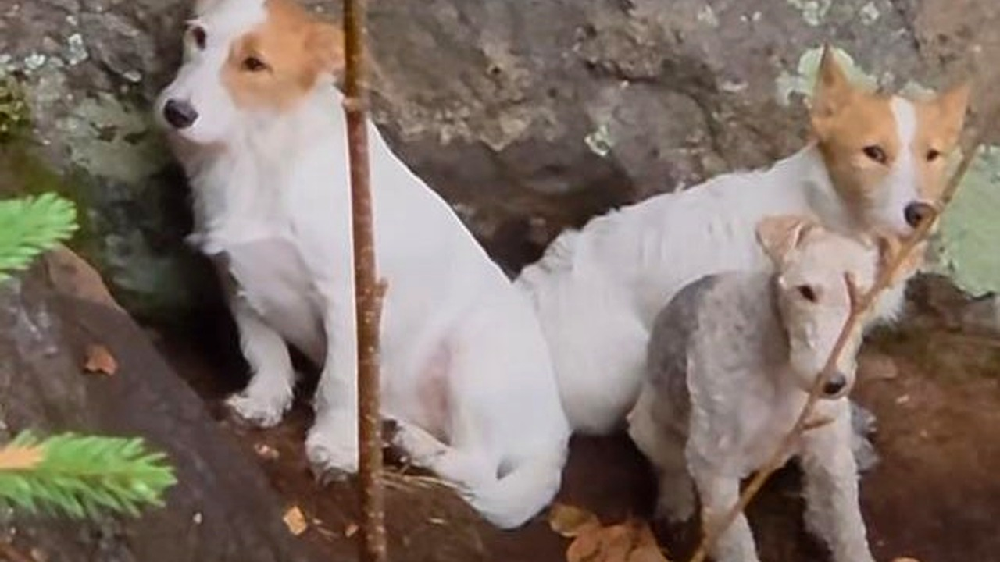

# إنقاذ ثلاثة كلاب علقت أياما على حافة جرف شاهق في كيبيك

على نتوء صخري ضيق للغاية يتدلى في الفراغ، وقفت ثلاثة كلاب من فصيلة فوكس تيرير، عاجزة عن التقدم أو التراجع، تفصلها عن الهاوية خطوات معدودة. الصدمة ليست فقط في شراسة الموقع ووعورته، بل في بقائها هناك لعدة أيام متواصلة تصارع الخوف والجوع في منطقة جبلية وعرة.

تخيّلوا كيف يمكن لركض ممتع بين الأشجار أن ينتهي بمأزق مرعب كهذا؟ بحسب ما نُشر، وقعت الحادثة في منطقة لورينتيد قرب بلدة سانت أديل بمقاطعة كيبيك الكندية. الكلاب الثلاثة اختفت فجأة، ليتضح لاحقًا أنها علقت على رف صخري شديد الانحدار في جدار المنحدر.

## لغز السقوط وسط الغابة

كيف وصلت الحيوانات إلى هذا المكان المستحيل؟ المشرفون على عملية الإنقاذ وضعوا الفرضية الأكثر منطقية لما حدث. يبدو أن الكلاب كانت تجري بسرعة واندفاع بين أشجار الغابة، ولم تلاحظ الهبوط المفاجئ والانحدار الحاد في تضاريس الأرض. 

سقطت الحيوانات عدة أمتار واستقرت على ذلك الممشى الصخري الضيق. المكان تحول في لحظة إلى فخ طبيعي محكم؛ فلا هي قادرة على تسلق الجدار الصخري للأعلى والعودة، ولا النزول للأسفل دون أن تسقط في القاع السحيق. هل يمكن لأي كائن أن يصمد في هذا الوضع المعلق بلا ماء لأيام؟

هذا الموقف المعقد ذكّرني بقصة أخرى تناولناها سابقًا، حول كيف يمكن للمساعدة البشرية الصبورة أن تتدخل في اللحظات الحاسمة لتنقذ روحًا ضعيفة من موت محقق.

**اقرأ أيضًا:** [ثعلب مصاب ينجو من القتل الرحيم بفضل دروس السباحة](https://atar12345a.blogspot.com/2026/10/blog-post_159.html)

## هبوط بالحبال فوق الهاوية

الموقف كان يتطلب تدخلاً تقنيًا بالغ الدقة لحساب كل حركة، فالصخور غير مستقرة وأي فزع يصيب الكلاب قد يدفعها للقفز إلى حتفها. فريق منظمة متخصصة في إنقاذ الحيوانات تدخّل في الموقع ووثّق الحادثة، ووصف العملية بأنها إنقاذ تقني مثير للإعجاب بشكل خاص. 

بدأ المنقذون بتثبيت الحبال بحذر شديد، ثم هبط أحدهم ببطء عبر الجرف العمودي نحو الرف الصخري الصغير. كل حركة كانت محسوبة بدقة لتأمين الحيوانات المذعورة واحدًا تلو الآخر. الصراحة، هذا النوع من المهمات يحبس الأنفاس لأن الخطأ فيه غير مسموح. نجح الفريق أخيرًا في سحب الكلاب إلى أعلى المنحدر بسلام، وأُعيدت سالمة إلى صاحبها بعد كل تلك المعاناة فوق القمة.

رأيي الشخصي أن مثل هذه العمليات تثبت أن قيمة الحياة لا ترتبط بنوع الكائن، وأن تكريس موارد وجهود بشرية معقدة لإنقاذ حيوانات بريئة هو المعيار الحقيقي للإنسانية والمسؤولية.

لو كنتم مكان المنقذين في ذلك المرتفع، هل تفضلون سحب الحيوانات دفعة واحدة أم تأمين كل واحد على حدة حتى لو تطلب الأمر وقتًا أطول؟
