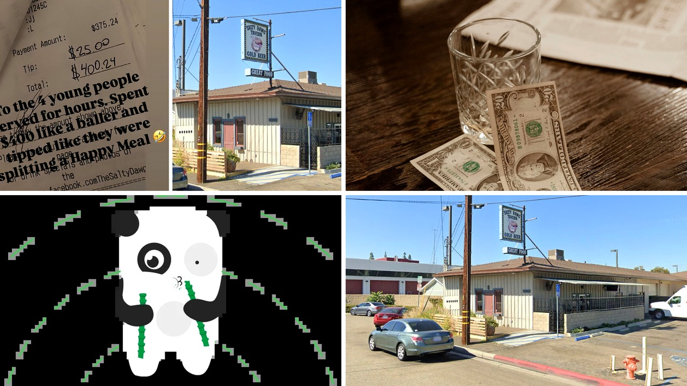

# إهانة البقشيش في كاليفورنيا: عندما يفضح بار العملاء

هل تخيّلت يومًا أن يكتب لك بار على إنستغرام "أنت تستحق السخرية"؟
هذا ما حدث في أحد الحانات بولاية كاليفورنيا، حيث تحول سخرية بسيطة إلى موجة انتقادات لا تنتهي.

أنا قرأت الخبر وفجأة استوقفني تفاصيل الفاتورة: 375.24 دولار إنفاق، ومع ذلك تركوا فقط 25 دولارًا كقيمة بقشيش. ما فاجأني هو أن صاحب البار قرر أن يضع الصورة على حسابه، يضيف تعليقًا يجرّح أربعة شباب قضوا ساعات في المكان.

## السخرية التي تحولت إلى عاصفة

البار – Salty Dawg Tavern في أورانج، كاليفورنيا – نشر صورة للفاتورة على قصة إنستغرام مع تعليق: "للأربع شباب الذين خدمنا لساعات، أنفقتم 400 دولار كأنكم بيلرز، لكن تركتم بقشيشًا كأنكم تقسمون هابي ميل". الصراحة، هذا الوصف حط من كرامتهم.

الملاحظة إن البقشيش كان 6.7٪ فقط، وهو أقل بكثير من النسبة الموصى بها 15‑20٪ في المطاعم الأمريكية. لكن رد الفعل لم يقتصر على نقد الفاتورة، بل انقلب على البار نفسه. المستخدمون على ريديت، خاصة في مجموعة r/EndTipping، هاجموا الفعل باعتباره "إهانة البقشيش" ودعوا إلى مقاطعة المكان.

## لماذا انتشر الجدل بسرعة؟

المسألة مش بس إنهم انتقدوا القليل من القروش، بل لأنهم حسّوا إن البار استغل منصته لإذلال الزبائن. أحد التعليقات قال: "هذا مقرف! إهانة البقشيش لازم تتوقف". تعليقات أخرى شددت على أن المسؤولية في دفع أجور العاملين تقع على صاحب العمل، مو على الزبائن.

المثير للدهشة إن البار حذف القصة بعد حوالي ست ساعات، لكن الضرر كان قد وقع. الناس بدأوا يطالبون بحذف الحساب أو إغلاقه، وبعضهم طلبوا من البار أن يرفع أجور موظفيه بدلاً من لوم الزبائن.

## ثقافة البقشيش تحت المجهر

الجدل أعاد إحياء النقاش حول ما إذا كان يجب على الزبائن أن يتحملوا عبء الرواتب. بعض الأصوات تقول إن "العمل يجب أن يُدفع له بكرامة من قبل صاحب العمل". وهذا يذكرني بما حكيته لكم سابقًا عن قصة هالي بيري وصراعها مع أوليفر مارتينيز حول حضانة الطفل 

## ردود فعل على السوشيال ميديا

المستخدمون لم يكتفوا بالكلام، بل أطلقوا حملات على تويتر وإنستغرام تدعو إلى "boycott". أحد التعليقات صرح: "إذا ما تقدروا تدفعوا للموظفين كفاية، أقفلوا الأبواب!". في النهاية، يبدو أن البار فقد الثقة، وربما سيفقد الزبائن.

## ماذا نتعلم من القصة؟

الصراحة، القصة تبيّن إن السوشيال ميديا صارت سلاحًا مزدوجًا. إذا استخدمته لتوجيه اللوم للزبائن، قد ينعكس عليك العكس. وش رأيك؟ هل تعتقد إن البارات يجب أن تنشر مثل هذه الأمور أم تظل خاصة؟

رأيي الشخصي إن الشكوى العامة عن البقشيش ليست طريقة بناءة. الأفضل أن يتفاوض الموظفون مع الإدارة لتأمين أجورهم، والزبائن يقررون بناءً على جودة الخدمة. إذاً، هل ستدعم حركات المقاطعة ضد مثل هذه الأفعال؟
