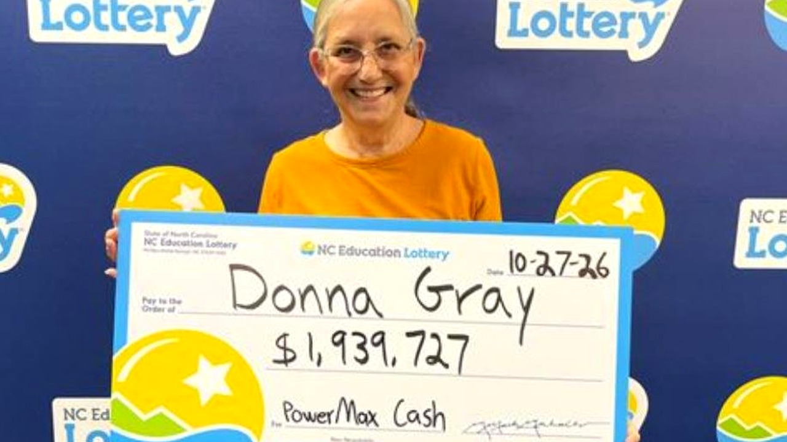

# دولار واحد يقود سيدة لجائزة يانصيب تتجاوز مليون دولار

أن تضع دولاراً واحداً في لعبة رقمية على هاتفك وتنتظر ربما مئة دولار كأقصى أمنياتك، ثم تجد الشاشة تخبرك برقم يتجاوز مليون وتسعمئة ألف دولار، هذا تماماً ما لا يمكن تصديقه بسهولة. بصراحة، كم مرة جربتم شراء بطاقة عشوائية وأنتم لا تتوقعون شيئاً على الإطلاق؟

هذا المشهد عاشته دونا غراي، المقيمة في بلدة ماونت بليزانت بولاية كارولاينا الشمالية. القصة كلها بدأت في الأول من أغسطس، حين قررت هذه السيدة أن تخوض تجربة جديدة كلياً بالنسبة لها. اعتادت على مدار سنوات شراء بطاقات الحك الورقية التقليدية، لكنها في ذلك اليوم دخلت الألعاب الفورية عبر الإنترنت كمبتدئة تماماً.

## المحاولة الأولى تقلب الموازين

اختارت دونا لعبة تُدعى باورماكس كاش، ودفعت دولاراً واحداً فقط لتجربتها لأول مرة في حياتها. تخيّلوا ما حدث في الثواني التالية، العداد على الشاشة بدأ يتحرك بسرعة ولم يتوقف. قالت إنها ظنت في البداية أن الأمر يتعلق بمبلغ متواضع مثل مئة دولار، لكن الأرقام استمرت بالدوران حتى استقرت المفاجأة الصادمة عند جائزة كبرى بلغت 1,939,727 دولاراً.

من منّا لا يشعر بالذهول في لحظة كهذه؟ مش معقول كيف يمكن لدولار واحد أن يغيّر ملامح الحياة المالية بلحظة خاطفة. هالسالفة تعكس حجم الصدفة المطلقة؛ سيدة لم تستخدم النظام الرقمي قط، وتصيب الهدف من نقرتها الأولى دون أي خبرة مسبقة بالألعاب الإلكترونية.

## شكوك عائلية وخطة هادئة

أول تصرف قامت به الفائزة كان الهروب السريع لإخبار زوجها بما جرى على الشاشة، وقالت له إنها ربحت مبلغاً كبيراً، لكنه لم يصدق كلماتها. استغرق الأمر منهما يومين كاملين حتى استوعبا أن الأمر حقيقة مكتملة الأركان وليس مجرد خطأ تقني أو وهم رقمي. هل يمكنكم لوم الزوج على شكه، وش رايكم في موقفه؟

المثير للانتباه أيضاً هو ما قررت دونا فعله بهذا المبلغ الاستثنائي، فقد أعلنت ببساطة أن كامل الأرباح ستذهب مباشرة إلى حساب المدخرات، بلا صخب ولا خطط إنفاق مجنونة، مفضلة الأمان المالي المستقر على أي شيء آخر.

رأيي الشخصي أن أعظم ما في هذه القصة ليس المليون وتسعمئة ألف دولار، بل ذلك الهدوء الغريب في التعامل مع ثروة هبطت فجأة ووضعها كاملة في الادخار. لو هبط عليكم مبلغ مماثل فجأة، هل ستضعونه كاملاً في حساب التوفير أم ستبدؤون فوراً بصرف جزء منه في مغامرة كنتم تحلمون بها؟
