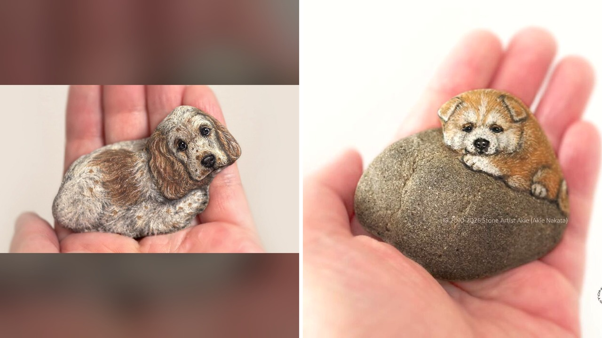

# فنانة يابانية تحول أحجار النهر إلى مجسمات كلاب واقعية

معظمنا يمشي بجانب ضفاف الأنهار ويدوس على آلاف الحجارة دون أن يلتفت إليها، لكن الفنانة اليابانية آكي ناكاتا تفعل العكس تمامًا. تلتقط الحجر بيدها، تقلّبه بهدوء، وتنتظر لترى الكائن الحي الذي يختبئ بداخله قبل أن تبدأ عملها.

استوقفني هذا الخبر بشدة؛ فالأمر يتجاوز فكرة الرسم التقليدي إلى نوع فريد من التأمل والملاحظة العميقة.

## صدفة على ضفاف النهر غيرت كل شيء
الحكاية بدأت من الطفولة، حيث كانت آكي تعشق جمع الحصى، لكن موهبتها لم تأخذ هذا المسار الفني إلا في عام 2011. في ذلك الوقت، وبينما كانت تتجول قرب مجرى مائي، لفت انتباهها حجر صغير يشبه أرنبًا بشكل مدهش، ومن هنا انطلقت مسيرتها كفنانة علّمت نفسها بنفسها وأصبحت تُعرف باسم فنانة الحجارة آكي. الصراحة، كم منا مر بجانب صخرة مميزة ولم يفكر أبدًا بما يمكن أن تحمله من أشكال؟

## لا كسر ولا نحت بل ريشة دقيقة
تجمع آكي حجارتها من ضفاف الأنهار في منطقة سايتاما الواقعة شمال غرب طوكيو، والغريب في هالسالفة أنها ترفض تمامًا تعديل شكل أي حجر أو نحته. هي لا تكسر زاوية ولا تصقل حافة، بل تتبع التموجات والنتوءات الطبيعية وكأنها العمود الفقري للكائن.

تخيّلوا أنها تعتمد فقط على ألوان أكريليك غواش وفرش بالغة الصغر، دون استخدام أي أقلام تخطيط. ترسم العيون والأنوف وتفاصيل الفراء ببراعة تجعلك تشعر أن الحيوان يستقر في راحة اليد وكأنه يتنفس، وايد يبدو المشهد ساحرًا لمن يراه. فهل تملكون هذا النوع من الصبر أمام خامات الطبيعة؟

## كلاب نائمة تنفد خلال ستين ثانية
التقرير ركّز على ثلاثين عملًا أبدعتها لمجموعة من الكلاب بمختلف السلالات والتعابير، وخصوصًا الجراء النائمة بملامح حية للغاية. المثير أن هذه القطع أصبحت شحيحة جدًا ومطلوبة؛ فبمجرد أن تعرض قطعة للبيع عبر صفحتها على فيسبوك، تباع أحيانًا خلال دقيقة واحدة فقط! شو رأيكم في سرعة بيعها هذه؟

رأيي الشخصي أن القيمة الحقيقية لهذا الفن تكمن في احترام الطبيعة كما هي دون محاولة تشكيلها بالقوة، وتحويل أبسط المقتنيات المهملة إلى تحف نابضة بالحياة.

لو أتيحت لك الفرصة، هل تفضل اقتناء مجسم رخامي منحوت بدقة مثالية أم قطعة حجرية طبيعية كهذه رُسمت بفرشاة دقيقة؟
