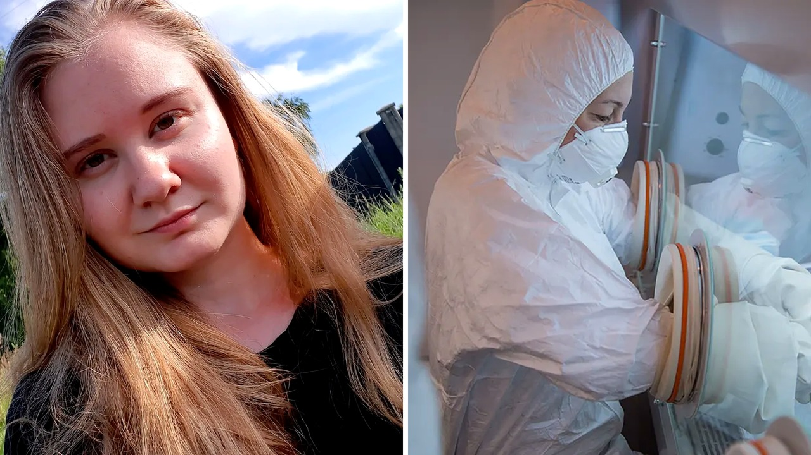

# وفاة باحثة روسية بالطاعون تثير الجدل حول سلامة المختبرات

قرأت خبرًا غريبًا أثار الكثير من علامات الاستفهام. باحثة روسية شابة، تبلغ من العمر 28 عامًا، تفارق الحياة فجأة في سيبيريا بعد إصابتها بمرض خطير. الرواية التي انتشرت في البداية زعمت أن أنبوب اختبار سقط منها بالخطأ في المختبر، وتسبب في إصابتها بالطاعون الرئوي. لكن هل القصة تنتهي هنا؟ لا، الحكاية تحمل تفاصيل تجعل التفكير يتجه إلى مسار مغاير تمامًا.

## رواية متداولة تثير الشكوك

داريا شيبيلوفا كانت تعمل داخل معهد إيركوتسك لأبحاث مكافحة الطاعون في سيبيريا والشرق الأقصى، وسقطت مريضة قبل أن تفارق الحياة في المستشفى بتاريخ الثاني من أكتوبر. الحادثة تسببت في وضع مئات الأشخاص الذين خالطوها داخل الحجر الصحي. ومع ذلك، لم تعترف موسكو رسميًا إلا بأن الوفاة نتجت عن التهاب رئوي غير معروف المصدر. الصراحة، هذا التباين الشديد يجعلك تتساءل: كيف لمختبر يتعامل مع أشد الأوبئة فتكًا أن يترك الأمر بهذا الغموض؟

## صرخة أم ترفض الرواية

تعال نتوقف عند ما قالته والدتها، سفيتلانا شيبيلوفا. الأم متخصصة في المجال الطبي، وخرجت لترفض تمامًا فرضية كسر الأنبوب. أوضحت بحسب ما ورد في التقرير أن كسر حاوية كهذه أمر مستحيل عمليًا، حتى لو ألقيت بقوة على الجدار، نظرًا لمستويات الحماية العالية المفروضة عليها. بل ذهبت إلى أبعد من ذلك ووجهت اتهامًا للمسؤولين بأنهم تركوها تموت ببساطة، مؤكدة أنها تعرف الحقيقة كاملة. مش معقول أن يمر كلام أم من قلب الميدان الطبي هكذا، أليس كذلك؟ هالسالفة فتحت أبوابًا واسعة من التشكيك فيما جرى داخل أروقة المعهد.

## لغز السلالة والعلاج الغائب

الموضوع أخذ بُعدًا أكبر عندما دخل الخبراء على الخط. التقرير نقل تصريحًا لروبرت ريدفيلد، المدير السابق لمراكز السيطرة على الأمراض والوقاية منها في أمريكا، حيث تساءل عن سبب فشل المضادات الحيوية. وأوضح أن وقوع حادث في مختبر كهذا يتبعه تلقائيًا بروتوكول علاجي معروف، متسائلًا عما إذا كانت السلالة قد عُدلت لتصبح مقاومة للعلاج كأداة بيولوجية محتملة. وفي المقابل، أعلن المتحدث باسم الكرملين ديمتري بيسكوف أن بلاده أخطرت منظمة الصحة العالمية واتبعت القواعد الدولية، معتبرًا ما يُنشر تضليلًا إعلاميًا، في وقت تطالب فيه واشنطن والمنظمة بمزيد من الشفافية.

الحين، بعد قراءة كل هذه المعطيات، رأيي الشخصي أن التناقض بين تصريحات والدة الباحثة والبيانات الرسمية يجعل تصديق فرضية الخطأ الفردي أمرًا صعبًا، ويشير إلى أسرار لم تُكشف بعد. وأنت، شو رأيك في هذه الروايات المتضاربة؟
