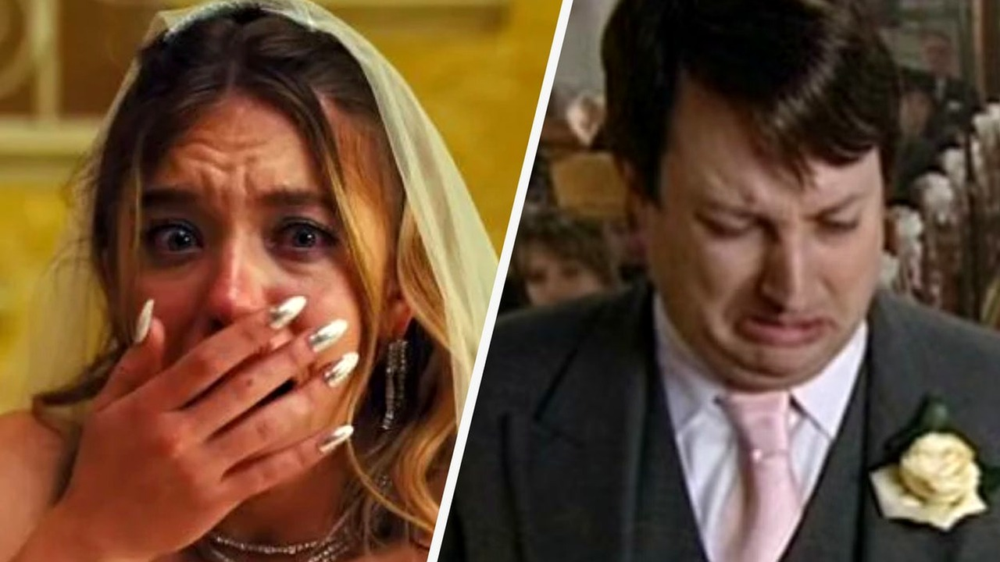

# علامات مبكرة كشفت نهاية الزواج قبل أن يبدأ

في اليوم الرابع عشر فقط من تعارفهما، وقف رجل وامرأة في حديقة خلفية ليعلنا زواجهما أمام الحاضرين، بعد أسبوع واحد من انتقالها مع أطفالها إلى بيته. المشهد بدا للبعض كأنه قصة حب خاطفة، لكن أحد الأصدقاء المقربين نظر إلى زوجته وقال بهدوء إن هذه العلاقة لن تكمل عامها الأول. لم تمر سوى مئة وعشرين يومًا حتى غيّر الزوج أقفال البيت تمامًا أثناء غيابها وأغلق كل وسائل التواصل بينهما.

استوقفني هذا الموقف كثيرًا وأنا أقرأ مجموعة من الشهادات الحقيقية التي شاركها أشخاص شهدوا بدايات زيجات كانوا على يقين تام بأنها تسير نحو طريق مسدود. الصراحة، تجعلنا هذه القصص نتأمل في مدى وضوح الإشارات أحيانًا أمام الجميع، بينما يتجاهلها الطرفان المعنيان تمامًا.

## التسرع والإنكار في خطوات البداية

تتكرر الحكايات التي تكشف أن التسرع أو محاولة مجاراة الآخرين قد تقود إلى قرارات مصيرية غير محسوبة. في قصة أخرى رواها أحد الأصدقاء عن ثنائي يُدعيان كيفن وماري، كانت ماري قد قررت بالفعل إنهاء العلاقة بسبب انعدام التوافق الفكري بينهما، وكانت تنتظر فقط انتهاء عطلة تخييم لتصارحه بالأمر. لكن كيفن فاجأها بطلب يدها أثناء الرحلة، والسبب أنه كان يريد مجاراة أصدقاء آخرين يستعدون لزفافهم.

المفارقة المؤلمة أن ماري وافقت لمجرد أن الخاتم نال إعجابها، وتحول الانفصال الوشيك إلى حفل زفاف ضخم حضره مئتا شخص وتكلف آلاف الدولارات مع حضور أقارب من قارة أخرى. الحاضرون من الأصدقاء كانوا يدركون الحقيقة المرة لدرجة أنهم أجروا رهانًا رمزيًا حول موعد الانفصال، وبالفعل انتهى الزواج بعد عام وأسبوع واحد فقط.

هذا السلوك يوضح كيف يمكن للضغوط والمظاهر أن تعمي الأطراف عن الواقع وتكلفهم الكثير عاطفيًا وماديًا، وهو ما ذكّرني بما قرأناه سابقًا حول الكيفية التي يمكن بها للمال والمظاهر أن تعصف بأعمق العلاقات الإنسانية حين تغيب الصراحة التامة بين الشريكين.

**اقرأ أيضًا:** [ألغت رحلته وطلبت منه الدفع: كيف يهدد المال العلاقات؟](https://atar12345a.blogspot.com/2026/10/blog-post_13.html)

## نذور الزواج ومشاعر خفية تطفو للسطح

تخيل أن تقف في يوم زفافك لتستمع إلى عهود شريكة حياتك، فبدلًا من مشاعر الدفء تجدها تسخر من ذكائك وتقلل من شأنك وتصف أصدقاءك بالخاسرين أمام الجميع. في المقابل، كانت كلماته مفعمة بالحب والامتنان لاستقبالها في عائلته. يروي صاحب القصة أن الجميع شعروا بثقل تلك اللحظة وقسوتها، ولم تكن مفاجأة حين اكتشف الزوج بعد سنوات قليلة خيانتها له عن طريق طفله الصغير. هل يعقل أن تمر مثل هذه الإشارات العلنية دون أن تترك أثرًا؟

وفي واقعة أخرى أكثر توترًا، حضرت سيدة زفافها وهي تصر على دعوة رجل كان حبيبها السابق والجميع يعلم ذلك، فما كان من العريس في حفل الاستقبال إلا أن سكب إبريقًا كاملًا من القهوة الساخنة فوق الحبيب السابق. لم يدم ذلك الزواج أكثر من عام واحد، وسرعان ما عادت الزوجة إلى حبيبها القديم.

## حين يصبح الخوف على الحياة سببًا للفراق

ليست كل النهايات ناتجة عن استخفاف أو غيرة، فبعضها يحمل وجعًا إنسانيًا عميقًا. يروي أحد الأشخاص قصة صديق له ارتبط بامرأة كانت قد تعرضت لمضاعفات حمل كادت تودي بحياتها في الماضي وأفقدتها جنينها. كان الرجل قد حسم خياره مسبقًا بأنه لا يريد إنجاب أطفال، وكان ذلك مناسبًا لحالتها الصحية تمامًا. ولكن مع اقتراب موعد الزواج، سيطرت عليها فكرة إنجاب طفل من رحمها مهما كان الثمن.

حاول الرجل بكل وسعه البحث عن خيارات بديلة تحميها، مثل التبني أو الرعاية، لأنه رفض تمامًا أن يكون طرفًا في قرار قد يودي بحياتها. تزوجا بالفعل، لكن الزواج انتهى بالإلغاء بعد فترة وجيزة نتيجة هذا الخلاف الجوهري. ورغم أنها ارتبطت لاحقًا برجل آخر وأنجبت طفلًا بسلام، يوضح الراوي أن صديقه ورغم حزنه على الانفصال، ظل مقتنعًا تمامًا بأنه اتخذ القرار الصحيح بعدم المغامرة بسلامة من أحب. ما الذي يدفع شخصين لتجاهل خلاف مصيري كهذا حتى اللحظة الأخيرة؟

رأيي الشخصي أن الزواج لا ينهار فجأة في الغالب، بل يرسل إشارات تحذيرية واضحة منذ البداية، غير أن الخوف من التراجع أو الرغبة في إرضاء الناس يدفع البعض للمضي قدمًا نحو نهايات متوقعة. 

لو كنت في مكان ذلك الرجل ووجدت شريكتك تصر على قرار يهدد حياتها، هل كنت ستوافقها بدافع الحب أم تختار الانفصال حفاظًا على سلامتها؟
