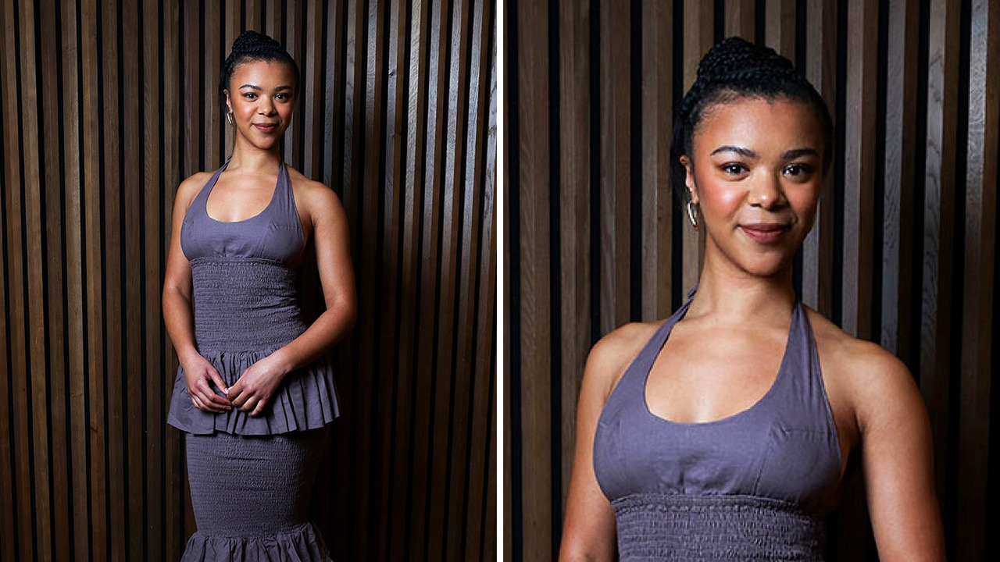

# متابعو إنستغرام أم الموهبة؟ أزمة اختيار الممثلين في هوليوود

تخيل أن تقضي سنوات في أروقة مسارح وست إند في لندن، وتثبت نفسك كبطلة لعمل عالمي حصد جوائز، ثم تسمع من شركة إنتاج كبرى عبارة واحدة: أنتِ مرشحة ممتازة، لكن عدد متابعي حسابك لا يكفي!

هذا تمامًا ما حدث مع الممثلة الشابة إنديا أمارتايفيو. والقصة لم تتوقف عند حدود خيبة أملها الشخصية، بل تحولت إلى موجة جدل عارمة على منصات التواصل الاجتماعي حول ما إذا كانت الموهبة والخبرة في التمثيل لا تزالان كافيتين للحصول على الأدوار، أم أن هوليوود باتت تطالب الفنانين بجلب جمهورهم الجاهز معهم.

## الاعتراف الذي أشعل منصات التواصل

كشفت صاحبة الـ25 عامًا، التي اشتهرت بتقديم شخصية الملكة شارلوت الشابة في عمل نيتفليكس الناجح وفازت عنه بجائزة صورة NAACP، تفاصيل تلك التجربة خلال مشاركتها في مهرجان سافانا السينمائي التاسع والعشرين الصادر عن كلية سافانا للتصميم. ما فاجأني في حديثها هو صراحتها الفائقة؛ إذ أوضحت أنها تعتمد بشكل أساسي على حساب واحد فقط على إنستغرام، وتلقت ردًا من جهة إنتاج محترمة تفيد بضرورة وجود فنان يملك عدد متابعين أكبر لتسويق العمل، رغم إقرارهم الكامل ببراعتها.

انتشر مقطع صحبتها على المنصات بعد ذلك بوقت قصير في نوفمبر 2026، ليعيد للواجهة تساؤلات الجمهور حول المعايير الحقيقية للتكليف بالأدوار. فقد بدأت مسيرتها الفنية منذ الطفولة في أعمال مسرحية ضخمة مثل تشارلي ومصنع الشوكولاتة وماتيلدا ول Lion King، لكن كل تلك الخبرة العريقة لم تشفع لها أمام مقياس الأرقام الرقمية.

## ليس حادثًا فرديًا بل اتجاه سائد

يا جماعة، السالفة ليست مجرد موقف عابر واجهته إنديا وحدها. فالنجمة إيل فانينغ صرحت في عام 2023 عبر بودكاست "هابي ساد كونفيوزد" بأنها خسرت دورًا في سلسلة أفلام كبرى للسبب ذاته، حيث أبلغوها أن قاعدة متابعيها على إنستغرام لم تكن كافية وقتها.

وفي فبراير 2025، تحدثت الممثلة مايا هوك عن الظاهرة ذاتها، مؤكدة أن بعض المنتجين يجمعون أرقام المتابعين لإجمالي طاقم العمل لحساب القوة التسويقية المجمعة، وهو ما يساعد في تأمين التمويل المالي للمشروع. شو يعني هذا؟ هذا يعني أن صناعة السينما باتت ترسم خطوطًا فاصلة بين الجودة الفنية والتسويق التجاري.

## نجوم البوب يقتحمون شاشات السينما

مع تصاعد هذا النقاش، تساءل متابعون عما إذا كان هذا التوجه هو السبب وراء منح أدوار رئيسية لنجوم غناء ومؤثرين لا يملكون تاريخًا طويلًا في التمثيل. الحين نرى أسماء مثل بيلي أيليش تشارك في بطولة فيلم "ذا بيل جار" إلى جانب كاري موليجان ودانييل ديدوايلر، رغم أن بيلي نشأت في عائلة فنية وشاركت سابقًا في مسلسل "سوورم" عام 2023.

كما تستعد غراسي أبراهمز للظهور في فيلم "بليز" من إنتاج شركة A24 وإخراج هالينا رين التي اختارتها بعد اختبارات أداء متعددة. وتشارك دوا ليبا في فيلم الكوميديا "بيكد" بعد ظهورها السابق في "باربي" و"أرجيل"، وهي التي درست جزئيًا في مدرسة سيلفيا يونغ المسرحية. وتضم القائمة أيضًا المغنية الإسبانية روساليا التي انضمت للجزء الثالث من مسلسل "يوفوريا". بصراحة، مشاركة المغنين في السينما ليست فكرة جديدة؛ فالتاريخ يذكر فرانك سيناترا وإلفيس بريسلي وشير وويتني هوستون، ومؤخرًا لادي غاغا وهاري ستايلز، لكن الفرق اليوم هو أن أرقام المتابعين أصبحت المعيار المعلن قبل بدء التصوير.

## أزمة الفرص بين الموهبة والأرقام

إن التحدي الأساسي الذي يواجه الممثلين المحترفين اليوم يكمن في فرض متطلبات إضافية تتجاوز سنوات التدريب واختبارات الأداء. فالاستوديوهات أصبحت ترى في حسابات التواصل الاجتماعي أداة جاهزة لضمان التفاعل وترويج الأعمال فور الإعلان عنها. وهذا الوضع يضع الفنانين الصاعدين أمام عائق جديد يفرض عليهم بناء علامة تجارية رقمية إلى جانب تطوير مهاراتهم الأدائية.

## التوازن الغائب في اختيار النجوم

رأيي الشخصي أن اعتماد شركات الإنتاج على أرقام المتابعين كشرط أساسي لمنح الأدوار السينمائية يعكس خللًا في ترتيب الأولويات الفنية. استوقفتني تجربة إنديا أمارتايفيو تحديدًا؛ فكيف لممثلة تمتلك خلفية مسرحية عريقة وأداءً مميزًا حصدت عنه جائزة رفيعة أن تُستبعد لمجرد أن نشاطها الرقمي محصور في حساب واحد؟ ما يقلقني هو أن تتحول السينما إلى منصة لإعادة تدوير الشهرة الرقمية بدل أن تكون مساحة لاكتشاف المواهب وصقلها. بالطبع، لا أمانع مشاركة نجوم البوب إذا مروا باختبارات أداء حقيقية وأثبتوا جدارتهم، لكن أن تصبح أرقام إنستغرام شرطًا مسبقًا للحصول على الدور فهذا يظلم الممثلين الذين كرسوا حياتهم للمسرح والتدريب الأكاديمي. زاوية التفكير التي يجب أن نتوقف عندها هي أن الجمهور يذهب للسينما ليشاهد قصة حقيقية وأداءً مقتنعًا، وليس ليرى عدد الإعجابات التي يحملها الممثل على هاتفه.

لو كنت مكان منتج سينمائي، هل تختار ممثلًا مسرحيًا مقتدرًا لا يملك حسابات رقمية، أم تختار نجم بوب شهيرًا يضمن لك ملايين المتابعين قبل عرض الفيلم؟

**المصدر:** أعدت صياغة الموضوع بأسلوبي اعتمادًا على خبر منشور في Bored Panda. وللاطلاع على الخبر كما ورد اضغط [هنا](https://www.boredpanda.com/india-amarteifio-hollywood-casting-influencers-follower-count/).
