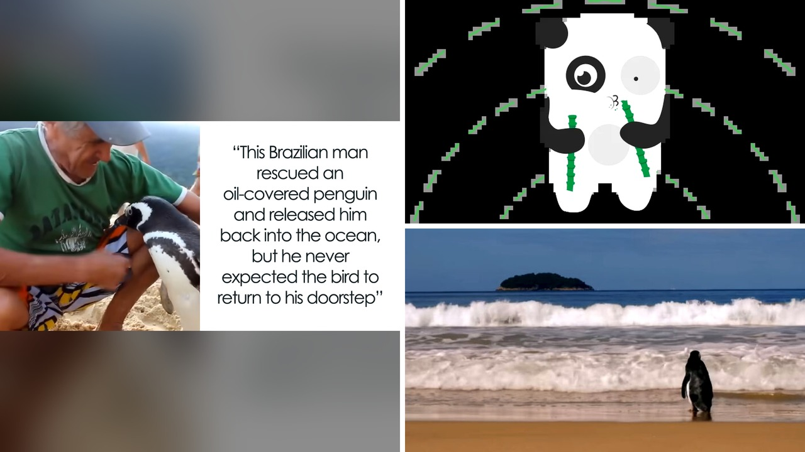

# بطريق يقطع المحيط سنويا لزيارة بنّاء متقاعد أنقذه من الموت

مشهد قاسم على رمال شاطئ بروفيتي في جزيرة إلها غراندي البرازيلية: كائن صغير منهك ممدد بلا حراك، غارق من رأسه حتى قدميه في طبقة سميكة من النفط الأسود اللزج، يلفظ أنفاسه الأخيرة ببطء.

في تلك اللحظة، كان بإمكان جواو بيريرا دي سوزا، وهو بنّاء متقاعد، أن يكمل نزهته ويتجاهل المأساة كأي عابر سبيل. لكنه بصراحة لم يستطع أن يدير ظهره لذلك المخلوق العاجز، فاقترب منه وحمله برفق، دون أن يتخيل للحظة واحدة ما الذي ستجرّه هذه الخطوة الإنسانية لاحقًا.

## معركة الأيام الصعبة في مواجهة السم الأسود

أخذ جواو الطائر إلى بيته وبدأت ملحمة إنقاذ حقيقية استمرت أيامًا متواصلة. كان ينظف ريشه بصبر بالغ من بقايا النفط الثقيل، ويطعمه الأسماك الطازجة بيديه حتى عادت إليه الحياة تدريجيًا، وأطلق عليه اسم دينديم.

عندما استعاد الطائر قوته وعافيته، حمله جواو إلى مياه البحر ليمنحه حريته المستحقة، مستعدًا لوداع مؤثر لا لقاء بعده. لكن ما حدث حينها كسر كل التوقعات؛ هل تتخيل أن يرفض طائر بري السباحة نحو مملكته المائية المفتوحة؟

دينديم لم يبتعد أبدًا، بل عاد يتهادى على الرمال صاعدًا وراء منقذه، حتى دخل معه باحة منزله في فترة ما بعد الظهيرة نفسها. قضى بضعة أيام إضافية في ضيافة جواو، ثم اختفى عائدًا إلى مياهه وعائلته، وظن العجوز أن القصة انتهت عند هذا الحد.

## رحلة المستحيل فوق أمواج المحيط المفتوح

مرت شهور طويلة والهدوء يسود الشاطئ، وفجأة ظهرت أقدام مألوفة تتهادى مجددًا على الرمال متجهة مباشرة نحو باب العجوز. دينديم قطع أميالًا طويلة عبر المحيط ليعود إلى المكان ذاته.

هذا المشهد تكرر عامًا بعد عام في رحلة حج مذهلة. ما فاجأني بحق هو ما سجله علماء الأحياء البرية الذين تابعوا القصة؛ وضعوا علامة تعريفية خاصة على الطائر للتأكد من هويته، وثبت يقينًا أن هذا البطريق البري يقطع المحيط سنويًا ليمضي أشهرًا كاملة بجوار جواو.

هذا الإصرار على التمسك بمن منحه فرصة ثانية للحياة ذكرني بما تداولناه سابقًا حول كيف يقاوم كائن ضعيف مصيره بفضل دعم إنسان لم يتردد في مد يد العون.

**اقرأ أيضًا:** [ثعلب مصاب ينجو من القتل الرحيم بفضل دروس السباحة](https://atar12345a.blogspot.com/2026/10/blog-post_159.html)

## سر الارتباط الذي ألهم العالم وشاشات السينما

كانت العلاقة بينهما فريدة واستثنائية؛ يتناول دينديم طعامه بسعادة من يدي جواو، ويستمتع بحمامات الماء البارد في الأيام الحارة، ويحك منقاره برفق على خد العجوز. لكنه في الوقت نفسه احتفظ بطبيعته الفطرية الحذرة، ورفض تمامًا أن يقترب منه أي إنسان آخر.

أوضح علماء الأحياء أن طيور البطريق تتمتع بولاء شديد يدفعها للعودة إلى موطنها وعائلتها كل سنة، وفي قلب هذا الطائر الصغير، أصبح جواو هو موطنه وعائلته الحقيقية. هذه الواقعة لم تبق حبيسة الجزيرة، بل تحولت في عام 2024 إلى فيلم سينمائي بعنوان صديقي البطريق عُرض على نتفليكس ليروي تفاصيل هذا الوفاء العابر للحدود.

رأيي الشخصي أن وفاء الكائنات الفطري يبرهن على أن الرحمة الحقيقية تترك أثرًا عصيًا على النسيان في نفوس لا تملك التعبير بالكلام. فهل ترون في عودة هذا الطائر سلوكًا مبرمجًا بدافع البحث عن الأمان، أم اعترافًا فطريًا صادقًا بالجميل؟
