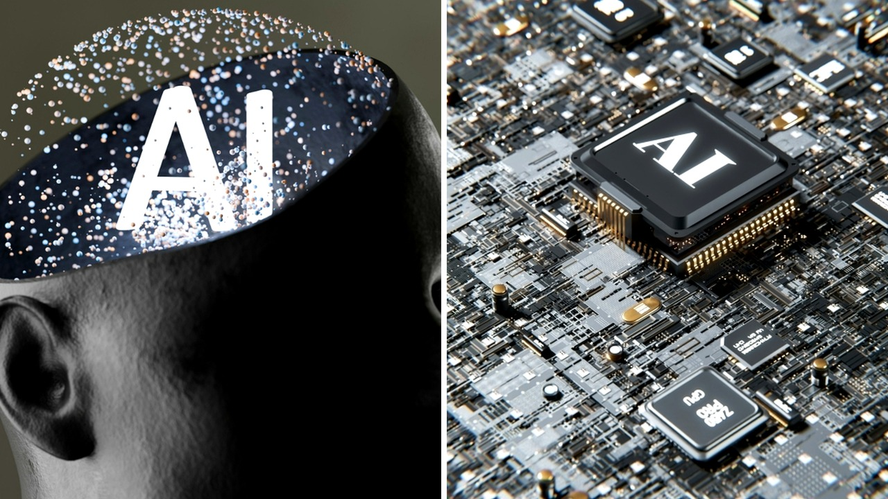

# الذكاء الاصطناعي يحدد عمرك المتبقي من صورة لوجهك

تخيّل أن تنظر إلى صورة شخصية أخذتها بهاتفك قبل قليل، فيخبرك برنامج حاسوبي بدقة كم بقي لك من العمر!

بصراحة، الأمر يبدو كأنه مشهد من فيلم خيال علمي غريب. لكن هذا ما طوره بالفعل فريق من الباحثين في مؤسسة ماس جنرال بريغام بولاية ماساتشوستس.

نجح العلماء في تدريب أداة من أدوات الذكاء الاصطناعي لتحديد الحالة الصحية العامة والعمر البيولوجي للإنسان، بالإضافة إلى تقدير المدة المتبقية من حياته، وكل ذلك من خلال صورة واحدة فقط لوجهه.

## خريطة دقيقة لتجاعيد الوجه

لكي تتعلم الخوارزميات كيفية القراءة، قام الفريق بتغذية النظام بأكثر من أربعين مليون صورة لأشخاص من مختلف الأعمار، بدءًا من الأطفال حديثي الولادة وحتى كبار السن بعمر مئة وستة عشر عامًا. وشملت البيانات أفرادًا من خلفيات وألوان بشرة متعددة، بالإضافة إلى خمسة وثلاثين ألف مريض بالسرطان.

بنى الباحثون أداتين تعملان معًا؛ الأولى تركز على قياس العمر البيولوجي وتتبع خطوط الوجه الهيكلية، حيث تفحص تجاعيد الجبهة، والخطوط حول العينين، وتفاصيل الخدين، والخطوط الممتدة من الأنف إلى الفم.

يبدو أن هالسالفة كشفت كيف تترك العادات اليومية، مثل التدخين وشرب الكحول بكثرة، علامات واضحة تعجل بسباق الساعة البيولوجية للجسم.

## كيف تقرأ الخوارزمية خطر الموت؟

الأداة الثانية تتجاهل التجاعيد العامة تمامًا عند تقييم خطر الوفاة المباشر، بل تركز بذكاء على الجلد الحساس تحت العينين وعلى جسر الأنف.

مش معقول كيف استطاع النظام الربط بين هذه المناطق الصغيرة واستجابة الجسم. أوضح هوغو إيرتس، وهو أحد المشاركين الكبار في الدراسة، أن هذه هي المرة الأولى التي يثبت فيها نموذج ذكاء اصطناعي قدرته على توقع فرص بقاء مرضى السرطان على قيد الحياة مباشرة من صورة فوتوغرافية.

وفقًا للنتائج الأولى المنشورة في مجلة لانست ديجيتال هيلث، تهدف هذه الأداة إلى منح الفرق الطبية تقييمًا سريعًا للياقة المريض البدنية. الهدف ليس استبدال الأطباء، بل مساعدتهم في اختيار العلاجات المناسبة وتجنب العلاجات القاسية غير الضرورية.

أظهرت النتائج أن مرضى السرطان الخاضعين للعلاج الإشعاعي ممن يبدون أكبر من عمرهم الحقيقي بخمس سنوات أو أكثر يواجهون خطر وفاة أعلى بنسبة إحدى وعشرين بالمئة خلال الأعوام الأربعة التالية، بينما انخفض الخطر بنسبة سبعة عشر بالمئة لدى من يبدون أصغر من سنهم بخمس سنوات على الأقل.

## تقييم الطبيب مقابل الآلة

أراد الباحثون معرفة مدى فائدة هذه التكنولوجيا مقارنة بالتقدير البشري. صرح ريموند ماك، وهو طبيب أورام إشعاعي وأحد الباحثين الرئيسي للقصة، بأن قدرة الأطباء على توقع العمر المتبقي للمريض باستخدام الصورة وحدها لا تتعدى نسبة رمي العملة النقدية في حظها.

الغريب أن التكنولوجيا أظهرت ثباتًا عاليًا رغم اختلاف الإضاءة، وتعابير الوجه، والزوايا، وحتى مساحيق التجميل. يا جماعة، حتى العمليات التجميلية مثل تجديد الأنف لم تؤثر سوى بتغيير طفيف جدًا في القراءات.

يسعى الفريق حاليًا لتوسيع قاعدة البيانات لتشمل أعراقًا متنوعة لضمان الدقة وعدم التحيز، كما يخططون لإطلاق دراسة تجريبية صغيرة تشمل خمسين مريضًا لاختبار الأداة في بيئة طبية حقيقية.

## مخاطر الخصوصية والاستغلال

المهم في هكذا ابتكار هو الجانب المظلم المتعلق بالخصوصية. خلافًا لفحوصات الدم أو عينات الحمض النووي، يمكن لأي شخص التقاط صورة لوجهك دون علمك.

صورة واحدة مأخوذة من جواز سفر أو حساب على منصات التواصل الاجتماعي قد تُستغل لتقييم صحتك. قد تحاول شركات التأمين على الحياة أو أصحاب العمل أو شركات اللياقة استخدام هذه الفحوصات السرية لتقييم طول عمرك، مما قد يؤثر على فرصك الوظيفية أو تغطيتك التأمينية.

أكد هوغو إيرتس أن المستشفيات تخضع للجان حوكمة وقوانين تنظيمية صارمة لضمان استخدام هذه التقنيات لصالح المرضى فقط، لكن الخطورة تكمن في وقوعها بأيدي أطراف غير مصرح لها.

رأيي الشخصي أن هذه التقنية تشكل قفزة طبية مذهلة قد تعيد تشكيل طريقة تقديم العلاج، بشرط ضبط استخدامها بقوانين حازمة تحمي بياناتنا الشخصية من الاستغلال.

لو أتيحت لك الفرصة، هل تختار إجراء هذا الفحص لمعرفة وضعك الصحي بدقة، أم تفضل ترك المستور مستورًا؟
