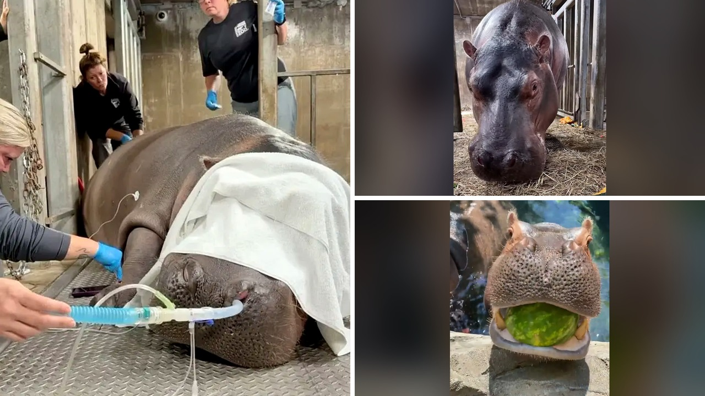

# فرس النهر فيونا تواجه أزمة صحية غريبة بعد ابتلاع قبعة طفل

قبعة صوفية صغيرة قذفها طفل، ارتطمت بمروحة سقف، ثم طارت عبر فتحة ضيقة لتستقر في حظيرة فرس النهر. مشهد يبدو للوهلة الأولى عفوياً ولا يستدعي القلق، لكنه سرعان ما تحول إلى حالة طوارئ حقيقية على مدار الساعة.

حين قرأت تفاصيل هذا الخبر القادم من حديقة حيوان سينسيناتي، استوقفني تسلسل الصدف العجيبة. أنثى فرس النهر الشهيرة فيونا، التي تزن الحين نحو ألفي رطل، تجد نفسها في ورطة صحية محرجة ومعقدة للغاية.

## مسار غريب لقبعة طائشة

الحكاية بدأت في الثامن من نوفمبر الجاري عندما كان أحد الصغار يزور الحديقة، فقام برمي قبعته الصوفية في الهواء. وبطريقة لا تخلو من الغرابة، علقت القبعة بمروحة السقف التي دفعتها بقوة عبر فتحة علوية صغيرة تعلو نوافذ المشاهدة، لتسقط مباشرة أمام فيونا.

ابتلعت فيونا القبعة دون تردد، والصراحة، كان الفريق الطبي يتوقع أن يمر هذا الجسم الصغير نسبياً بسلاسة عبر جهازها الهضمي الضخم. لكن التوقعات لم تصدق؛ إذ بقيت القبعة مستقرة في معدتها لعدة أيام، وبدأت شهية الحيوان تتراجع بوضوح، ما أثار قلق المختصين ودفعهم إلى التدخل السريع. هل تخيلتم يوماً أن قطعة قماش خفيفة قادرة على تعطيل أمعاء كائن عملاق بهذا الحجم؟

## منظار عملاق ولوح اهتزاز

نتائج فحوصات الدم جاءت مطمئنة وسليمة، غير أن تراجع الأكل دفع الأطباء البيطريين إلى تخدير فيونا لإجراء فحوصات تشخيصية أكثر دقة. المشكلة الكبرى ظهرت حين استشار الفريق أطباء بشريين وبيطريين حول خيار الجراحة، فأكد الجميع استحالتها تماماً بسبب الوزن الهائل لفرس النهر.

يا جماعة، تخيّلوا مدى تعقيد الموقف، حتى أن إدارة الحديقة استعارت منظاراً طبياً بطول تسعة أقدام من حديقة حيوان كولومبوس لمحاولة سحب القبعة، لكن حتى هذا الجهاز الطويل لم يتمكن من الوصول إلى عمق كافٍ داخل أمعائها. لاحقاً، أظهرت صور الموجات فوق الصوتية انكماشاً وتجمعاً في الأمعاء، ما دل على أن القبعة ربما بدأت تتحرك أخيراً.

هنا جاءت الفكرة الأغرب؛ أحضر المشرفون لوح اهتزاز استعاروه من مزرعة خيول محلية، وباتوا يشجعون فيونا على الوقوف عليه عدة مرات في اليوم لتنشيط حركية الجهاز الهضمي، بالتزامن مع إعطائها مسكنات ومضادات غثيان وأطعمتها المفضلة. شو رأيكم في مثل هذه الحلول المبتكرة للالتفاف على استحالة الجراحة؟ هذا التصرف ذكّرني بقصة علاجية أخرى اعتمدت على فكرة حركية غير متوقعة لإنقاذ حياة حيوان واجه خطر الموت.

**اقرأ أيضًا:** [ثعلب مصاب ينجو من القتل الرحيم بفضل دروس السباحة](https://atar12345a.blogspot.com/2026/10/blog-post_159.html)

## البطلة الصغيرة التي ألهمت الملايين

تعاطف الجمهور الواسع مع هالسالفة لم يأتِ من فراغ، ففيونا تملك مكانة استثنائية في القلوب. ولدت هذه الأنثى في يناير عام 2017 قبل موعدها بستة أسابيع كاملة من والدتها بيبي، وكان وزنها وقتها تسعة وعشرين رطلاً فقط، وهو رقم يقل بنحو خمسة وعشرين رطلاً عن أدنى وزن وُثّق لمولود من هذه الفصيلة.

نجاتها وإصرارها على الحياة ألهم صدور كتب شهيرة للأطفال، بل وحتى إنتاج خط مشروبات خاص لدعم الحديقة، ما جعل الجميع يرتبط بقصتها عاطفياً. واليوم، حتى الجمعية الطبية البيطرية الأمريكية، عبر رئيستها الدكتورة جين كوامين، عبّرت عن دعمها لجهود الأطباء، موجهة نداءً مشدداً للزوار بضرورة إبقاء المتعلقات الشخصية بعيدة عن متناول الحيوانات في كافة البيئات.

## حكاية تكشف هشاشة التفاصيل الصغيرة

رأيي الشخصي أن هذه الحادثة برمتها تجعلنا نتأمل مفارقة مذهلة: كيف يمكن لكائن جبار تغلب على ولادة مبكرة شبه مستحيلة، ونجا من الموت بأعجوبة، أن يصبح مهدداً بسبب غفلة ثوانٍ وقبعة صوفية؟

ما استوقفني فعلاً هو ذلك الإبداع البيطري الذي تخلى عن الإجراءات التقليدية المألوفة وبحث عن لوح اهتزاز من مزرعة مجاورة لإنقاذ الموقف. مش معقول أن يقف الطب عاجزاً عندما تنعدم فرصة الجراحة، وهذا التفكير المرن هو الجانب المضيء الوحيد في القصة. لكن في الوقت نفسه، يقلقني جداً هذا النقص في التدابير البسيطة؛ فوجود فتحة صغيرة تسمح لمروحة سقف بقذف جسم غريب داخل الحظيرة كان خطأً هندسياً لا ينبغي أن يقع في منشأة محترفة. كنت أتمنى لو سبقت وسائل الحماية وقوع مثل هذه الصدف غير المتوقعة، لأن سلامة هذه الكائنات أمانة معلقة بوعي البشر وتجهيزاتهم.

لو وُضعت في مكان مسؤولي الحديقة لتفادي تكرار الأزمة، هل تؤيد فرض غرامات مالية فورية على الزوار المهملين، أم ترى الأولوية لإعادة تصميم زجاج العرض وإغلاق كافة الفتحات العلوية حتى لو حدّ ذلك من التهوية الطبيعية؟

**للتوثيق:** استندت في هذا المقال إلى ما نشره موقع boredpanda.com، وهذا هو الخبر الأصلي لمن يريد التوسع: [هنا](https://2.boredpanda.com/hippo-fiona-receives-unusual-therapy-after-swallowing-hat/). أما التعليق والرأي فهما رأيي أنا.
