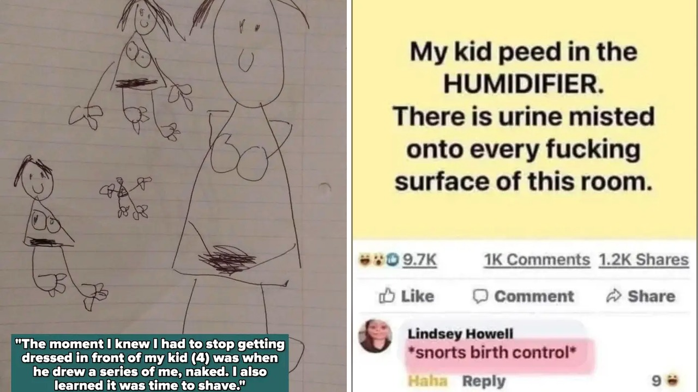

# مواقف شقية لأطفال تدفع الآباء لإعادة التفكير في تربيتهم

تخيل أن تدخل المطبخ لتعد وجبة العشاء، فتكتشف أن طفلك قرر تقشير جميع الملصقات الورقية عن العلب المعدنية، لتصبح كل علبة تفتحها مفاجأة مجهولة! هذا التحدي البسيط هو مجرد مشهد واحد من سلسلة مواقف شاركها أولياء أمور صوروا فيها لحظات شقية وغير متوقعة عاشوها مع أطفالهم.

استوقفتني هذه الصور والتفاصيل الكثيرة التي نُشرت، والتي تكشف كيف يمكن لتربية الأطفال أن تكون تجربة مليئة بالمواقف المربكة. تعالوا نتوقف عند أبرز ما جاء في هذا التقرير المنشور.

## مفاجآت غاضبة في المطبخ
في تفاصيل ما نُشر، لم تقتصر تصرفات الصغار على إزالة ملصقات الأطعمة المعلبة فقط، بل إن أحد الأطفال قرر أكل الجزء الأوسط اللذيذ فقط من جميع لفائف القرفة المخبوزة في المنزل، تاركًا الباقي للجميع! بصراحة، هذه التصرفات الصغيرة تظهر كيف يفكر الأطفال بطريقة غريبة وعفوية، لكنها تبث الحيرة في قلب أي أب أو أم يحاولان الحفاظ على النظام في البيت.

هل تجدون أن مثل هذه التصرفات مجرد شقاوة عابرة أم أنها تحتاج تدخلاً صارمًا؟

## حوادث منزلية لم تكن في الحسبان
الأمر لم يتوقف عند المطبخ، بل امتد إلى حوادث منزلية كادت أن تكون خطيرة أو مكلفة جدًا. بحسب الخبر، قام أحد الأطفال بالتعلق بشاشة التلفاز والرف المثبت على الجدار، مما أدى إلى سقوط المنظومة بالكامل وتحطمها. وفي موقف آخر، قررت طفلة أن تقوم بثقب أنفها بنفسها، لكن الأمر انتهى بها إلى استنشاق القرط ودخوله في مجرى التنفس.

أما عن الألعاب، فقد قام طفل بملء مسدس المياه بالبول ورشه، بينما قرر طفل آخر تجربة كمية الأشياء التي يمكن حشرها داخل المرحاض، ليتبين أنها كثيرة جدًا بعد انسداده! هل تتوقعون أن يتحمل أي شخص هذه المفاجآت اليومية دون أن يفقد أعصابه؟

## مواقف مضحكة خارج البيت
تجاوزت هذه المواقف جدران المنازل لتصل إلى الأماكن العامة والمتاحف. ورد في التقرير أن أطفالًا تسببوا في إتلاف قطعة فنية معروضة داخل أحد المتاحف. والمثير للدهشة أن إدارة المتحف لم تزِل المعرض المحطم، بل أبقت على القطعة المكسورة وضعت إلى جوارها شاشة تعرض تسجيلات كاميرات المراقبة التي وثقت لحظة وقوع الحادثة.

كما ظهرت مواقف أخرى عبر رسومات وصور أعدها الأطفال لآبائهم، منها طفل رسم والده محددًا أجزاء جسمه بشكل ساخر، وآخر أرسل رسالة غريبة لأخته على متن طائرة. يا جماعة، هذه المواقف تضع الآباء في اختبار حقيقي بين الضحك والحرج.

## حدود الصبر في عالم التربية
رأيي الشخصي أن التربية هي أكثر المهام الإنسانية تعقيدًا وصعوبة، وما قرأته في هذه الصور يعكس حجم الصبر الذي يحتاجه الآباء يوميًا. ما استوقفني حقًا في الخبر هو موقف إدارة المتحف التي حولت الحادثة إلى جزء من المعرض، فهذا ينبهنا إلى أن أخطاء الأطفال وتصرفاتهم العفوية قد تتحول أحيانًا إلى ذكريات مدونة، حتى وإن كانت مكلفة مثل تحطيم التلفاز أو إتلاف الطعام. أرى أن الأطفال لا يقصدون إلحاق الضرر أو مضايقة ذويهم، بل يحركهم الفضول والاستكشاف دون إدراك للعواقب، مثل طفل المطبخ الذي أكل منتصف الفطائر أو الطفل الذي حاول ثقب أنفه. كنت أتمنى لو أن التقرير تطرق أيضًا إلى كيفية التعامل التربوي الأمثل مع هذه اللحظات بدلاً من الاكتفاء بعرضها كصور مضحكة، لأن الخيط بين الشقاوة والتقصير في السلامة رفيع جدًا. إن القارئ لهذه القصص يخرج بزاوية تفكير مختلفة، وهي أن التربية ليست مجرد نصائح مثالية، بل هي يوميات مليئة بالارتباك والمفاجآت غير المتوقعة.

لو واجهتم موقف إزالة ملصقات الطعام أو سقوط التلفاز في منزلكم، هل ستضحكون وتوثقون اللحظة بصورة، أم ستغضبون وتفرضون عقابًا فوريًا؟

**المصدر:** أعدت صياغة الموضوع بأسلوبي اعتمادًا على خبر منشور في BuzzFeed. وللاطلاع على الخبر كما ورد اضغط [هنا](https://www.buzzfeed.com/kristatorres/rough-parenting-moments).
