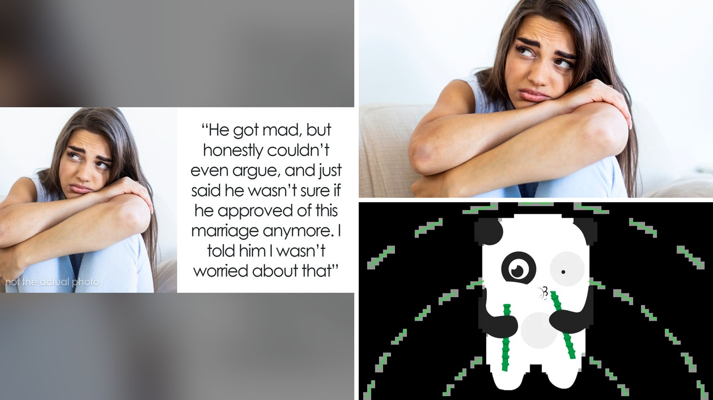

# أب يغيب ربع قرن ويغضب لحرمانه من زف ابنته في زفافها

خمسة وعشرون عامًا مرت لم يكن فيها الأب حاضرًا سوى بنفقة إلزامية يدفعها كواجب ثقيل. كبرت الفتاة في كنف أم كافحت بمفردها لتربيتها، بينما كان هو ينعم بحياته الخاصة مع أسرته الأخرى وأبنائه الآخرين. وحين جاء موعد الزفاف، تذكر فجأة أن له حق الأبوة في الممر الشرفي.

استوقفتني هذه القصة الإنسانية المؤلمة الصراحة؛ لأنها تطرح سؤالًا لا يغيب عن بيوت كثيرة: متى يستحق الأب حقًا أن يُمنح شرف الأبوة؟ هل يكفي الرابط البيولوجي وحده ليمنح صاحبه حق المشي بجانب العروس، أم أن التربية والاحتواء هما الأساس؟

## وجع المقارنة ولحظة الحقيقة

حين ارتبطت الشابة بخطيبها جون، سارت الأمور في البداية وفق المعتاد؛ طلبا مباركة والدها، وكان الظن البديهي أن يسير معها نحو المذبح. لكن التفاصيل المخبأة بين السطور بدأت تنكشف تباعًا، وجعلت العروس تعيد حساباتها بالكامل وتتراجع عن تلك الخطوة.

اكتشفت الفتاة أن والدها تكفل بكل مصاريف الجامعة لأبنائه الآخرين دون تردد، بينما تركها تواجه أعباء تعليمها الجامعي وحدها، تدبر أمورها المالية بصعوبة بالغة. تخيّل حجم الألم النفسي الذي تشعر به الابنة حين ترى دلال إخوتها وتهميشها هي تمامًا من حسابات الدعم. هذا الموقف بالذات كان النقطة الفاصلة التي جعلتها تتخذ قرارًا بطلب المساعدة من شقيقها ليزفها بدلاً من والدها، قبل أن تستقر على فكرة أخرى تمامًا.

شعرت العروس بالذنب في البداية بسبب تغيير رأيها، لكن الحقيقة أن الأبوة لا يمكن اختزالها في استعراض مؤقت داخل قاعة أفراح، بينما كان الغياب سيد الموقف لسنوات.

## حدود العلاقات والتوتر العائلي

تطور الأمر لاحقًا بصورة أشد توترًا؛ فالعروس لم تبلغ والدها بقرارها فورًا، وهو ما جعل الصدام يقع بقسوة حين علم بالأمر. غضب الأب بشدة وحاول فرض سيطرته، رغم أنه لم يقدم لابنته سوى الحد الأدنى لعقود طويلة. في النهاية، اتخذت الفتاة قرارًا بأن تمشي الممر وحدها، لتزف نفسها بنفسها أمام الجميع دون وصاية من أحد.

هذا الموقف يعكس ضغطًا كبيرًا تعيشه العائلات في مثل هذه المناسبات؛ فقد أشارت استطلاعات متخصصة إلى أن تسعة وسبعين في المئة من الأزواج يعانون من ضغوط أسرية حادة، بينما يخشى أكثر من تسعين في المئة منهم ألا ينال الحفل رضا الجميع. الأعراس بطبيعتها تصبح أحيانًا ساحة لإثبات الوجود على حساب مشاعر أصحاب الحفل أنفسهم.

التعامل مع المشاعر المعقدة والروابط الأسرية الهشة أمر يحتاج الكثير من الصبر، وهذا ذكّرني بما حكيته لكم سابقًا عن الخلافات الحساسة التي تهدد استقرار العلاقات الإنسانية حين تدخل الحسابات المادية في المنتصف.

**اقرأ أيضًا:** [ألغت رحلته وطلبت منه الدفع: كيف يهدد المال العلاقات؟](https://atar12345a.blogspot.com/2026/10/blog-post_13.html)

والحقيقة أن وضع الحدود الصارمة مع المقربين، وإن كان قاسيًا، يبقى هو السبيل الوحيد للحفاظ على راحة البال في مثل هذه المواقف.

## حكاية الانتقام والتعافي البطيء

لم يتوقف الحديث عند ممر الزفاف فقط؛ بل امتد لسنوات سابقة ارتبطت بزوجة الأب السابقة، هيلدي، التي كانت تعامل الفتاة بجفاء وبرود مستمر طوال فترة زواجها من الأب. في تحديثات لاحقة للقصة، تبيّن أن تلك المرأة فقدت وظيفتها وواجهت أوقاتًا عصيبة، قبل أن يتركها الأب نفسه ليرتبط بامرأة أخرى، لتجد نفسها مضطرة للانتقال إلى شقة صغيرة.

اعترفت العروس بشعورها بنوع من التشفي تجاه ما حدث لزوجة أبيها السابقة، معتبرة أن ما جرى هو نتاج ما زرعته من قسوة. انقسم المتابعون حول هذا الشعور؛ فمنهم من تفهم ألمها وجرحها القديم، ومنهم من رأى أن التشفي يضر صاحبته أولًا ويعكس رغبة غير صحية في الانتقام.

يا جماعة، الجروح العائلية التي تبدأ في الطفولة نادرًا ما تلتئم دون أثر؛ فالألم الذي يتركه إهمال أحد الوالدين يظل يطفو على السطح عند كل مفترق طرق حقيقي في حياة الأبناء.

رأيي الشخصي أن العروس كانت تملك كل الحق في اختيار من يشاركها لحظتها الخاصة، فالأبوة تُبنى بالمواقف اليومية لا بمشهد عابر يدوم لدقائق أمام المعازيم، وإن كنت أرى أن مصارحة الأب مبكرًا كانت ستجنبها جزءًا من هذه الفوضى النفسية.

لو كنت في مكان هذه العروس، هل كنت ستصارح والدك بقرار إبعاده قبل الزفاف بوقت كافٍ، أم تختار تجنب المواجهة حتى آخر لحظة لحماية سلامك النفسي؟
