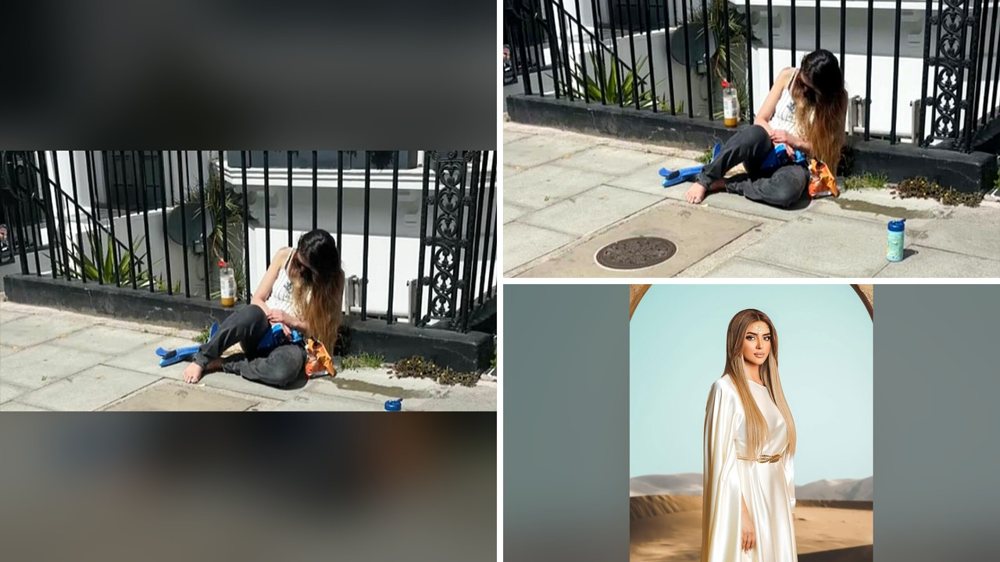

# أم ملكية تُعثر عليها فاقد الوعي في لندن والطفل حافي

## ما وقع على الرصيف الغربي
في صبيحة يوم 13 يونيو، لفتت أنظار المارة امرأة تبلغ من العمر 32 عاماً، مرتبطة بالعرق الملكي لأبوظبي، وهي ممدودة على حافة الرصيف في غرب لندن. الصدمة كانت أن الطفل الصغير، عمره ثلاث سنوات، يلعب حافي القدمين بجوارها مع سكوتر صغير، بينما كانت هي غير مستجيبة. حسب ما ورد في التقرير، استغلت المرأة مواد مخدرة في الأيام السابقة، ما جعلها تنام على الأرض وتغيب عن الانتباه. لحسن الحظ، تدخل أحد المارة قبل أن يجر الطفل إلى الطريق السريع، واتصل بالشرطة التي وصلت حوالي الساعة 1:50 مساءً.

## رد فعل المتفرجين على الأرض
المشهد أثار حماساً على الإنترنت؛ يا جماعة، ما فاجأني حجم التعاطف والانتقادات معاً. بعض المتابعين طلبوا إرسال الطفل إلى والده أو عائلته، وآخرون دعوا إلى إدخالها إلى برنامج إعادة تأهيل. أحد التعليقات كتب: "لا تحكموا، لا تعرفون ما تمر به"، بينما قال آخر: "هذه هي الوجه الحقيقي للملوك في السعودية والإمارات". الصراحة، التفاعل كان واسعاً ومتنوعاً، ما بين التعاطف والانتقاد الحاد. وش رايكم، هل يجب على الجمهور أن يتدخل في مثل هذه القضايا أم يتركها للسلطات؟

## المحكمة والعقوبة
في جلسة أمام محكمة ساوثوارك، اعترفت المرأة بتهمة إهمال الطفل وحُكم عليها بأمر مجتمع لمدة سنتين، بالإضافة إلى غرامة قدرها 5,000 جنيه إسترليني وتكلفة مقاضاة تبلغ 1,000 جنيه. الحكم شمل أيضاً شرطاً بإكمال برنامج علاج من ثلاثة أشهر في مركز بريوري في ووكنغ. القاضي جادل بأن الطفل كان قد يجر إلى الطريق إذا لم يتدخل المارة، وأوضح أن الإهمال كان نتيجة لتأثير المخدرات. بالمناسبة، المبلغ الشهري الذي تتقاضاه هذه السيدة هو 8,000 جنيه، وهو ما يضيف بُعداً آخر للنقاش حول الرفاهية والمسؤولية.

## تساؤلات حول المسؤولية والرفاهية
الصراحة، القصة تخللتها أسئلة كثيرة. تخيّلوا أن أحد أفراد عائلتكم كان في موقف مشابه؛ هل ستعتمدون على نظام العدالة لتصحيح الأخطاء أم ستسعون إلى حلول أسرع؟ كما أن الثروة المزعومة للعائلة، التي تُقدَّر بأكثر من 250 مليار جنيه، تجعلنا نتساءل عن مدى التفاوت في معاملة الأثرياء مقارنة بالمواطن العادي. ما رأيكم في أن تُعطى عقوبة أخف بسبب المكانة الاجتماعية؟ وما هو الدور الذي يجب أن تلعبه المؤسسات الاجتماعية في مثل هذه الحالات؟

رأيي الشخصي أن الوقوع في فخ الإدمان لا يقتصر على طبقة معينة، لكن عندما يلتقي بالسلطة والثروة يصبح الأمر أكثر تعقيداً. أعتقد أن العقوبة التي فرضتها المحكمة كانت مناسبة لتسليط الضوء على خطورة الإهمال، ولكن لا بد من متابعة حقيقية لضمان استقرار الطفل وسلامته. هل توافقون على أن تكون المتابعة المستمرة جزءاً من أي قرار قضائي في مثل هذه القضايا؟
