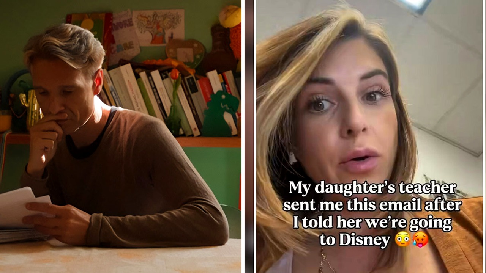

# رسالة معلمة بعد غياب طالبة عن المدرسة تثير الجدل

تخيل أن ترسل رسالة بسيطة إلى معلمة ابنتك في الصف الأول لتخبرك بأنكم ستسافرون في رحلة عائلية قصيرة، فتتلقى رداً يشبه إنذاراً أكاديمياً شديد اللهجة! هذا بالضبط ما حدث مع أم تُدعى أوليفيا، عندما قررت أخذ عائلتها في رحلة إلى متنزه ديزني وورلد.

أوليفيا، التي تعمل هي نفسها معلمة، كانت تتوقع تفهماً بسيطاً أو تفاهماً حول أيام الغياب، لكن ما وصلها في البريد الإلكتروني جعلها تتوقف مذهولة. لم تكن تتوقع أن غياب بضعة أيام لطفلة في عمر السادسة قد يترتب عليه ما وصفته المعلمة بعواقب أكاديمية خطيرة!

بصراحة، القصة لم تتوقف عند الذهول، بل حولت أوليفيا تلك الرسالة إلى أغنية وقامت بنشرها، ليتحول هذا الموقف البسيط إلى حديث الساعة بين الآلاف من الآباء والأمهات.

## رسالة شديدة النبرة وواجب من 37 صفحة

بدأت المعلمة رسالتها بشكر روتيني للأم على إبلاغها بالرحلة، لكن سرعان ما تغيرت النبرة كلياً. كتبت المعلمة أنها تتفهم رغبة العائلة في صناعة ذكريات مشتركة، لكنها شددت على أن الصف الأول يُعد مرحلة حاسمة للغاية في المسيرة التعليمية للطفل.

ولم تكتفِ بذلك، بل أرفقت قائمة مفصلة بجميع المهارات التي ستفوت الطفلة خلال أيام غيابها، مثل تعلم الدمج بين بعض الحروف الإنجليزية، والحساب في نطاق العدد عشرين، وحتى دورة حياة نبتة القرع. والأغرب من ذلك أن المعلمة نبهت إلى أن الطفلة ستفوت أيضاً فعاليات الجمعة الممتعة وفرصة قيادة طابور زملائها، وهي أمور أوضحت المعلمة أنه لا يمكن إعادة جدولتها!

ولم تكن تلك سوى البداية، إذ أعلنت المعلمة أنها سترسل مع الطفلة حزمة واجبات تعويضية تقع في 37 صفحة كتمارين يجب إنجازها. كما طلبت من الأم أن تقوم الطفلة بكتابة تعبير عما تعلمته هناك، بشرط ألا تقتصر الإجابة على عبارة بسيطة مثل أنها التقت بشخصية إلسا! هل تعتقدون أن معلمة الصف الأول بالغت في هذا الطلب؟

## انقسام الآراء بين مؤيد ومكذب

ما إن انتشرت الرسالة حتى انقسم المتابعون إلى فريقين واضحين، ولكل فريق وجهة نظر تستحق التأمل. فمن ناحية، وجد البعض أن رد المعلمة يتضمن تهويلاً غير مبرر لطالبة ما زالت في سنتها الدراسية الأولى، وتهكم بعض المتابعين بسخرية لطيفة قائلين إن تفويت درس دورة حياة القرع لن يدمر مستقبل أي طفل.

في المقابل، رأى آخرون أن المدرسة ليست مكاناً يمكن التعامل معه بحرية تامة والتغيب عنه في أي وقت لمجرد الذهاب إلى مكان مفتوح طوال العام. يا جماعة، حجة هذا الفريق تتمحور حول ضرورة غرس الالتزام لدى الأطفال منذ الصغر، متسائلين لماذا لا تقتصر الرحلات على العطلات الرسمية المحمية في التقويم الدراسي؟

غير أن بعض الأمهات والآباء أوضحوا أن السفر خارج مواسم العطلات الرسمية يكون أقل كلفة مالية وأقل ازدحاماً، مما يتيح للعائلات قضاء وقت أفضل مقارنة بالفترات المزدحمة.

## رؤية خبير وواقع الفصول

دخل على خط النقاش خبير عمل لمدة 38 عاماً في المدارس العامة، وتدرج في مسيرته من معلم إلى مدير مدرسة. وأوضح أنه يتفهم تماماً غياب الطفل في المناسبات الاستثنائية التي لا تكرر، كاحتفال الجدة بعيد ميلادها المئة أو حضور حفل زفاف، لكنه يبدي رفضاً كاملاً لقطع الدراسة من أجل زيارة أماكن متاحة على مدار السنة.

وفي المقابل، أشار متابع آخر إلى أن ظاهرة سحب الأطفال من المدارس لأجل الرحلات العائلية زادت بشكل ملحوظ بعد فترة الجائحة، حيث أتيحت الفرصة للعديد من أولياء الأمور للاطلاع عن قرب على سير العملية التعليمية داخل بعض الفصول، وشعر بعضهم أن المقررات في تلك المراحل الأولى لا تتطلب كل هذا التهويل.

شخصياً، أجد هذا النقاش يلامس واقع كل عائلة تحاول الموازنة بين الالتزام المدرسي وصناعة أوقات خاصة مع أبنائها.

## موقف يستحق التفكير

رأيي الشخصي أن كلا الطرفين يحمل جزءاً من الصواب، لكن نبرة الرسالة وشروطها كانت محملة بضغط غير ضوري على طفلة في الصف الأول. من الطبيعي والضروري أن تحرص المعلمة على انتظام طلابها وعلى استمرار العملية التعليمية دون انقطاع، فهذه مسؤوليتها المهنية، لكن طلب حزمة تعويضية من 37 صفحة وكتابة تقرير تأملي لطفلة بعمر السادسة يحول الإجازة العائلية إلى عبء نفسي ينزع منها هدفها الأساسي وهو الاسترخاء.

ما استوقفني في هذه القصة هو التباين الحاد بين مفهوم الذكريات العائلية ومفهوم الانضباط المدرسي. أعتقد أن المرونة كانت ستكون الحل الأمثل؛ فترتيب بعض التمارين البسيطة دون مبالغة كان سيحقق الفائدة التعليمية دون أن يترك شعوراً بالذنب لدى الأم أو الطفلة. ما كنت أتمنى رؤيته هو رسالة تشجع الطفلة على الاستمتاع بوقتها مع الاستمرار في القراءة الخفيفة، بدلاً من أسلوب التحذير الأكاديمي الصارم.

فهل ترون أن من حق العائلات اقتطاع أيام دراسية للرحلات أم أن الانضباط المدرسي يجب أن يتفوق دائماً؟

**للتوثيق:** استندت في هذا المقال إلى ما نشره موقع Bored Panda، وهذا هو الخبر الأصلي لمن يريد التوسع: [هنا](https://www.boredpanda.com/first-grade-teacher-email-disneyland-trip-mom-viral-video/). أما التعليق والرأي فهما رأيي أنا.
