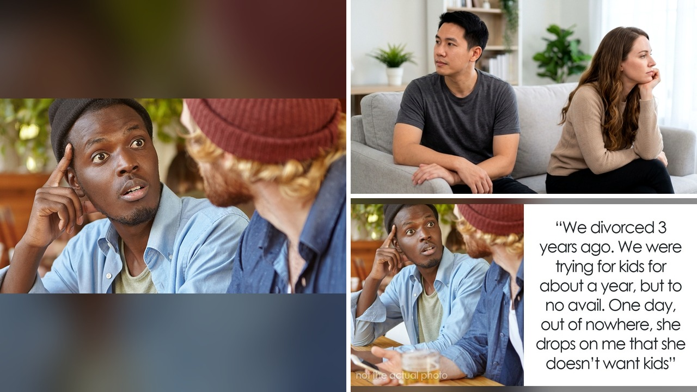

# طليقته تتهمه بإنهاء الزواج بسبب الإنجاب.. هل هذه كل الحقيقة؟

تخيل أنك انفصلت عن شريكة حياتك منذ ثلاث سنوات، وبنيت حياتك من جديد. وفجأة، تكتشف أن طليقتك نشرت تفاصيل طلاقكما على الإنترنت، ولكن ليس كما تتذكرها أنت! بل برواية مختلفة تمامًا، تتهمك فيها بإنهاء الزواج بسبب مشكلة الإنجاب. يا جماعة، هذا بالضبط ما حدث لرجل في السادسة والثلاثين من عمره، وقرأت خبره مؤخرًا. موقف مش معقول الصراحة.

## روايتان مختلفتان على الإنترنت
القصة بدأت عندما فوجئ هذا الرجل بأن طليقته، وبعد ثلاث سنوات من انفصالهما، قررت أن تشارك تفاصيل طلاقهما على إحدى منصات التواصل الاجتماعي. ليس هذا فحسب، بل وجهت له اتهامًا صريحًا بأن السبب الرئيسي لإنهاء زواجهما كان عدم قدرتها على الإنجاب. موقف كهذا كفيل بأن يقلب حياة أي شخص رأسًا على عقب، أليس كذلك؟ فالخلافات الشخصية، حين تخرج للعلن، تتخذ أبعادًا أخرى تمامًا.
ما لفت انتباهي في الخبر هو توقيت هذه "الفضيحة" التي أثارتها طليقته. فقد جاءت بعد أن علمت بأنه ينتظر طفلًا مع خطيبته الحالية. هنا نتوقف قليلًا، هل هذا مجرد صدفة؟ أم أن هناك أبعادًا أخرى للقصة وربما مشاعر قديمة لم تختفِ بعد؟ بحسب ما نُشر، الرجل ينفي تمامًا أن تكون مشكلة الإنجاب هي السبب الحقيقي لإنهاء العلاقة، وهذا يضعنا أمام روايتين متضاربتين، وكلتاهما تطرح علامات استفهام كبيرة.

## حين يصبح الإنجاب نقطة تحول
لا شك أن قرار الإنجاب هو أحد أهم القرارات في حياة أي زوجين، وغالبًا ما يكون حلمًا مشتركًا يؤسس لمستقبلهم. لكن الحياة ليست دائمًا بهذه البساطة التي نرسمها. أحيانًا، تكون هناك تحديات خارجة عن الإرادة، مثل مشكلات الخصوبة. وقد أشار التقرير إلى أن منظمة الصحة العالمية تبيّن أن حوالي واحد من كل ستة بالغين على مستوى العالم يواجه مشكلة في الخصوبة. وفي الولايات المتحدة، تواجه حوالي 10% من النساء بين 15 و 44 عامًا صعوبات في الحمل أو إتمام فترة الحمل.
هذه التحديات قد تسبب ضغوطًا هائلة على العلاقة، وتؤدي إلى مشاعر عميقة من الحزن والقلق وحتى فقدان الثقة بالنفس. تخيلوا، دراسة أجريت عام 2025 كشفت أن 77.2% من النساء اللاتي يواجهن مشكلات في الخصوبة يشعرن بالفراغ المستمر، و43.2% منهن يشعرن بعقدة نقص. ولهذا، ليس غريبًا أن يؤكد الدكتور برينان بيترسون، أستاذ علم النفس، أن الحزن غير المعالج يمكن أن يدمر العلاقة، وأحيانًا يصبح إنهاء العلاقة أقل إيلامًا من البقاء فيها، خاصة إذا كانت العلاقة تذكر الطرفين بمرارة عدم تحقيق حلم الأبوة. هذه النقطة مهمة جدًا، أليس كذلك؟ إنها تظهر كيف أن المشاعر الإنسانية المعقدة يمكن أن تشكل مسار العلاقات بشكل جذري، خاصة عندما تتعلق بأحلام أساسية في الحياة.

**اقرأ أيضًا:** [معركة حراسة هالي بيري لابنها: تفاصيل الخلاف مع أوليفير مارتينيز](https://atar12345a.blogspot.com/2026/10/blog-post_11.html)

## تغيير الأهداف: صراع الأنا والآخر
بعيدًا عن مشكلات الخصوبة، هناك تحدٍ آخر لا يقل تعقيدًا، وهو عندما يغير أحد الشريكين رأيه ببساطة بشأن الإنجاب بعد أن كانا متفقين. قد يبدأ الزوجان ولديهما رؤية مشتركة للحياة والأطفال، ثم تتغير الأهداف مع مرور الوقت أو بتغير الظروف. هذا التحول يمكن أن يولد صدمة وغضبًا واستياءً عميقًا لدى الطرف الآخر الذي تمسك بالحلم الأصلي. تخيل مدى صعوبة هذا الموقف، وكيف يمكن أن يهز أسس العلاقة.
في المقابل، يشعر الطرف الذي تراجع عن فكرة الإنجاب بذنب وعزلة شديدة، وكأنه هو من دمر العلاقة بمفرده. تقول أخصائية العلاج الأسري والزوجي أنيتا تشليبالا إنها عملت مع حالات غيّر فيها أحد الشريكين رأيه في الإنجاب خوفًا من فقدان العلاقة، لكنهما انفصلا بعد سنوات لأن الطرف الأول لم يستطع المضي قدمًا في إنجاب الأطفال. وتشدد على ضرورة مناقشة الأمور الأساسية غير القابلة للتفاوض في وقت مبكر قدر الإمكان. لأن الرغبة في إنجاب الأطفال من عدمها نادرًا ما تكون نقطة يمكن التوصل فيها إلى حل وسط، فالوفاء بهذا الحلم أو التخلي عنه يمس أعماق الإنسان. شو رأيكم في هذا الكلام؟ هل يمكن التنازل عن حلم الأبوة أو الأمومة من أجل استمرار العلاقة؟

## كيف نتعامل مع النهايات علناً؟
الرجل الآن في مأزق حقيقي، هل يرد على اتهامات طليقته علنًا أم يلتزم الصمت، ويترك الرواية الأخرى تنتشر؟ هذا سؤال صعب، خاصة وأن سمعته أصبحت على المحك، وقد تؤثر هذه الاتهامات على حياته الشخصية والمهنية. الخبراء يؤكدون أن الناس لديهم كل الحق في تغيير رأيهم حول ما يريدونه في الحياة، وإنهاء العلاقة بسبب أهداف غير متوافقة هو خيار سليم وناضج. لكن الأهم هو كيف نتعامل مع هذه النهايات، وكيف نتذكرها أو نرويها للآخرين، خاصة عندما تكون هناك مشاعر مؤلمة لم تُعالج بعد.
الخبر ذكر أن الخلافات خلف الأبواب المغلقة صعبة بما فيه الكفاية، فما بالكم حين تتحول إلى مادة للجدل العام أمام الملأ؟ هذا يجعل الأمور أكثر تعقيدًا بلا حدود، ويزيد من الآلام الشخصية التي قد لا تنتهي بسهولة.

رأيي الشخصي أن كل قصة طلاق تحمل وجهات نظر مختلفة، ومن النادر أن تكون الحقيقة المطلقة في جانب واحد فقط. لكن تحويل هذه الخلافات الشخصية إلى مادة للنشر العام، خاصة بعد سنوات وطرف يستعد لبداية جديدة، يطرح تساؤلات كثيرة عن النوايا. هل تعتقدون أن من حق الزوجة السابقة نشر تفاصيل طلاقها علنًا، حتى لو كانت روايتها تختلف عن الواقع وتؤذي الطرف الآخر؟
