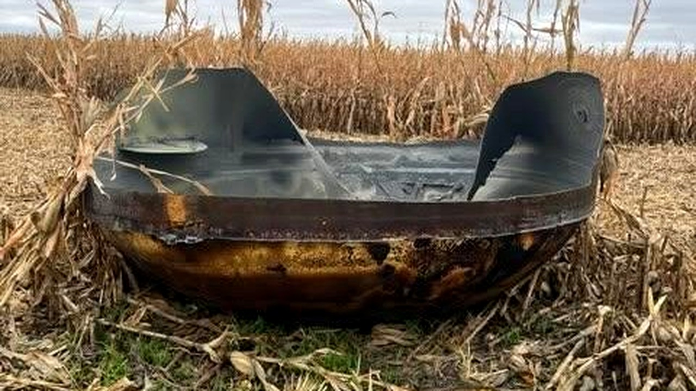

# العثور على جسم فضائي في مينيسوتا سقط بمنتصف حقل ذرة

تخيلوا أن تستيقظوا يومًا فتجدوا جسمًا غريبًا سقط من السماء في منتصف المزرعة! هذا ما حدث بالضبط في الرابع عشر من أكتوبر ببلدة سكوت التابعة لمقاطعة ستيفنز في ولاية مينيسوتا.

وصل نواب الشريف إلى حقل الذرة لمباشرة البلاغ. هناك عثروا على شيء معدني لم يتوقعه أحد، يُرجح أنه سقط من الفضاء.

## مفاجأة بين سقان الذرة
الجسم الذي عُثر عليه كان ضخمًا للغاية ويثير الذهول. قطر هذه القطعة الدائرية يصل إلى 11 قدمًا تقريبًا، وهو ما جعل النواب يتأكدون فورًا أن هالسالفة ليست مجرد نفايات عادية.

أُزيل هذا الجسم من المزرعة يوم الخميس لنقله وفحصه. مش معقول كيف هبط في هذا المكان بالتحديد دون أن يتسبب في أضرار كبرى.

## غموض ومعلومات مشفرة
الحين، بدأت الجهات الفيدرالية تحقيقات موسعة لمعرفة مصدر هذا الشيء وكيف وصل للأرض. الشريف جيسون دينجمان أوضح أن هناك عدة وكالات تتابع القضية.

الغريب يا جماعة أن المسؤولين المحميين لم يحصلوا على إجابات واضحة. الشريف قال إن التفاصيل الواردة إليهم غامضة ومبهمة، ويبدو أن هناك جهات أعلى تعرف الحقيقة كاملة لكنها تفضل الصمت، كما رفض الكشف عن أسماء تلك الوكالات مع استمرار التحقيق.

## رأيي الشخصي
رأيي الشخصي أن سقوط حطام بمثل هذا الحجم في منطقة زراعية يثير التساؤلات حول أمان ما يسبح فوق رؤوسنا في المدار. هل تظنون أن هذا الجسم بقايا قمر صناعي مهجور أم جزء من تجربة سرية؟
